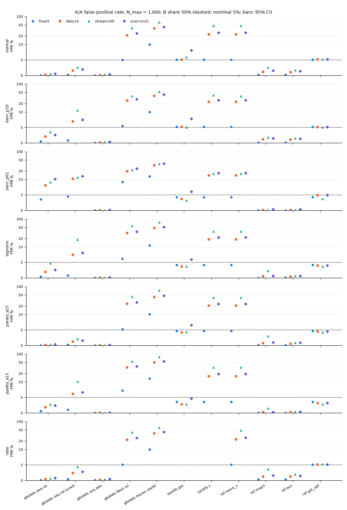
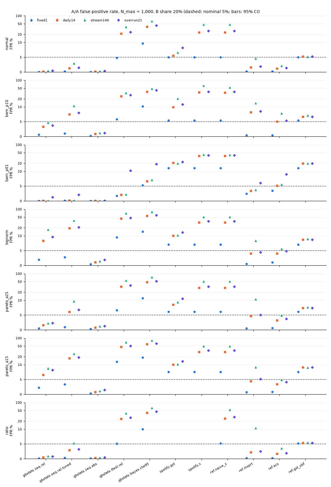
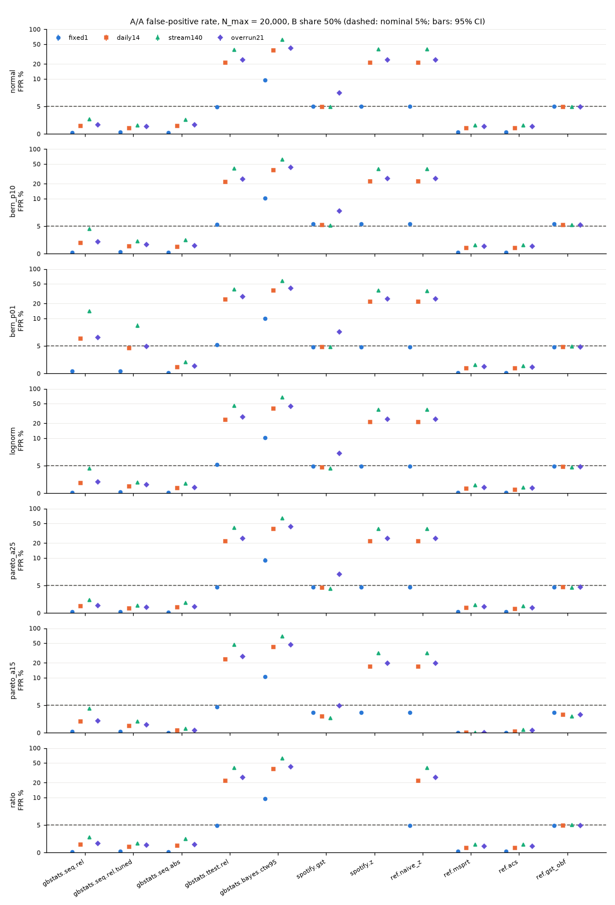
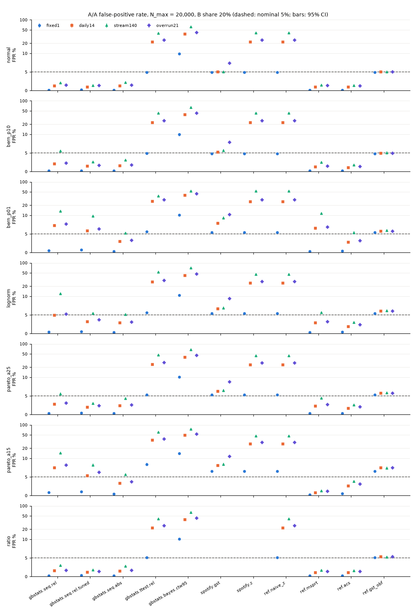
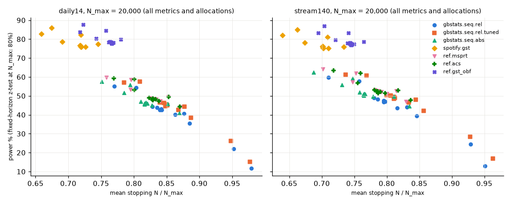

# peekaudit results: full study

Generated by `peekaudit report` from the unit checkpoints of this run. Every number
below is recomputable from `summary.json`. Rates are percentages with exact 95%
Clopper-Pearson intervals. Marks: **V** = violation (Holm-adjusted one-sided exact
test, p < 0.05), c = conservative (upper bound < 2.5%), i = informational (outside
the method's claim; no pass/fail). Unmarked claimed cells are consistent.

## What was run

- Replicates: 20,000 per A/A unit, 10,000 per A/B unit; chunks of 250; master seed 20261023; config hash `dde79da82e86a243`.
- Units: 52 of 52 completed; methods: 11; schedules: fixed1, daily14, stream140, overrun21.
- Engine verification: first 20 replicates per unit and schedule (spotify.gst on stream140: 4), real engine called look by look.
- Started 2026-10-23T21:10:25+00:00; 1 recorded start(s); 211.8 CPU-minutes over finished units.
- Code: git `e4e8dcc1d1cecc9a9510190b287c5fc23e0966df` for 52 units (source: unit record); versions: gbstats 0.8.0, numpy 1.26.4, pandas 1.5.3, peekaudit 0.1.0, pydantic 2.14.1, python 3.11.9, scipy 1.17.1, spotify-confidence 4.1.0, statsmodels 0.15.0.
- Deviations from the design: see the last section of this report.

## Sanity gates (DESIGN 5.3, 99.9% intervals)

| gate | result | detail |
|---|---|---|
| positive control: naive z daily14 | pass | FPR 0.2141, 99.9% CI [0.2046, 0.2238], exact 0.2196 |
| positive control: naive z stream140 | pass | FPR 0.3943, 99.9% CI [0.3829, 0.4057], exact 0.3985 |
| negative control: ref.gst_obf fixed1 | pass | FPR 0.0498, 99.9% CI [0.0448, 0.0550] vs 0.05 |
| negative control: ref.acs fixed1 | pass | FPR 0.0032, 99.9% CI [0.0020, 0.0047], lower <= 0.05 |
| negative control: ref.msprt fixed1 | pass | FPR 0.0032, 99.9% CI [0.0020, 0.0047], lower <= 0.05 |
| negative control: ref.gst_obf daily14 | pass | FPR 0.0493, 99.9% CI [0.0444, 0.0545] vs 0.05 |
| negative control: ref.acs daily14 | pass | FPR 0.0107, 99.9% CI [0.0085, 0.0133], lower <= 0.05 |
| negative control: ref.msprt daily14 | pass | FPR 0.0109, 99.9% CI [0.0086, 0.0135], lower <= 0.05 |
| negative control: ref.gst_obf stream140 | pass | FPR 0.0489, 99.9% CI [0.0440, 0.0541] vs 0.05 |
| negative control: ref.acs stream140 | pass | FPR 0.0157, 99.9% CI [0.0129, 0.0188], lower <= 0.05 |
| negative control: ref.msprt stream140 | pass | FPR 0.0158, 99.9% CI [0.0131, 0.0190], lower <= 0.05 |
| fixed-horizon calibration: gbstats.bayes.ctw95 (pi=0.5) | pass | FPR 0.0978, 99.9% CI [0.0910, 0.1049], contains 0.1 |
| fixed-horizon calibration: gbstats.seq.abs (pi=0.5) | pass | FPR 0.0024, 99.9% CI [0.0015, 0.0038], lower <= 0.05 (anytime-valid: conservative at one look) |
| fixed-horizon calibration: gbstats.seq.rel (pi=0.5) | pass | FPR 0.0023, 99.9% CI [0.0013, 0.0036], lower <= 0.05 (anytime-valid: conservative at one look) |
| fixed-horizon calibration: gbstats.seq.rel.tuned (pi=0.5) | pass | FPR 0.0035, 99.9% CI [0.0023, 0.0051], lower <= 0.05 (anytime-valid: conservative at one look) |
| fixed-horizon calibration: gbstats.ttest.rel (pi=0.5) | pass | FPR 0.0493, 99.9% CI [0.0444, 0.0545], contains 0.05 |
| fixed-horizon calibration: ref.acs (pi=0.5) | pass | FPR 0.0032, 99.9% CI [0.0020, 0.0047], lower <= 0.05 (anytime-valid: conservative at one look) |
| fixed-horizon calibration: ref.gst_obf (pi=0.5) | pass | FPR 0.0498, 99.9% CI [0.0448, 0.0550], contains 0.05 |
| fixed-horizon calibration: ref.msprt (pi=0.5) | pass | FPR 0.0032, 99.9% CI [0.0020, 0.0047], lower <= 0.05 (anytime-valid: conservative at one look) |
| fixed-horizon calibration: ref.naive_z (pi=0.5) | pass | FPR 0.0498, 99.9% CI [0.0448, 0.0550], contains 0.05 |
| fixed-horizon calibration: spotify.gst (pi=0.5) | pass | FPR 0.0498, 99.9% CI [0.0448, 0.0550], contains 0.05 |
| fixed-horizon calibration: spotify.z (pi=0.5) | pass | FPR 0.0498, 99.9% CI [0.0448, 0.0550], contains 0.05 |
| fixed-horizon calibration: gbstats.bayes.ctw95 (pi=0.2) | pass | FPR 0.0988, 99.9% CI [0.0920, 0.1060], contains 0.1 |
| fixed-horizon calibration: gbstats.seq.abs (pi=0.2) | pass | FPR 0.0014, 99.9% CI [0.0007, 0.0024], lower <= 0.05 (anytime-valid: conservative at one look) |
| fixed-horizon calibration: gbstats.seq.rel (pi=0.2) | pass | FPR 0.0013, 99.9% CI [0.0006, 0.0023], lower <= 0.05 (anytime-valid: conservative at one look) |
| fixed-horizon calibration: gbstats.seq.rel.tuned (pi=0.2) | pass | FPR 0.0019, 99.9% CI [0.0010, 0.0031], lower <= 0.05 (anytime-valid: conservative at one look) |
| fixed-horizon calibration: gbstats.ttest.rel (pi=0.2) | pass | FPR 0.0493, 99.9% CI [0.0444, 0.0545], contains 0.05 |
| fixed-horizon calibration: ref.acs (pi=0.2) | pass | FPR 0.0016, 99.9% CI [0.0009, 0.0028], lower <= 0.05 (anytime-valid: conservative at one look) |
| fixed-horizon calibration: ref.gst_obf (pi=0.2) | pass | FPR 0.0491, 99.9% CI [0.0442, 0.0543], contains 0.05 |
| fixed-horizon calibration: ref.msprt (pi=0.2) | pass | FPR 0.0016, 99.9% CI [0.0009, 0.0028], lower <= 0.05 (anytime-valid: conservative at one look) |
| fixed-horizon calibration: ref.naive_z (pi=0.2) | pass | FPR 0.0491, 99.9% CI [0.0442, 0.0543], contains 0.05 |
| fixed-horizon calibration: spotify.gst (pi=0.2) | pass | FPR 0.0491, 99.9% CI [0.0442, 0.0543], contains 0.05 |
| fixed-horizon calibration: spotify.z (pi=0.2) | pass | FPR 0.0491, 99.9% CI [0.0442, 0.0543], contains 0.05 |
| power calibration: naive z fixed1 normal pi=0.5 | pass | power 0.7912, 99.9% CI [0.7776, 0.8044] vs 0.80 |
| power calibration: naive z fixed1 normal pi=0.2 | pass | power 0.7923, 99.9% CI [0.7787, 0.8055] vs 0.80 |
| power calibration: naive z fixed1 bern_p10 pi=0.5 | pass | power 0.8009, 99.9% CI [0.7875, 0.8139] vs 0.80 |
| power calibration: naive z fixed1 bern_p10 pi=0.2 | pass | power 0.8011, 99.9% CI [0.7877, 0.8141] vs 0.80 |
| mirror self-consistency: bayes_vs_z10 | pass | Bayes mirror vs z at level 0.10, same variance helper: 0 mismatches, 0 ties in 168,000,000 replicate-looks |
| mirror self-consistency: acs_vs_gbstats_abs_nmax | pass | ref.acs vs gbstats absolute mirror, shared CS formula: 0 mismatches, 0 ties in 117,438,564 replicate-looks |
| engine in-loop agreement | pass | all units agree |

## Engine mirror verification (in-loop, real engine vs vectorised mirror)

| method | replicate-looks checked | decision mismatches | ties | no-result mismatches | interval mismatches | engine rejections |
|---|---|---|---|---|---|---|
| gbstats.seq.rel | 183,040 | 0 | 0 | 0 | 0 | 9438 |
| gbstats.seq.rel.tuned | 183,040 | 0 | 0 | 0 | 0 | 12972 |
| gbstats.seq.abs | 183,040 | 0 | 0 | 0 | 0 | 13266 |
| gbstats.ttest.rel | 183,040 | 0 | 0 | 0 | 0 | 45067 |
| gbstats.bayes.ctw95 | 183,040 | 0 | 0 | 0 | 0 | 58906 |
| spotify.gst | 56,320 | 0 | 0 | 0 | 0 | 10313 |
| spotify.z | 154,880 | 0 | 0 | 0 | 0 | 42836 |

## Verdict counts (claimed cells)

| method | family | cells | violations | consistent | conservative |
|---|---|---|---|---|---|
| gbstats.seq.rel | fpr_primary | 96 | 14 | 19 | 63 |
| gbstats.seq.rel | fpr_stress | 16 | 6 | 3 | 7 |
| gbstats.seq.rel | coverage | 96 | 0 | 96 | 0 |
| gbstats.seq.rel.tuned | fpr_primary | 96 | 22 | 18 | 56 |
| gbstats.seq.rel.tuned | fpr_stress | 16 | 8 | 2 | 6 |
| gbstats.seq.rel.tuned | coverage | 96 | 1 | 95 | 0 |
| gbstats.seq.abs | fpr_primary | 96 | 0 | 14 | 82 |
| gbstats.seq.abs | fpr_stress | 16 | 1 | 2 | 13 |
| gbstats.seq.abs | coverage | 96 | 0 | 96 | 0 |
| gbstats.ttest.rel | fpr_primary | 24 | 8 | 15 | 1 |
| gbstats.ttest.rel | fpr_stress | 4 | 3 | 1 | 0 |
| gbstats.ttest.rel | coverage | 24 | 8 | 16 | 0 |
| spotify.gst | fpr_primary | 60 | 21 | 39 | 0 |
| spotify.gst | fpr_stress | 12 | 6 | 6 | 0 |
| spotify.gst | coverage | 60 | 8 | 52 | 0 |
| spotify.z | fpr_primary | 20 | 4 | 16 | 0 |
| spotify.z | fpr_stress | 4 | 2 | 2 | 0 |
| spotify.z | coverage | 20 | 7 | 13 | 0 |
| ref.naive_z | fpr_primary | 24 | 4 | 20 | 0 |
| ref.naive_z | fpr_stress | 4 | 2 | 2 | 0 |
| ref.naive_z | coverage | 24 | 7 | 17 | 0 |
| ref.msprt | fpr_primary | 96 | 11 | 19 | 66 |
| ref.msprt | fpr_stress | 16 | 1 | 2 | 13 |
| ref.msprt | coverage | 96 | 0 | 96 | 0 |
| ref.acs | fpr_primary | 96 | 3 | 17 | 76 |
| ref.acs | fpr_stress | 16 | 0 | 6 | 10 |
| ref.acs | coverage | 96 | 0 | 96 | 0 |
| ref.gst_obf | fpr_primary | 72 | 17 | 55 | 0 |
| ref.gst_obf | fpr_stress | 12 | 6 | 6 | 0 |
| ref.gst_obf | coverage | 72 | 5 | 67 | 0 |

## Monte Carlo detection limit

A cell is flagged when the one-sided exact binomial test of FPR <= 5% rejects after
Holm adjustment at family-wise level 0.05 within the method's family. The table
gives the smallest observed FPR that can be flagged at the strictest Holm step (m
cells). Smaller excesses can go undetected, so 'consistent' means 'no excess
detected at this size', not 'calibrated'.

| method | family | cells m | replicates | smallest flaggable FPR % |
|---|---|---|---|---|
| gbstats.seq.rel | fpr_primary | 96 | 20,000 | 5.52 |
| gbstats.seq.rel | fpr_stress | 16 | 20,000 | 5.43 |
| gbstats.seq.rel.tuned | fpr_primary | 96 | 20,000 | 5.52 |
| gbstats.seq.rel.tuned | fpr_stress | 16 | 20,000 | 5.43 |
| gbstats.seq.abs | fpr_primary | 96 | 20,000 | 5.52 |
| gbstats.seq.abs | fpr_stress | 16 | 20,000 | 5.43 |
| gbstats.ttest.rel | fpr_primary | 24 | 20,000 | 5.45 |
| gbstats.ttest.rel | fpr_stress | 4 | 20,000 | 5.36 |
| spotify.gst | fpr_primary | 60 | 20,000 | 5.50 |
| spotify.gst | fpr_stress | 12 | 20,000 | 5.42 |
| spotify.z | fpr_primary | 20 | 20,000 | 5.45 |
| spotify.z | fpr_stress | 4 | 20,000 | 5.36 |
| ref.naive_z | fpr_primary | 24 | 20,000 | 5.45 |
| ref.naive_z | fpr_stress | 4 | 20,000 | 5.36 |
| ref.msprt | fpr_primary | 96 | 20,000 | 5.52 |
| ref.msprt | fpr_stress | 16 | 20,000 | 5.43 |
| ref.acs | fpr_primary | 96 | 20,000 | 5.52 |
| ref.acs | fpr_stress | 16 | 20,000 | 5.43 |
| ref.gst_obf | fpr_primary | 72 | 20,000 | 5.50 |
| ref.gst_obf | fpr_stress | 12 | 20,000 | 5.42 |

## Findings (every violation)

Kinds: 'sequential' = FPR excess under repeated looks; 'single look' = excess of the
one analysis at N_max (the single z-test failing with few events or heavy skew in
a small arm, not a sequential failure); 'coverage' = the interval at stopping
misses the true effect more than 5% of the time. For A/A cells, 'first look' and
'arm < 150' give the share of false
positives whose first rejection came at the first look, or at a look where the
smaller arm held fewer than 150 units.

- gbstats.seq.rel (sequential): FPR 16.7% [16.2, 17.2] on lognorm, N_max = 1,000, 20% to B, stream140 (Holm-adjusted p = 0, m = 96); first look 0%, arm < 150 93%.
- gbstats.seq.rel (sequential, stress): FPR 14.3% [13.8, 14.8] on pareto_a15, N_max = 20,000, 20% to B, stream140 (Holm-adjusted p = 0, m = 16); first look 5%, arm < 150 26%.
- gbstats.seq.rel (sequential): FPR 14.1% [13.7, 14.6] on bern_p01, N_max = 20,000, 50% to B, stream140 (Holm-adjusted p = 0, m = 96); first look 0%, arm < 150 1%.
- gbstats.seq.rel (sequential): FPR 13.5% [13.0, 14.0] on bern_p01, N_max = 20,000, 20% to B, stream140 (Holm-adjusted p = 0, m = 96); first look 0%, arm < 150 0%.
- gbstats.seq.rel (sequential): FPR 11.9% [11.5, 12.4] on lognorm, N_max = 20,000, 20% to B, stream140 (Holm-adjusted p = 4.6e-321, m = 96); first look 12%, arm < 150 42%.
- gbstats.seq.rel (sequential): FPR 10.2% [9.8, 10.6] on bern_p01, N_max = 1,000, 50% to B, overrun21 (Holm-adjusted p = 4.3e-193, m = 96); first look 0%, arm < 150 1%.
- gbstats.seq.rel (sequential): FPR 9.6% [9.2, 10.0] on lognorm, N_max = 1,000, 20% to B, overrun21 (Holm-adjusted p = 7e-153, m = 96); first look 17%, arm < 150 73%.
- gbstats.seq.rel (sequential): FPR 9.1% [8.7, 9.5] on bern_p01, N_max = 1,000, 50% to B, stream140 (Holm-adjusted p = 2e-127, m = 96); first look 0%, arm < 150 1%.
- gbstats.seq.rel (sequential, stress): FPR 8.7% [8.3, 9.1] on pareto_a15, N_max = 1,000, 20% to B, stream140 (Holm-adjusted p = 6e-104, m = 16); first look 0%, arm < 150 83%.
- gbstats.seq.rel (sequential): FPR 8.3% [7.9, 8.7] on lognorm, N_max = 1,000, 20% to B, daily14 (Holm-adjusted p = 4.1e-85, m = 96); first look 19%, arm < 150 84%.
- gbstats.seq.rel (sequential, stress): FPR 8.2% [7.8, 8.6] on pareto_a15, N_max = 20,000, 20% to B, overrun21 (Holm-adjusted p = 2.1e-79, m = 16); first look 25%, arm < 150 0%.
- gbstats.seq.rel (sequential, stress): FPR 8.2% [7.8, 8.6] on pareto_a15, N_max = 1,000, 20% to B, overrun21 (Holm-adjusted p = 3.4e-79, m = 16); first look 5%, arm < 150 62%.
- gbstats.seq.rel (sequential): FPR 8.1% [7.7, 8.5] on bern_p01, N_max = 1,000, 50% to B, daily14 (Holm-adjusted p = 5.7e-75, m = 96); first look 0%, arm < 150 1%.
- gbstats.seq.rel (sequential): FPR 7.7% [7.3, 8.0] on bern_p01, N_max = 20,000, 20% to B, overrun21 (Holm-adjusted p = 9.3e-57, m = 96); first look 9%, arm < 150 0%.
- gbstats.seq.rel (sequential, stress): FPR 7.5% [7.1, 7.9] on pareto_a15, N_max = 20,000, 20% to B, daily14 (Holm-adjusted p = 2.1e-51, m = 16); first look 27%, arm < 150 0%.
- gbstats.seq.rel (sequential): FPR 7.3% [6.9, 7.6] on bern_p01, N_max = 20,000, 20% to B, daily14 (Holm-adjusted p = 3.4e-42, m = 96); first look 9%, arm < 150 0%.
- gbstats.seq.rel (sequential, stress): FPR 6.6% [6.2, 6.9] on pareto_a15, N_max = 1,000, 20% to B, daily14 (Holm-adjusted p = 3e-21, m = 16); first look 6%, arm < 150 78%.
- gbstats.seq.rel (sequential): FPR 6.5% [6.2, 6.9] on bern_p01, N_max = 20,000, 50% to B, overrun21 (Holm-adjusted p = 4.1e-20, m = 96); first look 41%, arm < 150 0%.
- gbstats.seq.rel (sequential): FPR 6.3% [6.0, 6.7] on bern_p01, N_max = 20,000, 50% to B, daily14 (Holm-adjusted p = 6e-15, m = 96); first look 42%, arm < 150 0%.
- gbstats.seq.rel (sequential): FPR 5.6% [5.3, 5.9] on pareto_a25, N_max = 20,000, 20% to B, stream140 (Holm-adjusted p = 0.014, m = 96); first look 0%, arm < 150 15%.
- gbstats.seq.rel.tuned (sequential): FPR 37.2% [36.6, 37.9] on lognorm, N_max = 1,000, 20% to B, stream140 (Holm-adjusted p = 0, m = 96); first look 0%, arm < 150 98%.
- gbstats.seq.rel.tuned (sequential, stress): FPR 25.4% [24.8, 26.0] on pareto_a15, N_max = 1,000, 20% to B, stream140 (Holm-adjusted p = 0, m = 16); first look 0%, arm < 150 95%.
- gbstats.seq.rel.tuned (sequential): FPR 20.5% [19.9, 21.1] on lognorm, N_max = 1,000, 20% to B, overrun21 (Holm-adjusted p = 0, m = 96); first look 35%, arm < 150 89%.
- gbstats.seq.rel.tuned (sequential): FPR 19.4% [18.9, 20.0] on lognorm, N_max = 1,000, 20% to B, daily14 (Holm-adjusted p = 0, m = 96); first look 37%, arm < 150 94%.
- gbstats.seq.rel.tuned (sequential, stress): FPR 18.7% [18.2, 19.2] on pareto_a15, N_max = 1,000, 20% to B, overrun21 (Holm-adjusted p = 0, m = 16); first look 21%, arm < 150 84%.
- gbstats.seq.rel.tuned (sequential): FPR 18.0% [17.4, 18.5] on lognorm, N_max = 1,000, 50% to B, stream140 (Holm-adjusted p = 0, m = 96); first look 22%, arm < 150 87%.
- gbstats.seq.rel.tuned (sequential, stress): FPR 17.3% [16.7, 17.8] on pareto_a15, N_max = 1,000, 20% to B, daily14 (Holm-adjusted p = 0, m = 16); first look 23%, arm < 150 91%.
- gbstats.seq.rel.tuned (sequential): FPR 13.0% [12.5, 13.5] on bern_p01, N_max = 1,000, 50% to B, overrun21 (Holm-adjusted p = 0, m = 96); first look 0%, arm < 150 4%.
- gbstats.seq.rel.tuned (sequential): FPR 11.8% [11.3, 12.2] on bern_p01, N_max = 1,000, 50% to B, stream140 (Holm-adjusted p = 1.1e-309, m = 96); first look 0%, arm < 150 6%.
- gbstats.seq.rel.tuned (sequential): FPR 11.4% [10.9, 11.8] on bern_p10, N_max = 1,000, 50% to B, stream140 (Holm-adjusted p = 7.5e-277, m = 96); first look 0%, arm < 150 78%.
- gbstats.seq.rel.tuned (sequential): FPR 10.9% [10.5, 11.4] on bern_p10, N_max = 1,000, 20% to B, stream140 (Holm-adjusted p = 1.2e-243, m = 96); first look 0%, arm < 150 94%.
- gbstats.seq.rel.tuned (sequential): FPR 10.7% [10.2, 11.1] on bern_p01, N_max = 1,000, 50% to B, daily14 (Holm-adjusted p = 3.7e-224, m = 96); first look 0%, arm < 150 5%.
- gbstats.seq.rel.tuned (sequential, stress): FPR 10.2% [9.8, 10.6] on pareto_a15, N_max = 1,000, 50% to B, stream140 (Holm-adjusted p = 2.8e-194, m = 16); first look 11%, arm < 150 75%.
- gbstats.seq.rel.tuned (sequential): FPR 9.8% [9.4, 10.2] on bern_p01, N_max = 20,000, 20% to B, stream140 (Holm-adjusted p = 1.7e-166, m = 96); first look 0%, arm < 150 0%.
- gbstats.seq.rel.tuned (sequential): FPR 9.6% [9.2, 10.1] on pareto_a25, N_max = 1,000, 20% to B, stream140 (Holm-adjusted p = 7.1e-157, m = 96); first look 0%, arm < 150 92%.
- gbstats.seq.rel.tuned (sequential): FPR 8.7% [8.3, 9.1] on bern_p01, N_max = 20,000, 50% to B, stream140 (Holm-adjusted p = 3.2e-104, m = 96); first look 0%, arm < 150 0%.
- gbstats.seq.rel.tuned (sequential, stress): FPR 8.2% [7.8, 8.5] on pareto_a15, N_max = 20,000, 20% to B, stream140 (Holm-adjusted p = 1.5e-78, m = 16); first look 1%, arm < 150 5%.
- gbstats.seq.rel.tuned (sequential): FPR 8.0% [7.7, 8.4] on lognorm, N_max = 1,000, 50% to B, overrun21 (Holm-adjusted p = 1.2e-71, m = 96); first look 30%, arm < 150 66%.
- gbstats.seq.rel.tuned (sequential): FPR 8.0% [7.6, 8.4] on bern_p10, N_max = 1,000, 20% to B, overrun21 (Holm-adjusted p = 1.1e-69, m = 96); first look 0%, arm < 150 86%.
- gbstats.seq.rel.tuned (sequential): FPR 7.5% [7.1, 7.9] on bern_p10, N_max = 1,000, 50% to B, overrun21 (Holm-adjusted p = 8e-50, m = 96); first look 19%, arm < 150 63%.
- gbstats.seq.rel.tuned (sequential): FPR 7.5% [7.1, 7.8] on lognorm, N_max = 1,000, 50% to B, daily14 (Holm-adjusted p = 4.4e-49, m = 96); first look 33%, arm < 150 71%.
- gbstats.seq.rel.tuned (sequential): FPR 7.4% [7.1, 7.8] on bern_p10, N_max = 1,000, 20% to B, daily14 (Holm-adjusted p = 2e-47, m = 96); first look 0%, arm < 150 92%.
- gbstats.seq.rel.tuned (sequential): FPR 6.9% [6.6, 7.3] on bern_p10, N_max = 1,000, 50% to B, daily14 (Holm-adjusted p = 1.6e-30, m = 96); first look 20%, arm < 150 68%.
- gbstats.seq.rel.tuned (sequential): FPR 6.7% [6.4, 7.1] on pareto_a25, N_max = 1,000, 20% to B, overrun21 (Holm-adjusted p = 6.9e-25, m = 96); first look 12%, arm < 150 80%.
- gbstats.seq.rel.tuned (sequential, stress): FPR 6.7% [6.3, 7.0] on pareto_a15, N_max = 1,000, 50% to B, overrun21 (Holm-adjusted p = 1.2e-24, m = 16); first look 22%, arm < 150 60%.
- gbstats.seq.rel.tuned (sequential): FPR 6.3% [6.0, 6.7] on bern_p01, N_max = 20,000, 20% to B, overrun21 (Holm-adjusted p = 2e-15, m = 96); first look 1%, arm < 150 0%.
- gbstats.seq.rel.tuned (sequential, stress): FPR 6.2% [5.9, 6.6] on pareto_a15, N_max = 20,000, 20% to B, overrun21 (Holm-adjusted p = 2.9e-14, m = 16); first look 6%, arm < 150 0%.
- gbstats.seq.rel.tuned (sequential, stress): FPR 6.2% [5.8, 6.5] on pareto_a15, N_max = 1,000, 50% to B, daily14 (Holm-adjusted p = 2.1e-12, m = 16); first look 24%, arm < 150 65%.
- gbstats.seq.rel.tuned (sequential): FPR 6.1% [5.7, 6.4] on pareto_a25, N_max = 1,000, 20% to B, daily14 (Holm-adjusted p = 7.1e-10, m = 96); first look 13%, arm < 150 88%.
- gbstats.seq.rel.tuned (sequential): FPR 5.8% [5.5, 6.1] on bern_p01, N_max = 20,000, 20% to B, daily14 (Holm-adjusted p = 1.9e-05, m = 96); first look 1%, arm < 150 0%.
- gbstats.seq.rel.tuned (coverage): 94.0% [93.5, 94.5] on lognorm, N_max = 1,000, 20% to B, stream140 (Holm-adjusted p = 0.00079, m = 96).
- gbstats.seq.abs (sequential, stress): FPR 5.7% [5.3, 6.0] on pareto_a15, N_max = 20,000, 20% to B, stream140 (Holm-adjusted p = 0.0003, m = 16); first look 0%, arm < 150 4%.
- gbstats.ttest.rel (single look, stress): FPR 13.0% [12.6, 13.5] on pareto_a15, N_max = 1,000, 20% to B, fixed1 (Holm-adjusted p = 0, m = 4); first look 100%, arm < 150 0%.
- gbstats.ttest.rel (single look): FPR 9.5% [9.1, 9.9] on lognorm, N_max = 1,000, 20% to B, fixed1 (Holm-adjusted p = 4.8e-151, m = 24); first look 100%, arm < 150 0%.
- gbstats.ttest.rel (single look): FPR 9.2% [8.8, 9.6] on bern_p01, N_max = 1,000, 50% to B, fixed1 (Holm-adjusted p = 2e-131, m = 24); first look 100%, arm < 150 0%.
- gbstats.ttest.rel (single look, stress): FPR 8.4% [8.0, 8.8] on pareto_a15, N_max = 20,000, 20% to B, fixed1 (Holm-adjusted p = 9.8e-89, m = 4); first look 100%, arm < 150 0%.
- gbstats.ttest.rel (single look, stress): FPR 7.2% [6.9, 7.6] on pareto_a15, N_max = 1,000, 50% to B, fixed1 (Holm-adjusted p = 2.8e-42, m = 4); first look 100%, arm < 150 0%.
- gbstats.ttest.rel (single look): FPR 6.7% [6.3, 7.0] on pareto_a25, N_max = 1,000, 20% to B, fixed1 (Holm-adjusted p = 8.3e-24, m = 24); first look 100%, arm < 150 0%.
- gbstats.ttest.rel (single look): FPR 6.2% [5.9, 6.6] on lognorm, N_max = 1,000, 50% to B, fixed1 (Holm-adjusted p = 3.1e-13, m = 24); first look 100%, arm < 150 0%.
- gbstats.ttest.rel (single look): FPR 5.8% [5.5, 6.1] on bern_p10, N_max = 1,000, 20% to B, fixed1 (Holm-adjusted p = 5e-06, m = 24); first look 100%, arm < 150 0%.
- gbstats.ttest.rel (single look): FPR 5.6% [5.3, 6.0] on lognorm, N_max = 20,000, 20% to B, fixed1 (Holm-adjusted p = 0.00053, m = 24); first look 100%, arm < 150 0%.
- gbstats.ttest.rel (single look): FPR 5.6% [5.3, 6.0] on bern_p01, N_max = 20,000, 20% to B, fixed1 (Holm-adjusted p = 0.00065, m = 24); first look 100%, arm < 150 0%.
- gbstats.ttest.rel (single look): FPR 5.5% [5.2, 5.8] on bern_p10, N_max = 1,000, 50% to B, fixed1 (Holm-adjusted p = 0.011, m = 24); first look 100%, arm < 150 0%.
- gbstats.ttest.rel (coverage): 90.2% [89.6, 90.8] on lognorm, N_max = 1,000, 20% to B, fixed1 (Holm-adjusted p = 1.5e-84, m = 24).
- gbstats.ttest.rel (coverage): 93.0% [92.5, 93.5] on pareto_a25, N_max = 1,000, 20% to B, fixed1 (Holm-adjusted p = 2e-16, m = 24).
- gbstats.ttest.rel (coverage): 94.3% [93.9, 94.8] on pareto_a25, N_max = 20,000, 20% to B, fixed1 (Holm-adjusted p = 0.027, m = 24).
- gbstats.ttest.rel (coverage): 94.3% [93.8, 94.7] on lognorm, N_max = 20,000, 20% to B, fixed1 (Holm-adjusted p = 0.01, m = 24).
- gbstats.ttest.rel (coverage): 93.6% [93.1, 94.0] on lognorm, N_max = 1,000, 50% to B, fixed1 (Holm-adjusted p = 2.6e-09, m = 24).
- gbstats.ttest.rel (coverage): 94.2% [93.7, 94.6] on bern_p10, N_max = 20,000, 20% to B, fixed1 (Holm-adjusted p = 0.0029, m = 24).
- gbstats.ttest.rel (coverage): 91.2% [90.6, 91.7] on bern_p01, N_max = 1,000, 20% to B, fixed1 (Holm-adjusted p = 4.3e-56, m = 24).
- gbstats.ttest.rel (coverage): 91.7% [91.1, 92.2] on bern_p01, N_max = 1,000, 50% to B, fixed1 (Holm-adjusted p = 1.5e-43, m = 24).
- spotify.gst (sequential): FPR 20.5% [19.9, 21.1] on bern_p01, N_max = 1,000, 20% to B, daily14 (Holm-adjusted p = 0, m = 60); first look 0%, arm < 150 68%.
- spotify.gst (sequential): FPR 20.4% [19.8, 20.9] on bern_p10, N_max = 1,000, 20% to B, stream140 (Holm-adjusted p = 0, m = 60); first look 44%, arm < 150 90%.
- spotify.gst (sequential): FPR 19.7% [19.2, 20.3] on bern_p01, N_max = 1,000, 20% to B, stream140 (Holm-adjusted p = 0, m = 60); first look 5%, arm < 150 61%.
- spotify.gst (sequential): FPR 10.4% [9.9, 10.8] on lognorm, N_max = 1,000, 20% to B, stream140 (Holm-adjusted p = 1.8e-204, m = 60); first look 0%, arm < 150 71%.
- spotify.gst (sequential, stress): FPR 10.3% [9.9, 10.7] on pareto_a15, N_max = 1,000, 20% to B, stream140 (Holm-adjusted p = 5.1e-199, m = 12); first look 0%, arm < 150 69%.
- spotify.gst (sequential): FPR 10.0% [9.6, 10.4] on lognorm, N_max = 1,000, 20% to B, daily14 (Holm-adjusted p = 2e-181, m = 60); first look 2%, arm < 150 66%.
- spotify.gst (sequential, stress): FPR 10.0% [9.6, 10.4] on pareto_a15, N_max = 1,000, 20% to B, daily14 (Holm-adjusted p = 6.9e-179, m = 12); first look 2%, arm < 150 63%.
- spotify.gst (sequential): FPR 9.9% [9.5, 10.4] on bern_p10, N_max = 1,000, 20% to B, daily14 (Holm-adjusted p = 6.1e-176, m = 60); first look 5%, arm < 150 76%.
- spotify.gst (sequential): FPR 9.3% [8.9, 9.7] on pareto_a25, N_max = 1,000, 20% to B, stream140 (Holm-adjusted p = 1.7e-136, m = 60); first look 0%, arm < 150 73%.
- spotify.gst (sequential): FPR 9.3% [8.9, 9.7] on bern_p01, N_max = 20,000, 20% to B, stream140 (Holm-adjusted p = 1.7e-134, m = 60); first look 0%, arm < 150 0%.
- spotify.gst (sequential): FPR 8.5% [8.1, 8.9] on pareto_a25, N_max = 1,000, 20% to B, daily14 (Holm-adjusted p = 1.4e-94, m = 60); first look 3%, arm < 150 68%.
- spotify.gst (sequential, stress): FPR 8.4% [8.0, 8.8] on pareto_a15, N_max = 20,000, 20% to B, stream140 (Holm-adjusted p = 1.9e-88, m = 12); first look 0%, arm < 150 1%.
- spotify.gst (sequential, stress): FPR 8.1% [7.7, 8.5] on pareto_a15, N_max = 20,000, 20% to B, daily14 (Holm-adjusted p = 7.4e-77, m = 12); first look 1%, arm < 150 0%.
- spotify.gst (sequential): FPR 7.9% [7.5, 8.2] on bern_p01, N_max = 20,000, 20% to B, daily14 (Holm-adjusted p = 5.5e-65, m = 60); first look 19%, arm < 150 0%.
- spotify.gst (sequential): FPR 6.9% [6.5, 7.2] on lognorm, N_max = 20,000, 20% to B, stream140 (Holm-adjusted p = 2.2e-29, m = 60); first look 0%, arm < 150 2%.
- spotify.gst (sequential): FPR 6.7% [6.3, 7.0] on lognorm, N_max = 20,000, 20% to B, daily14 (Holm-adjusted p = 3.3e-23, m = 60); first look 3%, arm < 150 0%.
- spotify.gst (sequential): FPR 6.5% [6.2, 6.9] on normal, N_max = 1,000, 20% to B, stream140 (Holm-adjusted p = 5.3e-20, m = 60); first look 0%, arm < 150 67%.
- spotify.gst (sequential): FPR 6.5% [6.1, 6.8] on pareto_a25, N_max = 20,000, 20% to B, stream140 (Holm-adjusted p = 8.6e-19, m = 60); first look 0%, arm < 150 2%.
- spotify.gst (sequential): FPR 6.3% [5.9, 6.6] on pareto_a25, N_max = 20,000, 20% to B, daily14 (Holm-adjusted p = 6.1e-14, m = 60); first look 2%, arm < 150 0%.
- spotify.gst (sequential): FPR 5.9% [5.5, 6.2] on normal, N_max = 1,000, 50% to B, stream140 (Holm-adjusted p = 8.4e-07, m = 60); first look 11%, arm < 150 22%.
- spotify.gst (sequential): FPR 5.7% [5.3, 6.0] on bern_p10, N_max = 20,000, 20% to B, stream140 (Holm-adjusted p = 0.0005, m = 60); first look 1%, arm < 150 8%.
- spotify.gst (sequential): FPR 5.5% [5.2, 5.8] on normal, N_max = 1,000, 20% to B, daily14 (Holm-adjusted p = 0.049, m = 60); first look 2%, arm < 150 54%.
- spotify.gst (single look): FPR 13.3% [12.9, 13.8] on bern_p01, N_max = 1,000, 20% to B, fixed1 (Holm-adjusted p = 0, m = 60); first look 100%, arm < 150 0%.
- spotify.gst (single look, stress): FPR 7.6% [7.2, 7.9] on pareto_a15, N_max = 1,000, 20% to B, fixed1 (Holm-adjusted p = 1.1e-53, m = 12); first look 100%, arm < 150 0%.
- spotify.gst (single look): FPR 7.1% [6.7, 7.4] on lognorm, N_max = 1,000, 20% to B, fixed1 (Holm-adjusted p = 7e-36, m = 60); first look 100%, arm < 150 0%.
- spotify.gst (single look, stress): FPR 6.5% [6.2, 6.9] on pareto_a15, N_max = 20,000, 20% to B, fixed1 (Holm-adjusted p = 2.5e-20, m = 12); first look 100%, arm < 150 0%.
- spotify.gst (single look): FPR 6.1% [5.8, 6.4] on pareto_a25, N_max = 1,000, 20% to B, fixed1 (Holm-adjusted p = 1.4e-10, m = 60); first look 100%, arm < 150 0%.
- spotify.gst (coverage): 88.8% [88.1, 89.4] on lognorm, N_max = 1,000, 20% to B, fixed1 (Holm-adjusted p = 3.8e-134, m = 60).
- spotify.gst (coverage): 94.3% [93.8, 94.7] on lognorm, N_max = 1,000, 20% to B, daily14 (Holm-adjusted p = 0.03, m = 60).
- spotify.gst (coverage): 92.9% [92.4, 93.4] on pareto_a25, N_max = 1,000, 20% to B, fixed1 (Holm-adjusted p = 9.8e-18, m = 60).
- spotify.gst (coverage): 94.3% [93.8, 94.7] on lognorm, N_max = 1,000, 50% to B, fixed1 (Holm-adjusted p = 0.035, m = 60).
- spotify.gst (coverage): 92.7% [92.1, 93.2] on bern_p01, N_max = 1,000, 20% to B, fixed1 (Holm-adjusted p = 1.7e-22, m = 60).
- spotify.gst (coverage): 94.3% [93.8, 94.7] on bern_p10, N_max = 20,000, 20% to B, fixed1 (Holm-adjusted p = 0.046, m = 60).
- spotify.gst (coverage): 81.7% [80.9, 82.4] on bern_p10, N_max = 1,000, 20% to B, stream140 (Holm-adjusted p = 0, m = 60).
- spotify.gst (coverage): 90.6% [90.1, 91.2] on bern_p01, N_max = 1,000, 20% to B, stream140 (Holm-adjusted p = 3.7e-70, m = 60).
- spotify.z (single look): FPR 13.3% [12.9, 13.8] on bern_p01, N_max = 1,000, 20% to B, fixed1 (Holm-adjusted p = 0, m = 20); first look 100%, arm < 150 0%.
- spotify.z (single look, stress): FPR 7.6% [7.2, 7.9] on pareto_a15, N_max = 1,000, 20% to B, fixed1 (Holm-adjusted p = 5.5e-54, m = 4); first look 100%, arm < 150 0%.
- spotify.z (single look): FPR 7.1% [6.7, 7.4] on lognorm, N_max = 1,000, 20% to B, fixed1 (Holm-adjusted p = 2.7e-36, m = 20); first look 100%, arm < 150 0%.
- spotify.z (single look, stress): FPR 6.5% [6.2, 6.9] on pareto_a15, N_max = 20,000, 20% to B, fixed1 (Holm-adjusted p = 1.1e-20, m = 4); first look 100%, arm < 150 0%.
- spotify.z (single look): FPR 6.1% [5.8, 6.4] on pareto_a25, N_max = 1,000, 20% to B, fixed1 (Holm-adjusted p = 5.8e-11, m = 20); first look 100%, arm < 150 0%.
- spotify.z (single look): FPR 5.5% [5.2, 5.8] on bern_p10, N_max = 1,000, 20% to B, fixed1 (Holm-adjusted p = 0.023, m = 20); first look 100%, arm < 150 0%.
- spotify.z (coverage): 88.8% [88.1, 89.4] on lognorm, N_max = 1,000, 20% to B, fixed1 (Holm-adjusted p = 1.3e-134, m = 20).
- spotify.z (coverage): 92.9% [92.4, 93.4] on pareto_a25, N_max = 1,000, 20% to B, fixed1 (Holm-adjusted p = 3.2e-18, m = 20).
- spotify.z (coverage): 94.4% [93.9, 94.8] on pareto_a25, N_max = 20,000, 20% to B, fixed1 (Holm-adjusted p = 0.029, m = 20).
- spotify.z (coverage): 94.3% [93.8, 94.7] on lognorm, N_max = 1,000, 50% to B, fixed1 (Holm-adjusted p = 0.011, m = 20).
- spotify.z (coverage): 92.7% [92.1, 93.2] on bern_p01, N_max = 1,000, 20% to B, fixed1 (Holm-adjusted p = 5.5e-23, m = 20).
- spotify.z (coverage): 94.3% [93.9, 94.8] on lognorm, N_max = 20,000, 20% to B, fixed1 (Holm-adjusted p = 0.024, m = 20).
- spotify.z (coverage): 94.3% [93.8, 94.7] on bern_p10, N_max = 20,000, 20% to B, fixed1 (Holm-adjusted p = 0.014, m = 20).
- ref.naive_z (single look): FPR 13.3% [12.9, 13.8] on bern_p01, N_max = 1,000, 20% to B, fixed1 (Holm-adjusted p = 0, m = 24); first look 100%, arm < 150 0%.
- ref.naive_z (single look, stress): FPR 7.6% [7.2, 7.9] on pareto_a15, N_max = 1,000, 20% to B, fixed1 (Holm-adjusted p = 5.5e-54, m = 4); first look 100%, arm < 150 0%.
- ref.naive_z (single look): FPR 7.1% [6.7, 7.4] on lognorm, N_max = 1,000, 20% to B, fixed1 (Holm-adjusted p = 3.3e-36, m = 24); first look 100%, arm < 150 0%.
- ref.naive_z (single look, stress): FPR 6.5% [6.2, 6.9] on pareto_a15, N_max = 20,000, 20% to B, fixed1 (Holm-adjusted p = 1.1e-20, m = 4); first look 100%, arm < 150 0%.
- ref.naive_z (single look): FPR 6.1% [5.8, 6.4] on pareto_a25, N_max = 1,000, 20% to B, fixed1 (Holm-adjusted p = 7.1e-11, m = 24); first look 100%, arm < 150 0%.
- ref.naive_z (single look): FPR 5.5% [5.1, 5.8] on bern_p10, N_max = 1,000, 20% to B, fixed1 (Holm-adjusted p = 0.039, m = 24); first look 100%, arm < 150 0%.
- ref.naive_z (coverage): 88.8% [88.1, 89.4] on lognorm, N_max = 1,000, 20% to B, fixed1 (Holm-adjusted p = 1.6e-134, m = 24).
- ref.naive_z (coverage): 92.9% [92.4, 93.4] on pareto_a25, N_max = 1,000, 20% to B, fixed1 (Holm-adjusted p = 3.9e-18, m = 24).
- ref.naive_z (coverage): 94.4% [93.9, 94.8] on pareto_a25, N_max = 20,000, 20% to B, fixed1 (Holm-adjusted p = 0.038, m = 24).
- ref.naive_z (coverage): 94.3% [93.8, 94.7] on lognorm, N_max = 1,000, 50% to B, fixed1 (Holm-adjusted p = 0.014, m = 24).
- ref.naive_z (coverage): 94.3% [93.9, 94.8] on lognorm, N_max = 20,000, 20% to B, fixed1 (Holm-adjusted p = 0.03, m = 24).
- ref.naive_z (coverage): 92.7% [92.1, 93.2] on bern_p01, N_max = 1,000, 20% to B, fixed1 (Holm-adjusted p = 6.7e-23, m = 24).
- ref.naive_z (coverage): 94.3% [93.8, 94.7] on bern_p10, N_max = 20,000, 20% to B, fixed1 (Holm-adjusted p = 0.018, m = 24).
- ref.msprt (sequential): FPR 13.5% [13.0, 14.0] on bern_p10, N_max = 1,000, 20% to B, stream140 (Holm-adjusted p = 0, m = 96); first look 0%, arm < 150 98%.
- ref.msprt (sequential): FPR 11.3% [10.8, 11.7] on bern_p01, N_max = 20,000, 20% to B, stream140 (Holm-adjusted p = 1.6e-269, m = 96); first look 0%, arm < 150 0%.
- ref.msprt (sequential): FPR 10.7% [10.3, 11.2] on pareto_a25, N_max = 1,000, 20% to B, stream140 (Holm-adjusted p = 3.4e-230, m = 96); first look 0%, arm < 150 96%.
- ref.msprt (sequential): FPR 10.7% [10.3, 11.1] on ratio, N_max = 1,000, 20% to B, stream140 (Holm-adjusted p = 2.1e-228, m = 96); first look 0%, arm < 150 98%.
- ref.msprt (sequential, stress): FPR 9.0% [8.7, 9.5] on pareto_a15, N_max = 1,000, 20% to B, stream140 (Holm-adjusted p = 3.7e-123, m = 16); first look 0%, arm < 150 93%.
- ref.msprt (sequential): FPR 8.4% [8.1, 8.8] on bern_p10, N_max = 1,000, 20% to B, overrun21 (Holm-adjusted p = 4e-91, m = 96); first look 31%, arm < 150 93%.
- ref.msprt (sequential): FPR 8.3% [7.9, 8.7] on lognorm, N_max = 1,000, 20% to B, stream140 (Holm-adjusted p = 1.6e-82, m = 96); first look 0%, arm < 150 95%.
- ref.msprt (sequential): FPR 8.2% [7.8, 8.5] on bern_p10, N_max = 1,000, 20% to B, daily14 (Holm-adjusted p = 3.2e-77, m = 96); first look 32%, arm < 150 96%.
- ref.msprt (sequential): FPR 6.8% [6.5, 7.2] on bern_p01, N_max = 20,000, 20% to B, overrun21 (Holm-adjusted p = 4.5e-27, m = 96); first look 60%, arm < 150 0%.
- ref.msprt (sequential): FPR 6.5% [6.2, 6.8] on bern_p01, N_max = 20,000, 20% to B, daily14 (Holm-adjusted p = 7.3e-19, m = 96); first look 63%, arm < 150 0%.
- ref.msprt (sequential): FPR 6.0% [5.7, 6.4] on bern_p01, N_max = 1,000, 20% to B, overrun21 (Holm-adjusted p = 4.2e-09, m = 96); first look 0%, arm < 150 17%.
- ref.msprt (sequential): FPR 5.6% [5.3, 6.0] on lognorm, N_max = 20,000, 20% to B, stream140 (Holm-adjusted p = 0.0027, m = 96); first look 3%, arm < 150 19%.
- ref.acs (sequential): FPR 8.9% [8.6, 9.3] on bern_p01, N_max = 1,000, 20% to B, overrun21 (Holm-adjusted p = 6.8e-117, m = 96); first look 0%, arm < 150 19%.
- ref.acs (sequential): FPR 7.7% [7.4, 8.1] on bern_p10, N_max = 1,000, 20% to B, stream140 (Holm-adjusted p = 9.7e-60, m = 96); first look 0%, arm < 150 96%.
- ref.acs (sequential): FPR 5.5% [5.2, 5.9] on lognorm, N_max = 1,000, 20% to B, stream140 (Holm-adjusted p = 0.028, m = 96); first look 0%, arm < 150 86%.
- ref.gst_obf (sequential): FPR 19.7% [19.1, 20.2] on bern_p01, N_max = 1,000, 20% to B, daily14 (Holm-adjusted p = 0, m = 72); first look 0%, arm < 150 48%.
- ref.gst_obf (sequential): FPR 19.6% [19.0, 20.1] on bern_p01, N_max = 1,000, 20% to B, stream140 (Holm-adjusted p = 0, m = 72); first look 0%, arm < 150 52%.
- ref.gst_obf (sequential, stress): FPR 9.1% [8.7, 9.5] on pareto_a15, N_max = 1,000, 20% to B, daily14 (Holm-adjusted p = 3.2e-125, m = 12); first look 0%, arm < 150 44%.
- ref.gst_obf (sequential, stress): FPR 8.9% [8.5, 9.3] on pareto_a15, N_max = 1,000, 20% to B, stream140 (Holm-adjusted p = 1.5e-117, m = 12); first look 0%, arm < 150 51%.
- ref.gst_obf (sequential): FPR 8.9% [8.5, 9.3] on lognorm, N_max = 1,000, 20% to B, stream140 (Holm-adjusted p = 1e-112, m = 72); first look 0%, arm < 150 54%.
- ref.gst_obf (sequential): FPR 8.7% [8.3, 9.1] on lognorm, N_max = 1,000, 20% to B, daily14 (Holm-adjusted p = 8.9e-103, m = 72); first look 0%, arm < 150 48%.
- ref.gst_obf (sequential): FPR 7.6% [7.2, 8.0] on pareto_a25, N_max = 1,000, 20% to B, stream140 (Holm-adjusted p = 3.8e-53, m = 72); first look 0%, arm < 150 55%.
- ref.gst_obf (sequential, stress): FPR 7.4% [7.1, 7.8] on pareto_a15, N_max = 20,000, 20% to B, daily14 (Holm-adjusted p = 4.2e-49, m = 12); first look 0%, arm < 150 0%.
- ref.gst_obf (sequential, stress): FPR 7.4% [7.1, 7.8] on pareto_a15, N_max = 20,000, 20% to B, stream140 (Holm-adjusted p = 7.1e-48, m = 12); first look 0%, arm < 150 0%.
- ref.gst_obf (sequential): FPR 7.4% [7.0, 7.8] on pareto_a25, N_max = 1,000, 20% to B, daily14 (Holm-adjusted p = 9e-47, m = 72); first look 0%, arm < 150 48%.
- ref.gst_obf (sequential): FPR 7.0% [6.7, 7.4] on bern_p10, N_max = 1,000, 20% to B, stream140 (Holm-adjusted p = 1.2e-34, m = 72); first look 0%, arm < 150 57%.
- ref.gst_obf (sequential): FPR 6.7% [6.3, 7.0] on bern_p10, N_max = 1,000, 20% to B, daily14 (Holm-adjusted p = 9.4e-24, m = 72); first look 0%, arm < 150 49%.
- ref.gst_obf (sequential): FPR 6.1% [5.8, 6.4] on lognorm, N_max = 20,000, 20% to B, stream140 (Holm-adjusted p = 2.4e-10, m = 72); first look 0%, arm < 150 0%.
- ref.gst_obf (sequential): FPR 6.0% [5.7, 6.4] on lognorm, N_max = 20,000, 20% to B, daily14 (Holm-adjusted p = 3.5e-09, m = 72); first look 0%, arm < 150 0%.
- ref.gst_obf (sequential): FPR 5.9% [5.6, 6.2] on bern_p01, N_max = 20,000, 20% to B, stream140 (Holm-adjusted p = 4.1e-07, m = 72); first look 0%, arm < 150 0%.
- ref.gst_obf (sequential): FPR 5.8% [5.5, 6.2] on pareto_a25, N_max = 20,000, 20% to B, stream140 (Holm-adjusted p = 6.4e-06, m = 72); first look 0%, arm < 150 0%.
- ref.gst_obf (sequential): FPR 5.8% [5.5, 6.1] on pareto_a25, N_max = 20,000, 20% to B, daily14 (Holm-adjusted p = 2e-05, m = 72); first look 0%, arm < 150 0%.
- ref.gst_obf (sequential): FPR 5.7% [5.4, 6.1] on bern_p01, N_max = 20,000, 20% to B, daily14 (Holm-adjusted p = 0.00014, m = 72); first look 0%, arm < 150 0%.
- ref.gst_obf (single look): FPR 13.3% [12.9, 13.8] on bern_p01, N_max = 1,000, 20% to B, fixed1 (Holm-adjusted p = 0, m = 72); first look 100%, arm < 150 0%.
- ref.gst_obf (single look, stress): FPR 7.6% [7.2, 7.9] on pareto_a15, N_max = 1,000, 20% to B, fixed1 (Holm-adjusted p = 1.4e-53, m = 12); first look 100%, arm < 150 0%.
- ref.gst_obf (single look): FPR 7.1% [6.7, 7.4] on lognorm, N_max = 1,000, 20% to B, fixed1 (Holm-adjusted p = 9.3e-36, m = 72); first look 100%, arm < 150 0%.
- ref.gst_obf (single look, stress): FPR 6.5% [6.2, 6.9] on pareto_a15, N_max = 20,000, 20% to B, fixed1 (Holm-adjusted p = 2.5e-20, m = 12); first look 100%, arm < 150 0%.
- ref.gst_obf (single look): FPR 6.1% [5.8, 6.4] on pareto_a25, N_max = 1,000, 20% to B, fixed1 (Holm-adjusted p = 2e-10, m = 72); first look 100%, arm < 150 0%.
- ref.gst_obf (coverage): 88.8% [88.1, 89.4] on lognorm, N_max = 1,000, 20% to B, fixed1 (Holm-adjusted p = 4.7e-134, m = 72).
- ref.gst_obf (coverage): 94.2% [93.7, 94.7] on lognorm, N_max = 1,000, 20% to B, daily14 (Holm-adjusted p = 0.015, m = 72).
- ref.gst_obf (coverage): 92.9% [92.4, 93.4] on pareto_a25, N_max = 1,000, 20% to B, fixed1 (Holm-adjusted p = 1.2e-17, m = 72).
- ref.gst_obf (coverage): 94.3% [93.8, 94.7] on lognorm, N_max = 1,000, 50% to B, fixed1 (Holm-adjusted p = 0.044, m = 72).
- ref.gst_obf (coverage): 92.7% [92.1, 93.2] on bern_p01, N_max = 1,000, 20% to B, fixed1 (Holm-adjusted p = 2.1e-22, m = 72).

## Sensitivity: rejections only where both arms hold >= 150 units

Many excesses arise at the first looks of small experiments. With 20% of traffic to
B and N_max = 1,000, the first stream140 look has 6 users in A and 1 in B. spotify's
binary variance p(1 - p) is 0 for a one-unit arm, so its standard error can be 0 or
rest on the other arm alone, and it reports significance on 1 to 30 users in B;
gbstats and the reference methods give no result for an arm with n <= 1, but a
z-statistic on a few observations still rejects too often. The engines apply no
minimum; GrowthBook's product layer hides results below a minimum sample
size of 150 (not part of the audited library). The rows below recompute FPR counting
only rejections at looks where both arms hold at least 150 units (same data,
same analysis, earlier results ignored), Holm-adjusted per method and family as in
the main analysis. This is a sensitivity analysis, not a claim about any product.

| method | claimed A/A cells (primary + stress) | flagged (all looks) | flagged (arms >= 150) |
|---|---|---|---|
| gbstats.seq.rel | 112 | 20 | 13 |
| gbstats.seq.rel.tuned | 112 | 30 | 14 |
| gbstats.seq.abs | 112 | 1 | 1 |
| spotify.gst | 72 | 27 | 20 |
| ref.msprt | 112 | 12 | 4 |
| ref.acs | 112 | 3 | 1 |
| ref.gst_obf | 84 | 23 | 23 |

Cells flagged in the main analysis:

| method | cell | FPR % all looks | FPR % arms >= 150 | looks kept | flagged |
|---|---|---|---|---|---|
| gbstats.seq.rel | lognorm, N_max = 1,000, 20% to B, stream140 | 16.7 [16.2, 17.2] | 3.7 [3.5, 4.0] | 36/140 | no |
| gbstats.seq.rel | pareto_a15, N_max = 20,000, 20% to B, stream140 | 14.3 [13.8, 14.8] | 12.3 [11.8, 12.7] | 135/140 | **V** |
| gbstats.seq.rel | bern_p01, N_max = 20,000, 50% to B, stream140 | 14.1 [13.7, 14.6] | 14.1 [13.6, 14.6] | 138/140 | **V** |
| gbstats.seq.rel | bern_p01, N_max = 20,000, 20% to B, stream140 | 13.5 [13.0, 14.0] | 13.5 [13.0, 14.0] | 135/140 | **V** |
| gbstats.seq.rel | lognorm, N_max = 20,000, 20% to B, stream140 | 11.9 [11.5, 12.4] | 9.0 [8.6, 9.4] | 135/140 | **V** |
| gbstats.seq.rel | bern_p01, N_max = 1,000, 50% to B, overrun21 | 10.2 [9.8, 10.6] | 10.2 [9.8, 10.6] | 17/21 | **V** |
| gbstats.seq.rel | lognorm, N_max = 1,000, 20% to B, overrun21 | 9.6 [9.2, 10.0] | 4.7 [4.4, 5.0] | 11/21 | no |
| gbstats.seq.rel | bern_p01, N_max = 1,000, 50% to B, stream140 | 9.1 [8.7, 9.5] | 9.1 [8.7, 9.5] | 99/140 | **V** |
| gbstats.seq.rel | pareto_a15, N_max = 1,000, 20% to B, stream140 | 8.7 [8.3, 9.1] | 4.0 [3.8, 4.3] | 36/140 | no |
| gbstats.seq.rel | lognorm, N_max = 1,000, 20% to B, daily14 | 8.3 [7.9, 8.7] | 3.1 [2.9, 3.4] | 4/14 | no |
| gbstats.seq.rel | pareto_a15, N_max = 20,000, 20% to B, overrun21 | 8.2 [7.8, 8.6] | 8.2 [7.8, 8.6] | 21/21 | **V** |
| gbstats.seq.rel | pareto_a15, N_max = 1,000, 20% to B, overrun21 | 8.2 [7.8, 8.6] | 5.2 [4.9, 5.5] | 11/21 | no |
| gbstats.seq.rel | bern_p01, N_max = 1,000, 50% to B, daily14 | 8.1 [7.7, 8.5] | 8.1 [7.7, 8.5] | 10/14 | **V** |
| gbstats.seq.rel | bern_p01, N_max = 20,000, 20% to B, overrun21 | 7.7 [7.3, 8.0] | 7.7 [7.3, 8.0] | 21/21 | **V** |
| gbstats.seq.rel | pareto_a15, N_max = 20,000, 20% to B, daily14 | 7.5 [7.1, 7.9] | 7.5 [7.1, 7.9] | 14/14 | **V** |
| gbstats.seq.rel | bern_p01, N_max = 20,000, 20% to B, daily14 | 7.3 [6.9, 7.6] | 7.3 [6.9, 7.6] | 14/14 | **V** |
| gbstats.seq.rel | pareto_a15, N_max = 1,000, 20% to B, daily14 | 6.6 [6.2, 6.9] | 3.4 [3.2, 3.7] | 4/14 | no |
| gbstats.seq.rel | bern_p01, N_max = 20,000, 50% to B, overrun21 | 6.5 [6.2, 6.9] | 6.5 [6.2, 6.9] | 21/21 | **V** |
| gbstats.seq.rel | bern_p01, N_max = 20,000, 50% to B, daily14 | 6.3 [6.0, 6.7] | 6.3 [6.0, 6.7] | 14/14 | **V** |
| gbstats.seq.rel | pareto_a25, N_max = 20,000, 20% to B, stream140 | 5.6 [5.3, 5.9] | 5.1 [4.8, 5.4] | 135/140 | no |
| gbstats.seq.rel.tuned | lognorm, N_max = 1,000, 20% to B, stream140 | 37.2 [36.6, 37.9] | 5.7 [5.3, 6.0] | 36/140 | **V** |
| gbstats.seq.rel.tuned | pareto_a15, N_max = 1,000, 20% to B, stream140 | 25.4 [24.8, 26.0] | 6.7 [6.4, 7.1] | 36/140 | **V** |
| gbstats.seq.rel.tuned | lognorm, N_max = 1,000, 20% to B, overrun21 | 20.5 [19.9, 21.1] | 6.3 [6.0, 6.7] | 11/21 | **V** |
| gbstats.seq.rel.tuned | lognorm, N_max = 1,000, 20% to B, daily14 | 19.4 [18.9, 20.0] | 4.7 [4.4, 5.0] | 4/14 | no |
| gbstats.seq.rel.tuned | pareto_a15, N_max = 1,000, 20% to B, overrun21 | 18.7 [18.2, 19.2] | 7.7 [7.3, 8.1] | 11/21 | **V** |
| gbstats.seq.rel.tuned | lognorm, N_max = 1,000, 50% to B, stream140 | 18.0 [17.4, 18.5] | 5.3 [5.0, 5.6] | 99/140 | no |
| gbstats.seq.rel.tuned | pareto_a15, N_max = 1,000, 20% to B, daily14 | 17.3 [16.7, 17.8] | 5.6 [5.3, 6.0] | 4/14 | **V** |
| gbstats.seq.rel.tuned | bern_p01, N_max = 1,000, 50% to B, overrun21 | 13.0 [12.5, 13.5] | 12.9 [12.4, 13.3] | 17/21 | **V** |
| gbstats.seq.rel.tuned | bern_p01, N_max = 1,000, 50% to B, stream140 | 11.8 [11.3, 12.2] | 11.7 [11.2, 12.1] | 99/140 | **V** |
| gbstats.seq.rel.tuned | bern_p10, N_max = 1,000, 50% to B, stream140 | 11.4 [10.9, 11.8] | 5.4 [5.1, 5.7] | 99/140 | no |
| gbstats.seq.rel.tuned | bern_p10, N_max = 1,000, 20% to B, stream140 | 10.9 [10.5, 11.4] | 2.7 [2.5, 3.0] | 36/140 | no |
| gbstats.seq.rel.tuned | bern_p01, N_max = 1,000, 50% to B, daily14 | 10.7 [10.2, 11.1] | 10.5 [10.1, 11.0] | 10/14 | **V** |
| gbstats.seq.rel.tuned | pareto_a15, N_max = 1,000, 50% to B, stream140 | 10.2 [9.8, 10.6] | 4.9 [4.6, 5.2] | 99/140 | no |
| gbstats.seq.rel.tuned | bern_p01, N_max = 20,000, 20% to B, stream140 | 9.8 [9.4, 10.2] | 9.8 [9.4, 10.2] | 135/140 | **V** |
| gbstats.seq.rel.tuned | pareto_a25, N_max = 1,000, 20% to B, stream140 | 9.6 [9.2, 10.1] | 2.4 [2.2, 2.6] | 36/140 | no |
| gbstats.seq.rel.tuned | bern_p01, N_max = 20,000, 50% to B, stream140 | 8.7 [8.3, 9.1] | 8.7 [8.3, 9.1] | 138/140 | **V** |
| gbstats.seq.rel.tuned | pareto_a15, N_max = 20,000, 20% to B, stream140 | 8.2 [7.8, 8.5] | 8.0 [7.6, 8.4] | 135/140 | **V** |
| gbstats.seq.rel.tuned | lognorm, N_max = 1,000, 50% to B, overrun21 | 8.0 [7.7, 8.4] | 4.3 [4.0, 4.6] | 17/21 | no |
| gbstats.seq.rel.tuned | bern_p10, N_max = 1,000, 20% to B, overrun21 | 8.0 [7.6, 8.4] | 2.8 [2.6, 3.1] | 11/21 | no |
| gbstats.seq.rel.tuned | bern_p10, N_max = 1,000, 50% to B, overrun21 | 7.5 [7.1, 7.9] | 4.4 [4.1, 4.7] | 17/21 | no |
| gbstats.seq.rel.tuned | lognorm, N_max = 1,000, 50% to B, daily14 | 7.5 [7.1, 7.8] | 3.7 [3.4, 4.0] | 10/14 | no |
| gbstats.seq.rel.tuned | bern_p10, N_max = 1,000, 20% to B, daily14 | 7.4 [7.1, 7.8] | 2.1 [1.9, 2.3] | 4/14 | no |
| gbstats.seq.rel.tuned | bern_p10, N_max = 1,000, 50% to B, daily14 | 6.9 [6.6, 7.3] | 3.8 [3.5, 4.1] | 10/14 | no |
| gbstats.seq.rel.tuned | pareto_a25, N_max = 1,000, 20% to B, overrun21 | 6.7 [6.4, 7.1] | 2.7 [2.5, 2.9] | 11/21 | no |
| gbstats.seq.rel.tuned | pareto_a15, N_max = 1,000, 50% to B, overrun21 | 6.7 [6.3, 7.0] | 4.2 [4.0, 4.5] | 17/21 | no |
| gbstats.seq.rel.tuned | bern_p01, N_max = 20,000, 20% to B, overrun21 | 6.3 [6.0, 6.7] | 6.3 [6.0, 6.7] | 21/21 | **V** |
| gbstats.seq.rel.tuned | pareto_a15, N_max = 20,000, 20% to B, overrun21 | 6.2 [5.9, 6.6] | 6.2 [5.9, 6.6] | 21/21 | **V** |
| gbstats.seq.rel.tuned | pareto_a15, N_max = 1,000, 50% to B, daily14 | 6.2 [5.8, 6.5] | 3.7 [3.4, 4.0] | 10/14 | no |
| gbstats.seq.rel.tuned | pareto_a25, N_max = 1,000, 20% to B, daily14 | 6.1 [5.7, 6.4] | 1.9 [1.7, 2.1] | 4/14 | no |
| gbstats.seq.rel.tuned | bern_p01, N_max = 20,000, 20% to B, daily14 | 5.8 [5.5, 6.1] | 5.8 [5.5, 6.1] | 14/14 | **V** |
| gbstats.seq.abs | pareto_a15, N_max = 20,000, 20% to B, stream140 | 5.7 [5.3, 6.0] | 5.5 [5.2, 5.9] | 135/140 | **V** |
| spotify.gst | bern_p01, N_max = 1,000, 20% to B, daily14 | 20.5 [19.9, 21.1] | 16.8 [16.3, 17.3] | 4/14 | **V** |
| spotify.gst | bern_p10, N_max = 1,000, 20% to B, stream140 | 20.4 [19.8, 20.9] | 5.1 [4.8, 5.4] | 36/140 | no |
| spotify.gst | bern_p01, N_max = 1,000, 20% to B, stream140 | 19.7 [19.2, 20.3] | 15.8 [15.3, 16.3] | 36/140 | **V** |
| spotify.gst | bern_p01, N_max = 1,000, 20% to B, fixed1 | 13.3 [12.9, 13.8] | 13.3 [12.9, 13.8] | 1/1 | **V** |
| spotify.gst | lognorm, N_max = 1,000, 20% to B, stream140 | 10.4 [9.9, 10.8] | 6.7 [6.4, 7.1] | 36/140 | **V** |
| spotify.gst | pareto_a15, N_max = 1,000, 20% to B, stream140 | 10.3 [9.9, 10.7] | 6.7 [6.4, 7.1] | 36/140 | **V** |
| spotify.gst | lognorm, N_max = 1,000, 20% to B, daily14 | 10.0 [9.6, 10.4] | 6.7 [6.4, 7.1] | 4/14 | **V** |
| spotify.gst | pareto_a15, N_max = 1,000, 20% to B, daily14 | 10.0 [9.6, 10.4] | 6.9 [6.6, 7.3] | 4/14 | **V** |
| spotify.gst | bern_p10, N_max = 1,000, 20% to B, daily14 | 9.9 [9.5, 10.4] | 4.9 [4.6, 5.2] | 4/14 | no |
| spotify.gst | pareto_a25, N_max = 1,000, 20% to B, stream140 | 9.3 [8.9, 9.7] | 5.5 [5.2, 5.8] | 36/140 | **V** |
| spotify.gst | bern_p01, N_max = 20,000, 20% to B, stream140 | 9.3 [8.9, 9.7] | 9.3 [8.9, 9.7] | 135/140 | **V** |
| spotify.gst | pareto_a25, N_max = 1,000, 20% to B, daily14 | 8.5 [8.1, 8.9] | 5.5 [5.2, 5.8] | 4/14 | no |
| spotify.gst | pareto_a15, N_max = 20,000, 20% to B, stream140 | 8.4 [8.0, 8.8] | 8.3 [7.9, 8.7] | 135/140 | **V** |
| spotify.gst | pareto_a15, N_max = 20,000, 20% to B, daily14 | 8.1 [7.7, 8.5] | 8.1 [7.7, 8.5] | 14/14 | **V** |
| spotify.gst | bern_p01, N_max = 20,000, 20% to B, daily14 | 7.9 [7.5, 8.2] | 7.9 [7.5, 8.2] | 14/14 | **V** |
| spotify.gst | pareto_a15, N_max = 1,000, 20% to B, fixed1 | 7.6 [7.2, 7.9] | 7.6 [7.2, 7.9] | 1/1 | **V** |
| spotify.gst | lognorm, N_max = 1,000, 20% to B, fixed1 | 7.1 [6.7, 7.4] | 7.1 [6.7, 7.4] | 1/1 | **V** |
| spotify.gst | lognorm, N_max = 20,000, 20% to B, stream140 | 6.9 [6.5, 7.2] | 6.8 [6.5, 7.2] | 135/140 | **V** |
| spotify.gst | lognorm, N_max = 20,000, 20% to B, daily14 | 6.7 [6.3, 7.0] | 6.7 [6.3, 7.0] | 14/14 | **V** |
| spotify.gst | normal, N_max = 1,000, 20% to B, stream140 | 6.5 [6.2, 6.9] | 4.1 [3.8, 4.3] | 36/140 | no |
| spotify.gst | pareto_a15, N_max = 20,000, 20% to B, fixed1 | 6.5 [6.2, 6.9] | 6.5 [6.2, 6.9] | 1/1 | **V** |
| spotify.gst | pareto_a25, N_max = 20,000, 20% to B, stream140 | 6.5 [6.1, 6.8] | 6.4 [6.1, 6.8] | 135/140 | **V** |
| spotify.gst | pareto_a25, N_max = 20,000, 20% to B, daily14 | 6.3 [5.9, 6.6] | 6.3 [5.9, 6.6] | 14/14 | **V** |
| spotify.gst | pareto_a25, N_max = 1,000, 20% to B, fixed1 | 6.1 [5.8, 6.4] | 6.1 [5.8, 6.4] | 1/1 | **V** |
| spotify.gst | normal, N_max = 1,000, 50% to B, stream140 | 5.9 [5.5, 6.2] | 4.9 [4.6, 5.2] | 99/140 | no |
| spotify.gst | bern_p10, N_max = 20,000, 20% to B, stream140 | 5.7 [5.3, 6.0] | 5.3 [5.0, 5.6] | 135/140 | no |
| spotify.gst | normal, N_max = 1,000, 20% to B, daily14 | 5.5 [5.2, 5.8] | 4.1 [3.8, 4.4] | 4/14 | no |
| ref.msprt | bern_p10, N_max = 1,000, 20% to B, stream140 | 13.5 [13.0, 14.0] | 1.3 [1.2, 1.5] | 36/140 | no |
| ref.msprt | bern_p01, N_max = 20,000, 20% to B, stream140 | 11.3 [10.8, 11.7] | 11.3 [10.8, 11.7] | 135/140 | **V** |
| ref.msprt | pareto_a25, N_max = 1,000, 20% to B, stream140 | 10.7 [10.3, 11.2] | 1.4 [1.2, 1.5] | 36/140 | no |
| ref.msprt | ratio, N_max = 1,000, 20% to B, stream140 | 10.7 [10.3, 11.1] | 0.8 [0.6, 0.9] | 36/140 | no |
| ref.msprt | pareto_a15, N_max = 1,000, 20% to B, stream140 | 9.0 [8.7, 9.5] | 1.8 [1.6, 1.9] | 36/140 | no |
| ref.msprt | bern_p10, N_max = 1,000, 20% to B, overrun21 | 8.4 [8.1, 8.8] | 1.4 [1.3, 1.6] | 11/21 | no |
| ref.msprt | lognorm, N_max = 1,000, 20% to B, stream140 | 8.3 [7.9, 8.7] | 1.3 [1.1, 1.5] | 36/140 | no |
| ref.msprt | bern_p10, N_max = 1,000, 20% to B, daily14 | 8.2 [7.8, 8.5] | 1.0 [0.9, 1.2] | 4/14 | no |
| ref.msprt | bern_p01, N_max = 20,000, 20% to B, overrun21 | 6.8 [6.5, 7.2] | 6.8 [6.5, 7.2] | 21/21 | **V** |
| ref.msprt | bern_p01, N_max = 20,000, 20% to B, daily14 | 6.5 [6.2, 6.8] | 6.5 [6.2, 6.8] | 14/14 | **V** |
| ref.msprt | bern_p01, N_max = 1,000, 20% to B, overrun21 | 6.0 [5.7, 6.4] | 5.7 [5.4, 6.0] | 11/21 | **V** |
| ref.msprt | lognorm, N_max = 20,000, 20% to B, stream140 | 5.6 [5.3, 6.0] | 5.0 [4.7, 5.3] | 135/140 | no |
| ref.acs | bern_p01, N_max = 1,000, 20% to B, overrun21 | 8.9 [8.6, 9.3] | 8.5 [8.1, 8.9] | 11/21 | **V** |
| ref.acs | bern_p10, N_max = 1,000, 20% to B, stream140 | 7.7 [7.4, 8.1] | 1.4 [1.2, 1.6] | 36/140 | no |
| ref.acs | lognorm, N_max = 1,000, 20% to B, stream140 | 5.5 [5.2, 5.9] | 2.2 [2.0, 2.4] | 36/140 | no |
| ref.gst_obf | bern_p01, N_max = 1,000, 20% to B, daily14 | 19.7 [19.1, 20.2] | 17.1 [16.6, 17.7] | 4/14 | **V** |
| ref.gst_obf | bern_p01, N_max = 1,000, 20% to B, stream140 | 19.6 [19.0, 20.1] | 17.5 [17.0, 18.1] | 36/140 | **V** |
| ref.gst_obf | bern_p01, N_max = 1,000, 20% to B, fixed1 | 13.3 [12.9, 13.8] | 13.3 [12.9, 13.8] | 1/1 | **V** |
| ref.gst_obf | pareto_a15, N_max = 1,000, 20% to B, daily14 | 9.1 [8.7, 9.5] | 7.9 [7.5, 8.3] | 4/14 | **V** |
| ref.gst_obf | pareto_a15, N_max = 1,000, 20% to B, stream140 | 8.9 [8.5, 9.3] | 7.7 [7.3, 8.1] | 36/140 | **V** |
| ref.gst_obf | lognorm, N_max = 1,000, 20% to B, stream140 | 8.9 [8.5, 9.3] | 7.5 [7.1, 7.9] | 36/140 | **V** |
| ref.gst_obf | lognorm, N_max = 1,000, 20% to B, daily14 | 8.7 [8.3, 9.1] | 7.4 [7.1, 7.8] | 4/14 | **V** |
| ref.gst_obf | pareto_a25, N_max = 1,000, 20% to B, stream140 | 7.6 [7.2, 8.0] | 6.3 [5.9, 6.6] | 36/140 | **V** |
| ref.gst_obf | pareto_a15, N_max = 1,000, 20% to B, fixed1 | 7.6 [7.2, 7.9] | 7.6 [7.2, 7.9] | 1/1 | **V** |
| ref.gst_obf | pareto_a15, N_max = 20,000, 20% to B, daily14 | 7.4 [7.1, 7.8] | 7.4 [7.1, 7.8] | 14/14 | **V** |
| ref.gst_obf | pareto_a15, N_max = 20,000, 20% to B, stream140 | 7.4 [7.1, 7.8] | 7.4 [7.1, 7.8] | 135/140 | **V** |
| ref.gst_obf | pareto_a25, N_max = 1,000, 20% to B, daily14 | 7.4 [7.0, 7.8] | 6.3 [5.9, 6.6] | 4/14 | **V** |
| ref.gst_obf | lognorm, N_max = 1,000, 20% to B, fixed1 | 7.1 [6.7, 7.4] | 7.1 [6.7, 7.4] | 1/1 | **V** |
| ref.gst_obf | bern_p10, N_max = 1,000, 20% to B, stream140 | 7.0 [6.7, 7.4] | 5.6 [5.3, 5.9] | 36/140 | **V** |
| ref.gst_obf | bern_p10, N_max = 1,000, 20% to B, daily14 | 6.7 [6.3, 7.0] | 5.5 [5.2, 5.9] | 4/14 | **V** |
| ref.gst_obf | pareto_a15, N_max = 20,000, 20% to B, fixed1 | 6.5 [6.2, 6.9] | 6.5 [6.2, 6.9] | 1/1 | **V** |
| ref.gst_obf | pareto_a25, N_max = 1,000, 20% to B, fixed1 | 6.1 [5.8, 6.4] | 6.1 [5.8, 6.4] | 1/1 | **V** |
| ref.gst_obf | lognorm, N_max = 20,000, 20% to B, stream140 | 6.1 [5.8, 6.4] | 6.1 [5.8, 6.4] | 135/140 | **V** |
| ref.gst_obf | lognorm, N_max = 20,000, 20% to B, daily14 | 6.0 [5.7, 6.4] | 6.0 [5.7, 6.4] | 14/14 | **V** |
| ref.gst_obf | bern_p01, N_max = 20,000, 20% to B, stream140 | 5.9 [5.6, 6.2] | 5.9 [5.6, 6.2] | 135/140 | **V** |
| ref.gst_obf | pareto_a25, N_max = 20,000, 20% to B, stream140 | 5.8 [5.5, 6.2] | 5.8 [5.5, 6.2] | 135/140 | **V** |
| ref.gst_obf | pareto_a25, N_max = 20,000, 20% to B, daily14 | 5.8 [5.5, 6.1] | 5.8 [5.5, 6.1] | 14/14 | **V** |
| ref.gst_obf | bern_p01, N_max = 20,000, 20% to B, daily14 | 5.7 [5.4, 6.1] | 5.7 [5.4, 6.1] | 14/14 | **V** |

## Limitations

- **PyPI release, not the hosted code.** gbstats 0.8.0 on PyPI (2024-06-20) is older
  than the code GrowthBook runs today, which still reports version 0.8.0 (for example,
  post-stratification is now on by default). This audit covers the PyPI release only.
- **Detection limit.** Per-cell excesses below about 5.45-5.52% FPR (primary
  families, see above) can go undetected; 'consistent' is not proof of calibration.
- **stream140 understates continuous monitoring.** stream140 looks 140 times up to
  N_max. Looking after every observation can only add rejections, so the error under
  truly continuous monitoring is at least as high as reported here for every method.
- **Small arms drive many excesses.** Rejections at looks with a handful of users in
  one arm account for most of several headline rates (see the sensitivity section).
  They are real outputs of the engines on these inputs, not adapter errors (the
  mirrors match the engines on them), but a product with a minimum sample size would
  hide them.
- **Single-look failures are not sequential failures.** A spotify.gst violation at
  `fixed1` is the single z-test at N_max with few events or heavy skew in the small arm
  (for example 1% conversions with 200 users in B); the findings list labels them
  separately.
- **Mirrors, verified on a subsample.** Engine rates come from vectorised mirrors,
  compared with real engine calls on the first replicates of every unit and schedule
  and on randomised grids (zero disagreements). The two identity gates are
  self-consistency checks between code paths that share arithmetic, not independent
  checks of engine correctness.
- **Scope.** Product-layer behaviour (minimum sample sizes, data-quality checks) is not
  audited. Results apply to the pinned engine versions and the simulated conditions.
  Calibration findings describe statistical behaviour, not software defects.

## False-positive rate (A/A), % [95% CI]

### gbstats.seq.rel: gbstats sequential, relative, N* = 5000

| metric | N_max | B share | fixed1 | daily14 | stream140 | overrun21 |
|---|---|---|---|---|---|---|
| normal | 1,000 | 50% | 0.1 [0.0, 0.1] c | 0.2 [0.2, 0.3] c | 0.4 [0.3, 0.5] c | 0.5 [0.4, 0.6] c |
| normal | 1,000 | 20% | 0.1 [0.0, 0.1] c | 0.2 [0.1, 0.2] c | 0.4 [0.3, 0.5] c | 0.4 [0.3, 0.5] c |
| normal | 20,000 | 50% | 0.2 [0.2, 0.3] c | 1.5 [1.3, 1.7] c | 2.7 [2.5, 2.9] | 1.7 [1.5, 1.9] c |
| normal | 20,000 | 20% | 0.1 [0.1, 0.2] c | 1.2 [1.1, 1.4] c | 2.1 [1.9, 2.3] c | 1.4 [1.3, 1.6] c |
| bern_p10 | 1,000 | 50% | 0.5 [0.4, 0.6] c | 2.1 [1.9, 2.3] c | 3.5 [3.3, 3.8] | 2.5 [2.3, 2.8] |
| bern_p10 | 1,000 | 20% | 0.6 [0.5, 0.7] c | 3.2 [3.0, 3.5] | 4.6 [4.3, 4.9] | 3.7 [3.5, 4.0] |
| bern_p10 | 20,000 | 50% | 0.2 [0.2, 0.3] c | 2.0 [1.8, 2.2] c | 4.5 [4.2, 4.8] | 2.2 [2.0, 2.4] c |
| bern_p10 | 20,000 | 20% | 0.2 [0.1, 0.3] c | 2.1 [1.9, 2.3] c | 5.5 [5.2, 5.8] | 2.3 [2.1, 2.5] c |
| bern_p01 | 1,000 | 50% | 3.6 [3.3, 3.9] | 8.1 [7.7, 8.5] **V** | 9.1 [8.7, 9.5] **V** | 10.2 [9.8, 10.6] **V** |
| bern_p01 | 1,000 | 20% | 0.0 [0.0, 0.1] c | 0.0 [0.0, 0.1] c | 0.0 [0.0, 0.1] c | 1.3 [1.2, 1.5] c |
| bern_p01 | 20,000 | 50% | 0.4 [0.3, 0.5] c | 6.3 [6.0, 6.7] **V** | 14.1 [13.7, 14.6] **V** | 6.5 [6.2, 6.9] **V** |
| bern_p01 | 20,000 | 20% | 0.6 [0.5, 0.7] c | 7.3 [6.9, 7.6] **V** | 13.5 [13.0, 14.0] **V** | 7.7 [7.3, 8.0] **V** |
| lognorm | 1,000 | 50% | 0.4 [0.3, 0.5] c | 2.0 [1.8, 2.2] c | 4.7 [4.4, 5.0] | 2.5 [2.3, 2.8] |
| lognorm | 1,000 | 20% | 1.9 [1.8, 2.1] c | 8.3 [7.9, 8.7] **V** | 16.7 [16.2, 17.2] **V** | 9.6 [9.2, 10.0] **V** |
| lognorm | 20,000 | 50% | 0.1 [0.1, 0.2] c | 1.9 [1.7, 2.1] c | 4.5 [4.2, 4.8] | 2.1 [1.9, 2.3] c |
| lognorm | 20,000 | 20% | 0.4 [0.3, 0.5] c | 4.9 [4.6, 5.2] | 11.9 [11.5, 12.4] **V** | 5.2 [4.9, 5.5] |
| pareto_a25 | 1,000 | 50% | 0.1 [0.0, 0.1] c | 0.2 [0.1, 0.2] c | 0.2 [0.2, 0.3] c | 0.4 [0.3, 0.5] c |
| pareto_a25 | 1,000 | 20% | 0.5 [0.4, 0.6] c | 1.6 [1.4, 1.8] c | 2.2 [2.0, 2.4] c | 2.3 [2.1, 2.5] c |
| pareto_a25 | 20,000 | 50% | 0.2 [0.1, 0.3] c | 1.2 [1.1, 1.4] c | 2.3 [2.1, 2.6] | 1.4 [1.2, 1.5] c |
| pareto_a25 | 20,000 | 20% | 0.3 [0.2, 0.4] c | 2.8 [2.6, 3.0] | 5.6 [5.3, 5.9] **V** | 3.1 [2.9, 3.4] |
| pareto_a15 | 1,000 | 50% | 0.6 [0.5, 0.7] c | 1.9 [1.7, 2.1] c | 2.6 [2.4, 2.9] | 2.4 [2.2, 2.6] |
| pareto_a15 | 1,000 | 20% | 2.2 [2.0, 2.4] c | 6.6 [6.2, 6.9] **V** | 8.7 [8.3, 9.1] **V** | 8.2 [7.8, 8.6] **V** |
| pareto_a15 | 20,000 | 50% | 0.2 [0.1, 0.3] c | 2.1 [1.9, 2.3] c | 4.4 [4.1, 4.7] | 2.2 [2.0, 2.4] c |
| pareto_a15 | 20,000 | 20% | 0.9 [0.8, 1.0] c | 7.5 [7.1, 7.9] **V** | 14.3 [13.8, 14.8] **V** | 8.2 [7.8, 8.6] **V** |
| ratio | 1,000 | 50% | 0.2 [0.1, 0.3] c | 0.5 [0.4, 0.6] c | 0.7 [0.5, 0.8] c | 0.7 [0.6, 0.9] c |
| ratio | 1,000 | 20% | 0.1 [0.1, 0.2] c | 0.5 [0.4, 0.6] c | 0.8 [0.7, 1.0] c | 0.7 [0.6, 0.9] c |
| ratio | 20,000 | 50% | 0.2 [0.1, 0.2] c | 1.5 [1.3, 1.6] c | 2.8 [2.5, 3.0] | 1.7 [1.5, 1.9] c |
| ratio | 20,000 | 20% | 0.2 [0.2, 0.3] c | 1.5 [1.4, 1.7] c | 3.0 [2.8, 3.3] | 1.7 [1.5, 1.9] c |

### gbstats.seq.rel.tuned: gbstats sequential, relative, N* = N_max

| metric | N_max | B share | fixed1 | daily14 | stream140 | overrun21 |
|---|---|---|---|---|---|---|
| normal | 1,000 | 50% | 0.3 [0.2, 0.4] c | 1.6 [1.4, 1.7] c | 2.6 [2.3, 2.8] | 1.9 [1.8, 2.1] c |
| normal | 1,000 | 20% | 0.2 [0.2, 0.3] c | 1.3 [1.1, 1.4] c | 2.9 [2.6, 3.1] | 1.5 [1.3, 1.7] c |
| normal | 20,000 | 50% | 0.4 [0.3, 0.4] c | 1.1 [0.9, 1.2] c | 1.6 [1.4, 1.8] c | 1.4 [1.2, 1.6] c |
| normal | 20,000 | 20% | 0.2 [0.1, 0.3] c | 0.9 [0.8, 1.1] c | 1.4 [1.2, 1.6] c | 1.3 [1.2, 1.5] c |
| bern_p10 | 1,000 | 50% | 0.9 [0.8, 1.0] c | 6.9 [6.6, 7.3] **V** | 11.4 [10.9, 11.8] **V** | 7.5 [7.1, 7.9] **V** |
| bern_p10 | 1,000 | 20% | 1.1 [0.9, 1.2] c | 7.4 [7.1, 7.8] **V** | 10.9 [10.5, 11.4] **V** | 8.0 [7.6, 8.4] **V** |
| bern_p10 | 20,000 | 50% | 0.3 [0.3, 0.4] c | 1.3 [1.2, 1.5] c | 2.2 [2.0, 2.4] c | 1.7 [1.5, 1.8] c |
| bern_p10 | 20,000 | 20% | 0.3 [0.2, 0.3] c | 1.4 [1.3, 1.6] c | 2.5 [2.3, 2.8] | 1.7 [1.5, 1.9] c |
| bern_p01 | 1,000 | 50% | 4.5 [4.2, 4.8] | 10.7 [10.2, 11.1] **V** | 11.8 [11.3, 12.2] **V** | 13.0 [12.5, 13.5] **V** |
| bern_p01 | 1,000 | 20% | 0.1 [0.1, 0.1] c | 0.1 [0.1, 0.2] c | 0.1 [0.1, 0.2] c | 2.0 [1.8, 2.2] c |
| bern_p01 | 20,000 | 50% | 0.5 [0.4, 0.6] c | 4.6 [4.3, 4.9] | 8.7 [8.3, 9.1] **V** | 4.9 [4.6, 5.2] |
| bern_p01 | 20,000 | 20% | 0.7 [0.6, 0.8] c | 5.8 [5.5, 6.1] **V** | 9.8 [9.4, 10.2] **V** | 6.3 [6.0, 6.7] **V** |
| lognorm | 1,000 | 50% | 0.8 [0.7, 1.0] c | 7.5 [7.1, 7.8] **V** | 18.0 [17.4, 18.5] **V** | 8.0 [7.7, 8.4] **V** |
| lognorm | 1,000 | 20% | 2.8 [2.6, 3.0] | 19.4 [18.9, 20.0] **V** | 37.2 [36.6, 37.9] **V** | 20.5 [19.9, 21.1] **V** |
| lognorm | 20,000 | 50% | 0.2 [0.1, 0.3] c | 1.2 [1.1, 1.4] c | 2.0 [1.8, 2.2] c | 1.5 [1.4, 1.7] c |
| lognorm | 20,000 | 20% | 0.5 [0.4, 0.6] c | 3.2 [3.0, 3.5] | 5.5 [5.1, 5.8] | 3.7 [3.5, 4.0] |
| pareto_a25 | 1,000 | 50% | 0.3 [0.2, 0.3] c | 1.3 [1.1, 1.5] c | 2.1 [1.9, 2.3] c | 1.6 [1.4, 1.8] c |
| pareto_a25 | 1,000 | 20% | 1.0 [0.9, 1.1] c | 6.1 [5.7, 6.4] **V** | 9.6 [9.2, 10.1] **V** | 6.7 [6.4, 7.1] **V** |
| pareto_a25 | 20,000 | 50% | 0.2 [0.2, 0.3] c | 0.9 [0.7, 1.0] c | 1.4 [1.2, 1.6] c | 1.1 [0.9, 1.2] c |
| pareto_a25 | 20,000 | 20% | 0.4 [0.3, 0.5] c | 2.0 [1.8, 2.2] c | 3.0 [2.7, 3.2] | 2.4 [2.2, 2.6] |
| pareto_a15 | 1,000 | 50% | 1.0 [0.9, 1.2] c | 6.2 [5.8, 6.5] **V** | 10.2 [9.8, 10.6] **V** | 6.7 [6.3, 7.0] **V** |
| pareto_a15 | 1,000 | 20% | 3.4 [3.2, 3.7] | 17.3 [16.7, 17.8] **V** | 25.4 [24.8, 26.0] **V** | 18.7 [18.2, 19.2] **V** |
| pareto_a15 | 20,000 | 50% | 0.3 [0.2, 0.3] c | 1.2 [1.1, 1.4] c | 2.1 [1.9, 2.3] c | 1.5 [1.3, 1.6] c |
| pareto_a15 | 20,000 | 20% | 1.1 [0.9, 1.2] c | 5.4 [5.1, 5.7] | 8.2 [7.8, 8.5] **V** | 6.2 [5.9, 6.6] **V** |
| ratio | 1,000 | 50% | 0.4 [0.4, 0.5] c | 2.4 [2.2, 2.6] | 4.4 [4.1, 4.7] | 2.8 [2.5, 3.0] |
| ratio | 1,000 | 20% | 0.3 [0.3, 0.4] c | 2.9 [2.6, 3.1] | 5.2 [4.9, 5.5] | 3.2 [2.9, 3.4] |
| ratio | 20,000 | 50% | 0.2 [0.1, 0.3] c | 1.0 [0.9, 1.2] c | 1.7 [1.5, 1.9] c | 1.3 [1.2, 1.5] c |
| ratio | 20,000 | 20% | 0.3 [0.2, 0.4] c | 1.1 [1.0, 1.3] c | 1.7 [1.5, 1.9] c | 1.4 [1.2, 1.5] c |

### gbstats.seq.abs: gbstats sequential, absolute, N* = 5000

| metric | N_max | B share | fixed1 | daily14 | stream140 | overrun21 |
|---|---|---|---|---|---|---|
| normal | 1,000 | 50% | 0.1 [0.0, 0.1] c | 0.2 [0.1, 0.2] c | 0.2 [0.2, 0.3] c | 0.4 [0.3, 0.5] c |
| normal | 1,000 | 20% | 0.1 [0.0, 0.1] c | 0.1 [0.1, 0.2] c | 0.2 [0.2, 0.3] c | 0.4 [0.3, 0.5] c |
| normal | 20,000 | 50% | 0.2 [0.2, 0.3] c | 1.4 [1.3, 1.6] c | 2.5 [2.3, 2.8] | 1.6 [1.5, 1.8] c |
| normal | 20,000 | 20% | 0.1 [0.1, 0.2] c | 1.2 [1.1, 1.4] c | 2.1 [1.9, 2.3] c | 1.4 [1.3, 1.6] c |
| bern_p10 | 1,000 | 50% | 0.1 [0.0, 0.1] c | 0.1 [0.1, 0.2] c | 0.2 [0.2, 0.3] c | 0.3 [0.3, 0.4] c |
| bern_p10 | 1,000 | 20% | 0.2 [0.2, 0.3] c | 0.8 [0.7, 1.0] c | 1.2 [1.0, 1.3] c | 1.1 [1.0, 1.3] c |
| bern_p10 | 20,000 | 50% | 0.2 [0.1, 0.3] c | 1.3 [1.1, 1.4] c | 2.5 [2.3, 2.7] | 1.5 [1.3, 1.6] c |
| bern_p10 | 20,000 | 20% | 0.2 [0.1, 0.3] c | 1.6 [1.4, 1.8] c | 3.1 [2.9, 3.4] | 1.8 [1.6, 2.0] c |
| bern_p01 | 1,000 | 50% | 0.0 [0.0, 0.0] c | 0.0 [0.0, 0.0] c | 0.0 [0.0, 0.0] c | 0.1 [0.1, 0.2] c |
| bern_p01 | 1,000 | 20% | 0.0 [0.0, 0.0] c | 0.0 [0.0, 0.0] c | 0.0 [0.0, 0.0] c | 0.0 [0.0, 0.0] c |
| bern_p01 | 20,000 | 50% | 0.1 [0.1, 0.2] c | 1.1 [1.0, 1.3] c | 2.1 [1.9, 2.3] c | 1.3 [1.2, 1.5] c |
| bern_p01 | 20,000 | 20% | 0.3 [0.2, 0.4] c | 3.0 [2.7, 3.2] | 5.3 [4.9, 5.6] | 3.2 [3.0, 3.5] |
| lognorm | 1,000 | 50% | 0.0 [0.0, 0.0] c | 0.0 [0.0, 0.1] c | 0.0 [0.0, 0.1] c | 0.1 [0.1, 0.2] c |
| lognorm | 1,000 | 20% | 0.5 [0.4, 0.6] c | 1.1 [1.0, 1.3] c | 1.4 [1.2, 1.6] c | 1.8 [1.6, 2.0] c |
| lognorm | 20,000 | 50% | 0.1 [0.1, 0.2] c | 0.9 [0.8, 1.1] c | 1.7 [1.5, 1.9] c | 1.1 [1.0, 1.2] c |
| lognorm | 20,000 | 20% | 0.3 [0.2, 0.4] c | 2.9 [2.6, 3.1] | 5.1 [4.8, 5.4] | 3.1 [2.9, 3.4] |
| pareto_a25 | 1,000 | 50% | 0.0 [0.0, 0.0] c | 0.0 [0.0, 0.1] c | 0.1 [0.0, 0.1] c | 0.2 [0.1, 0.2] c |
| pareto_a25 | 1,000 | 20% | 0.3 [0.2, 0.4] c | 0.8 [0.7, 0.9] c | 1.1 [1.0, 1.3] c | 1.3 [1.2, 1.5] c |
| pareto_a25 | 20,000 | 50% | 0.2 [0.1, 0.3] c | 1.0 [0.9, 1.2] c | 1.9 [1.7, 2.1] c | 1.2 [1.0, 1.3] c |
| pareto_a25 | 20,000 | 20% | 0.3 [0.2, 0.4] c | 2.3 [2.1, 2.6] | 4.3 [4.0, 4.6] | 2.6 [2.4, 2.8] |
| pareto_a15 | 1,000 | 50% | 0.0 [0.0, 0.0] c | 0.0 [0.0, 0.1] c | 0.0 [0.0, 0.1] c | 0.1 [0.0, 0.1] c |
| pareto_a15 | 1,000 | 20% | 0.3 [0.3, 0.4] c | 0.8 [0.7, 0.9] c | 1.1 [0.9, 1.2] c | 1.4 [1.3, 1.6] c |
| pareto_a15 | 20,000 | 50% | 0.1 [0.0, 0.1] c | 0.4 [0.3, 0.5] c | 0.8 [0.7, 0.9] c | 0.5 [0.4, 0.6] c |
| pareto_a15 | 20,000 | 20% | 0.5 [0.4, 0.6] c | 3.3 [3.0, 3.5] | 5.7 [5.3, 6.0] **V** | 3.7 [3.4, 3.9] |
| ratio | 1,000 | 50% | 0.1 [0.1, 0.2] c | 0.2 [0.2, 0.3] c | 0.3 [0.2, 0.4] c | 0.5 [0.4, 0.6] c |
| ratio | 1,000 | 20% | 0.1 [0.1, 0.2] c | 0.3 [0.2, 0.3] c | 0.4 [0.3, 0.5] c | 0.4 [0.3, 0.5] c |
| ratio | 20,000 | 50% | 0.2 [0.1, 0.2] c | 1.3 [1.1, 1.5] c | 2.5 [2.3, 2.7] | 1.5 [1.3, 1.7] c |
| ratio | 20,000 | 20% | 0.2 [0.2, 0.3] c | 1.5 [1.3, 1.7] c | 2.8 [2.5, 3.0] | 1.7 [1.5, 1.9] c |

### gbstats.ttest.rel: gbstats t-test (peeked)

| metric | N_max | B share | fixed1 | daily14 | stream140 | overrun21 |
|---|---|---|---|---|---|---|
| normal | 1,000 | 50% | 5.0 [4.7, 5.3] | 21.5 [20.9, 22.0] i | 38.5 [37.8, 39.1] i | 24.7 [24.1, 25.3] i |
| normal | 1,000 | 20% | 4.8 [4.5, 5.1] | 21.2 [20.6, 21.8] i | 37.3 [36.6, 38.0] i | 24.3 [23.7, 24.9] i |
| normal | 20,000 | 50% | 4.9 [4.6, 5.2] | 21.3 [20.8, 21.9] i | 38.9 [38.2, 39.5] i | 24.3 [23.7, 24.9] i |
| normal | 20,000 | 20% | 4.9 [4.6, 5.2] | 21.7 [21.2, 22.3] i | 39.3 [38.7, 40.0] i | 24.8 [24.2, 25.4] i |
| bern_p10 | 1,000 | 50% | 5.5 [5.2, 5.8] **V** | 25.2 [24.6, 25.8] i | 37.0 [36.3, 37.7] i | 28.1 [27.5, 28.7] i |
| bern_p10 | 1,000 | 20% | 5.8 [5.5, 6.1] **V** | 24.9 [24.3, 25.5] i | 32.9 [32.3, 33.6] i | 27.8 [27.2, 28.4] i |
| bern_p10 | 20,000 | 50% | 5.3 [5.0, 5.6] | 22.0 [21.4, 22.6] i | 40.9 [40.3, 41.6] i | 25.1 [24.5, 25.7] i |
| bern_p10 | 20,000 | 20% | 4.9 [4.6, 5.2] | 22.3 [21.8, 22.9] i | 43.0 [42.4, 43.7] i | 25.5 [24.9, 26.1] i |
| bern_p01 | 1,000 | 50% | 9.2 [8.8, 9.6] **V** | 19.7 [19.2, 20.3] i | 21.9 [21.3, 22.5] i | 24.1 [23.5, 24.7] i |
| bern_p01 | 1,000 | 20% | 1.8 [1.6, 2.0] c | 2.1 [1.9, 2.3] i | 2.2 [2.0, 2.4] i | 10.5 [10.1, 10.9] i |
| bern_p01 | 20,000 | 50% | 5.2 [4.9, 5.5] | 24.3 [23.7, 24.9] i | 39.2 [38.5, 39.9] i | 27.2 [26.6, 27.9] i |
| bern_p01 | 20,000 | 20% | 5.6 [5.3, 6.0] **V** | 26.0 [25.4, 26.6] i | 37.2 [36.6, 37.9] i | 29.0 [28.4, 29.6] i |
| lognorm | 1,000 | 50% | 6.2 [5.9, 6.6] **V** | 31.8 [31.1, 32.4] i | 57.3 [56.7, 58.0] i | 34.7 [34.0, 35.4] i |
| lognorm | 1,000 | 20% | 9.5 [9.1, 9.9] **V** | 44.1 [43.4, 44.8] i | 69.4 [68.8, 70.1] i | 47.0 [46.3, 47.6] i |
| lognorm | 20,000 | 50% | 5.2 [4.9, 5.5] | 23.6 [23.0, 24.2] i | 45.6 [44.9, 46.3] i | 26.6 [26.0, 27.3] i |
| lognorm | 20,000 | 20% | 5.6 [5.3, 6.0] **V** | 27.0 [26.4, 27.6] i | 52.5 [51.8, 53.2] i | 30.0 [29.3, 30.6] i |
| pareto_a25 | 1,000 | 50% | 5.2 [4.9, 5.5] | 24.2 [23.6, 24.8] i | 42.9 [42.2, 43.6] i | 27.3 [26.6, 27.9] i |
| pareto_a25 | 1,000 | 20% | 6.7 [6.3, 7.0] **V** | 32.5 [31.8, 33.1] i | 54.7 [54.0, 55.4] i | 35.6 [34.9, 36.2] i |
| pareto_a25 | 20,000 | 50% | 4.8 [4.5, 5.1] | 22.0 [21.4, 22.6] i | 40.3 [39.7, 41.0] i | 25.1 [24.5, 25.7] i |
| pareto_a25 | 20,000 | 20% | 5.3 [5.0, 5.6] | 24.1 [23.5, 24.7] i | 46.1 [45.4, 46.8] i | 27.4 [26.8, 28.1] i |
| pareto_a15 | 1,000 | 50% | 7.2 [6.9, 7.6] **V** | 33.1 [32.4, 33.7] i | 54.2 [53.6, 54.9] i | 36.3 [35.6, 37.0] i |
| pareto_a15 | 1,000 | 20% | 13.0 [12.6, 13.5] **V** | 46.9 [46.2, 47.6] i | 68.8 [68.1, 69.4] i | 50.1 [49.4, 50.8] i |
| pareto_a15 | 20,000 | 50% | 4.7 [4.4, 5.0] | 23.6 [23.1, 24.2] i | 46.1 [45.4, 46.8] i | 26.7 [26.1, 27.3] i |
| pareto_a15 | 20,000 | 20% | 8.4 [8.0, 8.8] **V** | 34.5 [33.9, 35.2] i | 59.6 [58.9, 60.3] i | 37.6 [36.9, 38.3] i |
| ratio | 1,000 | 50% | 5.1 [4.8, 5.4] | 22.4 [21.8, 23.0] i | 40.6 [39.9, 41.3] i | 25.6 [25.0, 26.2] i |
| ratio | 1,000 | 20% | 5.2 [4.9, 5.5] | 24.2 [23.6, 24.8] i | 39.2 [38.5, 39.9] i | 27.2 [26.6, 27.8] i |
| ratio | 20,000 | 50% | 4.9 [4.6, 5.2] | 22.1 [21.6, 22.7] i | 39.5 [38.8, 40.1] i | 25.3 [24.7, 25.9] i |
| ratio | 20,000 | 20% | 5.1 [4.8, 5.4] | 22.0 [21.5, 22.6] i | 40.8 [40.1, 41.5] i | 25.4 [24.8, 26.0] i |

### gbstats.bayes.ctw95: gbstats Bayesian, chance to win 95%

| metric | N_max | B share | fixed1 | daily14 | stream140 | overrun21 |
|---|---|---|---|---|---|---|
| normal | 1,000 | 50% | 10.1 [9.7, 10.5] i | 37.2 [36.6, 37.9] i | 61.4 [60.7, 62.0] i | 42.0 [41.3, 42.7] i |
| normal | 1,000 | 20% | 9.7 [9.3, 10.1] i | 38.7 [38.0, 39.4] i | 62.4 [61.7, 63.0] i | 43.2 [42.5, 43.9] i |
| normal | 20,000 | 50% | 9.8 [9.4, 10.2] i | 37.2 [36.5, 37.9] i | 61.2 [60.6, 61.9] i | 41.8 [41.1, 42.5] i |
| normal | 20,000 | 20% | 9.9 [9.5, 10.3] i | 37.7 [37.1, 38.4] i | 62.3 [61.6, 63.0] i | 42.3 [41.6, 42.9] i |
| bern_p10 | 1,000 | 50% | 10.1 [9.7, 10.5] i | 37.4 [36.8, 38.1] i | 52.4 [51.8, 53.1] i | 41.9 [41.2, 42.6] i |
| bern_p10 | 1,000 | 20% | 10.7 [10.2, 11.1] i | 36.8 [36.1, 37.4] i | 47.9 [47.2, 48.6] i | 41.5 [40.8, 42.2] i |
| bern_p10 | 20,000 | 50% | 10.3 [9.8, 10.7] i | 37.8 [37.1, 38.5] i | 61.3 [60.6, 62.0] i | 42.4 [41.8, 43.1] i |
| bern_p10 | 20,000 | 20% | 10.0 [9.5, 10.4] i | 38.6 [37.9, 39.3] i | 63.1 [62.4, 63.8] i | 43.3 [42.6, 43.9] i |
| bern_p01 | 1,000 | 50% | 13.0 [12.5, 13.4] i | 32.3 [31.6, 32.9] i | 35.8 [35.1, 36.4] i | 36.5 [35.8, 37.2] i |
| bern_p01 | 1,000 | 20% | 5.3 [5.0, 5.6] i | 6.6 [6.3, 7.0] i | 7.0 [6.7, 7.4] i | 18.8 [18.3, 19.3] i |
| bern_p01 | 20,000 | 50% | 10.0 [9.6, 10.4] i | 36.6 [36.0, 37.3] i | 57.1 [56.4, 57.8] i | 41.3 [40.6, 42.0] i |
| bern_p01 | 20,000 | 20% | 10.2 [9.8, 10.6] i | 39.6 [38.9, 40.2] i | 53.4 [52.8, 54.1] i | 44.2 [43.5, 44.9] i |
| lognorm | 1,000 | 50% | 11.3 [10.9, 11.8] i | 47.4 [46.7, 48.1] i | 76.0 [75.4, 76.6] i | 51.6 [50.9, 52.3] i |
| lognorm | 1,000 | 20% | 14.4 [13.9, 14.9] i | 55.1 [54.4, 55.8] i | 79.2 [78.6, 79.7] i | 58.8 [58.1, 59.4] i |
| lognorm | 20,000 | 50% | 10.4 [9.9, 10.8] i | 39.6 [39.0, 40.3] i | 66.4 [65.8, 67.1] i | 44.5 [43.8, 45.2] i |
| lognorm | 20,000 | 20% | 10.8 [10.4, 11.3] i | 42.2 [41.5, 42.9] i | 69.7 [69.1, 70.4] i | 46.7 [46.0, 47.4] i |
| pareto_a25 | 1,000 | 50% | 10.2 [9.7, 10.6] i | 42.2 [41.5, 42.9] i | 72.1 [71.4, 72.7] i | 46.8 [46.1, 47.5] i |
| pareto_a25 | 1,000 | 20% | 11.9 [11.5, 12.4] i | 47.3 [46.6, 48.0] i | 73.3 [72.6, 73.9] i | 51.4 [50.7, 52.1] i |
| pareto_a25 | 20,000 | 50% | 9.6 [9.2, 10.0] i | 38.5 [37.8, 39.2] i | 63.5 [62.8, 64.2] i | 43.2 [42.5, 43.9] i |
| pareto_a25 | 20,000 | 20% | 10.3 [9.9, 10.7] i | 40.2 [39.5, 40.9] i | 66.1 [65.4, 66.7] i | 44.8 [44.1, 45.4] i |
| pareto_a15 | 1,000 | 50% | 13.4 [13.0, 13.9] i | 50.2 [49.5, 50.9] i | 78.2 [77.6, 78.8] i | 54.7 [54.0, 55.4] i |
| pareto_a15 | 1,000 | 20% | 18.7 [18.1, 19.2] i | 58.7 [58.0, 59.4] i | 80.4 [79.8, 80.9] i | 62.5 [61.8, 63.2] i |
| pareto_a15 | 20,000 | 50% | 10.5 [10.1, 10.9] i | 41.9 [41.2, 42.6] i | 68.9 [68.2, 69.5] i | 46.4 [45.7, 47.1] i |
| pareto_a15 | 20,000 | 20% | 14.2 [13.7, 14.7] i | 49.0 [48.3, 49.7] i | 74.4 [73.7, 75.0] i | 53.2 [52.5, 53.9] i |
| ratio | 1,000 | 50% | 10.2 [9.7, 10.6] i | 37.7 [37.0, 38.4] i | 60.9 [60.2, 61.6] i | 42.4 [41.7, 43.1] i |
| ratio | 1,000 | 20% | 10.1 [9.7, 10.5] i | 40.7 [40.0, 41.4] i | 61.2 [60.6, 61.9] i | 45.3 [44.6, 46.0] i |
| ratio | 20,000 | 50% | 9.8 [9.4, 10.2] i | 37.7 [37.0, 38.4] i | 61.7 [61.0, 62.4] i | 42.5 [41.8, 43.2] i |
| ratio | 20,000 | 20% | 10.2 [9.8, 10.7] i | 38.8 [38.1, 39.5] i | 63.0 [62.4, 63.7] i | 43.5 [42.9, 44.2] i |

### spotify.gst: spotify GST (power spending, rho 2)

| metric | N_max | B share | fixed1 | daily14 | stream140 | overrun21 |
|---|---|---|---|---|---|---|
| normal | 1,000 | 50% | 5.1 [4.8, 5.4] | 5.2 [4.9, 5.5] | 5.9 [5.5, 6.2] **V** | 8.0 [7.6, 8.4] i |
| normal | 1,000 | 20% | 5.0 [4.7, 5.3] | 5.5 [5.2, 5.8] **V** | 6.5 [6.2, 6.9] **V** | 8.2 [7.8, 8.5] i |
| normal | 20,000 | 50% | 5.0 [4.7, 5.3] | 4.9 [4.6, 5.2] | 4.9 [4.6, 5.2] | 7.5 [7.1, 7.8] i |
| normal | 20,000 | 20% | 4.9 [4.6, 5.2] | 5.0 [4.7, 5.3] | 5.0 [4.7, 5.3] | 7.3 [7.0, 7.7] i |
| bern_p10 | 1,000 | 50% | 5.2 [4.9, 5.6] | 5.2 [4.9, 5.5] | 5.1 [4.8, 5.4] | 7.7 [7.4, 8.1] i |
| bern_p10 | 1,000 | 20% | 5.5 [5.2, 5.8] | 9.9 [9.5, 10.4] **V** | 20.4 [19.8, 20.9] **V** | 12.3 [11.8, 12.8] i |
| bern_p10 | 20,000 | 50% | 5.4 [5.1, 5.7] | 5.2 [4.9, 5.5] | 5.1 [4.8, 5.4] | 7.8 [7.4, 8.1] i |
| bern_p10 | 20,000 | 20% | 4.9 [4.6, 5.2] | 5.2 [4.9, 5.5] | 5.7 [5.3, 6.0] **V** | 7.8 [7.5, 8.2] i |
| bern_p01 | 1,000 | 50% | 4.3 [4.0, 4.6] | 3.7 [3.5, 4.0] | 3.2 [3.0, 3.5] | 6.0 [5.7, 6.3] i |
| bern_p01 | 1,000 | 20% | 13.3 [12.9, 13.8] **V** | 20.5 [19.9, 21.1] **V** | 19.7 [19.2, 20.3] **V** | 22.3 [21.7, 22.9] i |
| bern_p01 | 20,000 | 50% | 4.8 [4.5, 5.1] | 4.9 [4.6, 5.2] | 4.8 [4.6, 5.2] | 7.5 [7.2, 7.9] i |
| bern_p01 | 20,000 | 20% | 5.4 [5.1, 5.7] | 7.9 [7.5, 8.2] **V** | 9.3 [8.9, 9.7] **V** | 10.4 [10.0, 10.9] i |
| lognorm | 1,000 | 50% | 4.2 [3.9, 4.5] | 3.7 [3.5, 4.0] | 3.7 [3.5, 4.0] | 6.0 [5.7, 6.3] i |
| lognorm | 1,000 | 20% | 7.1 [6.7, 7.4] **V** | 10.0 [9.6, 10.4] **V** | 10.4 [9.9, 10.8] **V** | 13.3 [12.8, 13.7] i |
| lognorm | 20,000 | 50% | 5.0 [4.7, 5.3] | 4.7 [4.4, 5.0] | 4.5 [4.2, 4.8] | 7.3 [6.9, 7.7] i |
| lognorm | 20,000 | 20% | 5.4 [5.1, 5.7] | 6.7 [6.3, 7.0] **V** | 6.9 [6.5, 7.2] **V** | 9.4 [9.0, 9.8] i |
| pareto_a25 | 1,000 | 50% | 4.7 [4.4, 5.0] | 4.2 [3.9, 4.5] | 4.3 [4.0, 4.6] | 6.6 [6.2, 6.9] i |
| pareto_a25 | 1,000 | 20% | 6.1 [5.8, 6.4] **V** | 8.5 [8.1, 8.9] **V** | 9.3 [8.9, 9.7] **V** | 11.4 [11.0, 11.8] i |
| pareto_a25 | 20,000 | 50% | 4.7 [4.4, 5.0] | 4.6 [4.3, 4.9] | 4.4 [4.1, 4.7] | 7.0 [6.7, 7.4] i |
| pareto_a25 | 20,000 | 20% | 5.3 [5.0, 5.6] | 6.3 [5.9, 6.6] **V** | 6.5 [6.1, 6.8] **V** | 8.8 [8.4, 9.2] i |
| pareto_a15 | 1,000 | 50% | 3.6 [3.4, 3.9] | 2.8 [2.6, 3.0] | 2.8 [2.6, 3.0] | 4.6 [4.3, 4.9] i |
| pareto_a15 | 1,000 | 20% | 7.6 [7.2, 7.9] **V** | 10.0 [9.6, 10.4] **V** | 10.3 [9.9, 10.7] **V** | 13.3 [12.8, 13.7] i |
| pareto_a15 | 20,000 | 50% | 3.7 [3.4, 3.9] | 3.0 [2.8, 3.2] | 2.7 [2.5, 2.9] | 4.9 [4.6, 5.2] i |
| pareto_a15 | 20,000 | 20% | 6.5 [6.2, 6.9] **V** | 8.1 [7.7, 8.5] **V** | 8.4 [8.0, 8.8] **V** | 11.3 [10.8, 11.7] i |

### spotify.z: spotify z-test (peeked)

| metric | N_max | B share | fixed1 | daily14 | stream140 | overrun21 |
|---|---|---|---|---|---|---|
| normal | 1,000 | 50% | 5.1 [4.8, 5.4] | 22.8 [22.2, 23.4] i | 46.2 [45.5, 46.9] i | 26.2 [25.5, 26.8] i |
| normal | 1,000 | 20% | 5.0 [4.7, 5.3] | 23.7 [23.1, 24.3] i | 46.4 [45.7, 47.0] i | 26.7 [26.1, 27.4] i |
| normal | 20,000 | 50% | 5.0 [4.7, 5.3] | 21.4 [20.8, 22.0] i | 39.4 [38.8, 40.1] i | 24.4 [23.8, 25.0] i |
| normal | 20,000 | 20% | 4.9 [4.6, 5.2] | 21.9 [21.4, 22.5] i | 40.4 [39.7, 41.1] i | 25.0 [24.4, 25.6] i |
| bern_p10 | 1,000 | 50% | 5.2 [4.9, 5.6] | 23.1 [22.5, 23.7] i | 39.9 [39.2, 40.5] i | 26.2 [25.6, 26.8] i |
| bern_p10 | 1,000 | 20% | 5.5 [5.2, 5.8] **V** | 34.7 [34.0, 35.3] i | 61.3 [60.6, 62.0] i | 37.2 [36.5, 37.9] i |
| bern_p10 | 20,000 | 50% | 5.4 [5.1, 5.7] | 22.2 [21.6, 22.8] i | 39.9 [39.2, 40.6] i | 25.2 [24.6, 25.8] i |
| bern_p10 | 20,000 | 20% | 4.9 [4.6, 5.2] | 22.5 [22.0, 23.1] i | 42.6 [41.9, 43.3] i | 25.7 [25.1, 26.3] i |
| bern_p01 | 1,000 | 50% | 4.3 [4.0, 4.6] | 14.0 [13.5, 14.5] i | 16.1 [15.6, 16.6] i | 17.0 [16.5, 17.5] i |
| bern_p01 | 1,000 | 20% | 13.3 [12.9, 13.8] **V** | 38.2 [37.5, 38.9] i | 41.5 [40.8, 42.2] i | 40.2 [39.5, 40.8] i |
| bern_p01 | 20,000 | 50% | 4.8 [4.5, 5.1] | 21.8 [21.2, 22.4] i | 36.3 [35.6, 36.9] i | 25.1 [24.5, 25.7] i |
| bern_p01 | 20,000 | 20% | 5.4 [5.1, 5.7] | 25.8 [25.2, 26.4] i | 52.8 [52.1, 53.5] i | 28.8 [28.2, 29.4] i |
| lognorm | 1,000 | 50% | 4.2 [3.9, 4.5] | 18.7 [18.2, 19.2] i | 36.0 [35.3, 36.7] i | 21.7 [21.1, 22.3] i |
| lognorm | 1,000 | 20% | 7.1 [6.7, 7.4] **V** | 31.4 [30.7, 32.0] i | 50.7 [50.0, 51.4] i | 34.8 [34.1, 35.5] i |
| lognorm | 20,000 | 50% | 5.0 [4.7, 5.3] | 21.0 [20.5, 21.6] i | 37.8 [37.1, 38.5] i | 24.1 [23.5, 24.7] i |
| lognorm | 20,000 | 20% | 5.4 [5.1, 5.7] | 24.9 [24.3, 25.6] i | 45.4 [44.7, 46.1] i | 28.0 [27.3, 28.6] i |
| pareto_a25 | 1,000 | 50% | 4.7 [4.4, 5.0] | 20.5 [20.0, 21.1] i | 39.5 [38.8, 40.1] i | 23.4 [22.9, 24.0] i |
| pareto_a25 | 1,000 | 20% | 6.1 [5.8, 6.4] **V** | 29.1 [28.5, 29.7] i | 50.1 [49.4, 50.8] i | 32.3 [31.7, 33.0] i |
| pareto_a25 | 20,000 | 50% | 4.7 [4.4, 5.0] | 21.6 [21.0, 22.2] i | 38.3 [37.6, 38.9] i | 24.6 [24.0, 25.2] i |
| pareto_a25 | 20,000 | 20% | 5.3 [5.0, 5.6] | 23.7 [23.1, 24.3] i | 44.1 [43.4, 44.8] i | 27.0 [26.4, 27.6] i |
| pareto_a15 | 1,000 | 50% | 3.6 [3.4, 3.9] | 16.1 [15.6, 16.6] i | 33.4 [32.7, 34.0] i | 19.1 [18.5, 19.6] i |
| pareto_a15 | 1,000 | 20% | 7.6 [7.2, 7.9] **V** | 30.3 [29.6, 30.9] i | 49.1 [48.4, 49.8] i | 33.7 [33.0, 34.3] i |
| pareto_a15 | 20,000 | 50% | 3.7 [3.4, 3.9] | 17.0 [16.5, 17.5] i | 31.6 [31.0, 32.3] i | 19.8 [19.3, 20.4] i |
| pareto_a15 | 20,000 | 20% | 6.5 [6.2, 6.9] **V** | 27.0 [26.3, 27.6] i | 46.5 [45.8, 47.2] i | 30.1 [29.5, 30.7] i |

### ref.naive_z: naive z-test (peeked)

| metric | N_max | B share | fixed1 | daily14 | stream140 | overrun21 |
|---|---|---|---|---|---|---|
| normal | 1,000 | 50% | 5.1 [4.8, 5.4] | 22.8 [22.2, 23.4] i | 46.2 [45.5, 46.9] i | 26.2 [25.5, 26.8] i |
| normal | 1,000 | 20% | 5.0 [4.7, 5.3] | 23.7 [23.1, 24.3] i | 46.4 [45.7, 47.0] i | 26.7 [26.1, 27.4] i |
| normal | 20,000 | 50% | 5.0 [4.7, 5.3] | 21.4 [20.8, 22.0] i | 39.4 [38.8, 40.1] i | 24.4 [23.8, 25.0] i |
| normal | 20,000 | 20% | 4.9 [4.6, 5.2] | 21.9 [21.4, 22.5] i | 40.4 [39.7, 41.1] i | 25.0 [24.4, 25.6] i |
| bern_p10 | 1,000 | 50% | 5.2 [4.9, 5.6] | 22.9 [22.3, 23.5] i | 37.0 [36.4, 37.7] i | 26.0 [25.4, 26.6] i |
| bern_p10 | 1,000 | 20% | 5.5 [5.1, 5.8] **V** | 34.3 [33.7, 35.0] i | 52.2 [51.5, 52.9] i | 36.9 [36.2, 37.5] i |
| bern_p10 | 20,000 | 50% | 5.4 [5.1, 5.7] | 22.2 [21.6, 22.8] i | 39.9 [39.2, 40.5] i | 25.2 [24.6, 25.8] i |
| bern_p10 | 20,000 | 20% | 4.9 [4.6, 5.2] | 22.5 [21.9, 23.1] i | 42.4 [41.7, 43.1] i | 25.6 [25.0, 26.2] i |
| bern_p01 | 1,000 | 50% | 4.3 [4.0, 4.6] | 13.9 [13.4, 14.4] i | 15.9 [15.4, 16.4] i | 17.0 [16.4, 17.5] i |
| bern_p01 | 1,000 | 20% | 13.3 [12.9, 13.8] **V** | 38.2 [37.5, 38.9] i | 40.5 [39.8, 41.2] i | 40.2 [39.5, 40.8] i |
| bern_p01 | 20,000 | 50% | 4.8 [4.5, 5.1] | 21.8 [21.2, 22.3] i | 36.2 [35.6, 36.9] i | 25.1 [24.5, 25.7] i |
| bern_p01 | 20,000 | 20% | 5.4 [5.1, 5.7] | 25.8 [25.2, 26.4] i | 52.8 [52.1, 53.5] i | 28.8 [28.2, 29.4] i |
| lognorm | 1,000 | 50% | 4.2 [3.9, 4.5] | 18.7 [18.2, 19.2] i | 36.0 [35.3, 36.7] i | 21.7 [21.1, 22.3] i |
| lognorm | 1,000 | 20% | 7.1 [6.7, 7.4] **V** | 31.4 [30.7, 32.0] i | 50.7 [50.0, 51.4] i | 34.8 [34.1, 35.5] i |
| lognorm | 20,000 | 50% | 5.0 [4.7, 5.3] | 21.0 [20.5, 21.6] i | 37.8 [37.1, 38.5] i | 24.1 [23.5, 24.7] i |
| lognorm | 20,000 | 20% | 5.4 [5.1, 5.7] | 24.9 [24.3, 25.6] i | 45.4 [44.7, 46.1] i | 28.0 [27.3, 28.6] i |
| pareto_a25 | 1,000 | 50% | 4.7 [4.4, 5.0] | 20.5 [20.0, 21.1] i | 39.5 [38.8, 40.1] i | 23.4 [22.9, 24.0] i |
| pareto_a25 | 1,000 | 20% | 6.1 [5.8, 6.4] **V** | 29.1 [28.5, 29.7] i | 50.1 [49.4, 50.8] i | 32.3 [31.7, 33.0] i |
| pareto_a25 | 20,000 | 50% | 4.7 [4.4, 5.0] | 21.6 [21.0, 22.2] i | 38.3 [37.6, 38.9] i | 24.6 [24.0, 25.2] i |
| pareto_a25 | 20,000 | 20% | 5.3 [5.0, 5.6] | 23.7 [23.1, 24.3] i | 44.1 [43.4, 44.8] i | 27.0 [26.4, 27.6] i |
| pareto_a15 | 1,000 | 50% | 3.6 [3.4, 3.9] | 16.1 [15.6, 16.6] i | 33.4 [32.7, 34.0] i | 19.1 [18.5, 19.6] i |
| pareto_a15 | 1,000 | 20% | 7.6 [7.2, 7.9] **V** | 30.3 [29.6, 30.9] i | 49.1 [48.4, 49.8] i | 33.7 [33.0, 34.3] i |
| pareto_a15 | 20,000 | 50% | 3.7 [3.4, 3.9] | 17.0 [16.5, 17.5] i | 31.6 [31.0, 32.3] i | 19.8 [19.3, 20.4] i |
| pareto_a15 | 20,000 | 20% | 6.5 [6.2, 6.9] **V** | 27.0 [26.3, 27.6] i | 46.5 [45.8, 47.2] i | 30.1 [29.5, 30.7] i |
| ratio | 1,000 | 50% | 5.1 [4.8, 5.5] | 23.0 [22.4, 23.6] i | 47.8 [47.1, 48.5] i | 26.1 [25.5, 26.7] i |
| ratio | 1,000 | 20% | 5.2 [4.9, 5.5] | 25.0 [24.4, 25.6] i | 53.3 [52.7, 54.0] i | 28.2 [27.6, 28.8] i |
| ratio | 20,000 | 50% | 4.9 [4.6, 5.2] | 22.1 [21.5, 22.7] i | 39.7 [39.0, 40.3] i | 25.3 [24.7, 25.9] i |
| ratio | 20,000 | 20% | 5.1 [4.8, 5.4] | 22.1 [21.5, 22.7] i | 41.0 [40.3, 41.7] i | 25.4 [24.8, 26.0] i |

### ref.msprt: mSPRT (normal mixture)

| metric | N_max | B share | fixed1 | daily14 | stream140 | overrun21 |
|---|---|---|---|---|---|---|
| normal | 1,000 | 50% | 0.2 [0.1, 0.3] c | 1.2 [1.0, 1.3] c | 2.6 [2.4, 2.9] | 1.5 [1.3, 1.7] c |
| normal | 1,000 | 20% | 0.2 [0.2, 0.3] c | 1.6 [1.4, 1.8] c | 4.5 [4.3, 4.8] | 1.8 [1.6, 2.0] c |
| normal | 20,000 | 50% | 0.3 [0.2, 0.4] c | 1.1 [0.9, 1.2] c | 1.6 [1.4, 1.8] c | 1.4 [1.2, 1.6] c |
| normal | 20,000 | 20% | 0.2 [0.1, 0.2] c | 0.9 [0.8, 1.1] c | 1.4 [1.3, 1.6] c | 1.3 [1.2, 1.5] c |
| bern_p10 | 1,000 | 50% | 0.2 [0.1, 0.2] c | 1.1 [1.0, 1.3] c | 1.8 [1.6, 2.0] c | 1.4 [1.3, 1.6] c |
| bern_p10 | 1,000 | 20% | 0.5 [0.4, 0.6] c | 8.2 [7.8, 8.5] **V** | 13.5 [13.0, 14.0] **V** | 8.4 [8.1, 8.8] **V** |
| bern_p10 | 20,000 | 50% | 0.2 [0.2, 0.3] c | 1.0 [0.9, 1.2] c | 1.6 [1.4, 1.8] c | 1.4 [1.2, 1.5] c |
| bern_p10 | 20,000 | 20% | 0.3 [0.2, 0.3] c | 1.2 [1.1, 1.4] c | 2.5 [2.2, 2.7] | 1.5 [1.3, 1.7] c |
| bern_p01 | 1,000 | 50% | 0.1 [0.0, 0.1] c | 0.1 [0.1, 0.2] c | 0.2 [0.1, 0.2] c | 0.3 [0.3, 0.4] c |
| bern_p01 | 1,000 | 20% | 2.4 [2.2, 2.7] | 3.4 [3.1, 3.7] | 3.7 [3.4, 4.0] | 6.0 [5.7, 6.4] **V** |
| bern_p01 | 20,000 | 50% | 0.2 [0.1, 0.2] c | 1.0 [0.8, 1.1] c | 1.6 [1.4, 1.7] c | 1.2 [1.1, 1.4] c |
| bern_p01 | 20,000 | 20% | 0.4 [0.3, 0.5] c | 6.5 [6.2, 6.8] **V** | 11.3 [10.8, 11.7] **V** | 6.8 [6.5, 7.2] **V** |
| lognorm | 1,000 | 50% | 0.1 [0.0, 0.1] c | 0.5 [0.4, 0.6] c | 2.3 [2.1, 2.5] | 0.6 [0.5, 0.8] c |
| lognorm | 1,000 | 20% | 0.5 [0.4, 0.6] c | 4.0 [3.7, 4.2] | 8.3 [7.9, 8.7] **V** | 4.4 [4.1, 4.7] |
| lognorm | 20,000 | 50% | 0.2 [0.1, 0.2] c | 0.8 [0.7, 1.0] c | 1.4 [1.3, 1.6] c | 1.1 [0.9, 1.2] c |
| lognorm | 20,000 | 20% | 0.4 [0.3, 0.5] c | 2.9 [2.7, 3.1] | 5.6 [5.3, 6.0] **V** | 3.2 [3.0, 3.5] |
| pareto_a25 | 1,000 | 50% | 0.1 [0.1, 0.2] c | 0.8 [0.7, 0.9] c | 3.0 [2.7, 3.2] | 1.0 [0.8, 1.1] c |
| pareto_a25 | 1,000 | 20% | 0.5 [0.4, 0.6] c | 4.6 [4.3, 4.9] | 10.7 [10.3, 11.2] **V** | 5.0 [4.7, 5.3] |
| pareto_a25 | 20,000 | 50% | 0.2 [0.2, 0.3] c | 0.9 [0.8, 1.1] c | 1.5 [1.3, 1.7] c | 1.1 [1.0, 1.3] c |
| pareto_a25 | 20,000 | 20% | 0.4 [0.3, 0.4] c | 2.3 [2.1, 2.5] | 4.5 [4.2, 4.7] | 2.7 [2.5, 2.9] |
| pareto_a15 | 1,000 | 50% | 0.0 [0.0, 0.1] c | 0.2 [0.1, 0.3] c | 1.5 [1.3, 1.6] c | 0.3 [0.2, 0.4] c |
| pareto_a15 | 1,000 | 20% | 0.8 [0.7, 0.9] c | 4.4 [4.1, 4.7] | 9.0 [8.7, 9.5] **V** | 5.1 [4.8, 5.4] |
| pareto_a15 | 20,000 | 50% | 0.0 [0.0, 0.0] c | 0.0 [0.0, 0.0] c | 0.0 [0.0, 0.0] c | 0.0 [0.0, 0.0] c |
| pareto_a15 | 20,000 | 20% | 0.2 [0.2, 0.3] c | 0.8 [0.7, 0.9] c | 1.3 [1.1, 1.5] c | 1.1 [1.0, 1.3] c |
| ratio | 1,000 | 50% | 0.3 [0.2, 0.4] c | 1.3 [1.2, 1.5] c | 3.6 [3.3, 3.8] | 1.6 [1.4, 1.7] c |
| ratio | 1,000 | 20% | 0.3 [0.2, 0.4] c | 2.2 [2.0, 2.4] c | 10.7 [10.3, 11.1] **V** | 2.5 [2.3, 2.7] |
| ratio | 20,000 | 50% | 0.2 [0.2, 0.3] c | 0.9 [0.8, 1.0] c | 1.5 [1.3, 1.7] c | 1.2 [1.0, 1.3] c |
| ratio | 20,000 | 20% | 0.3 [0.2, 0.4] c | 1.1 [1.0, 1.2] c | 1.7 [1.5, 1.9] c | 1.3 [1.2, 1.5] c |

### ref.acs: asymptotic CS (N* = N_max)

| metric | N_max | B share | fixed1 | daily14 | stream140 | overrun21 |
|---|---|---|---|---|---|---|
| normal | 1,000 | 50% | 0.2 [0.1, 0.3] c | 1.0 [0.9, 1.2] c | 1.7 [1.5, 1.8] c | 1.4 [1.2, 1.5] c |
| normal | 1,000 | 20% | 0.2 [0.2, 0.3] c | 1.2 [1.0, 1.3] c | 2.0 [1.8, 2.2] c | 1.4 [1.2, 1.6] c |
| normal | 20,000 | 50% | 0.3 [0.2, 0.4] c | 1.1 [0.9, 1.2] c | 1.6 [1.4, 1.7] c | 1.4 [1.2, 1.6] c |
| normal | 20,000 | 20% | 0.2 [0.1, 0.2] c | 0.9 [0.8, 1.1] c | 1.4 [1.2, 1.6] c | 1.3 [1.1, 1.5] c |
| bern_p10 | 1,000 | 50% | 0.2 [0.1, 0.2] c | 1.0 [0.9, 1.2] c | 1.5 [1.3, 1.7] c | 1.4 [1.2, 1.5] c |
| bern_p10 | 1,000 | 20% | 0.5 [0.4, 0.6] c | 5.0 [4.7, 5.3] | 7.7 [7.4, 8.1] **V** | 5.4 [5.1, 5.7] |
| bern_p10 | 20,000 | 50% | 0.2 [0.2, 0.3] c | 1.0 [0.9, 1.2] c | 1.6 [1.4, 1.7] c | 1.4 [1.2, 1.5] c |
| bern_p10 | 20,000 | 20% | 0.3 [0.2, 0.3] c | 1.1 [0.9, 1.2] c | 1.8 [1.6, 2.0] c | 1.3 [1.2, 1.5] c |
| bern_p01 | 1,000 | 50% | 0.1 [0.0, 0.1] c | 0.1 [0.1, 0.2] c | 0.1 [0.1, 0.2] c | 0.4 [0.3, 0.5] c |
| bern_p01 | 1,000 | 20% | 3.5 [3.3, 3.8] | 5.1 [4.8, 5.4] | 5.5 [5.2, 5.8] | 8.9 [8.6, 9.3] **V** |
| bern_p01 | 20,000 | 50% | 0.2 [0.1, 0.2] c | 0.9 [0.8, 1.0] c | 1.4 [1.2, 1.6] c | 1.2 [1.0, 1.3] c |
| bern_p01 | 20,000 | 20% | 0.4 [0.3, 0.5] c | 2.8 [2.6, 3.0] | 5.4 [5.1, 5.7] | 3.2 [2.9, 3.4] |
| lognorm | 1,000 | 50% | 0.1 [0.1, 0.2] c | 0.4 [0.3, 0.5] c | 0.6 [0.5, 0.7] c | 0.6 [0.5, 0.7] c |
| lognorm | 1,000 | 20% | 1.0 [0.9, 1.2] c | 4.0 [3.7, 4.2] | 5.5 [5.2, 5.9] **V** | 4.8 [4.5, 5.1] |
| lognorm | 20,000 | 50% | 0.2 [0.1, 0.2] c | 0.7 [0.6, 0.8] c | 1.1 [0.9, 1.2] c | 0.9 [0.8, 1.1] c |
| lognorm | 20,000 | 20% | 0.4 [0.3, 0.5] c | 1.9 [1.7, 2.1] c | 2.9 [2.7, 3.2] | 2.3 [2.1, 2.5] |
| pareto_a25 | 1,000 | 50% | 0.1 [0.1, 0.2] c | 0.5 [0.4, 0.7] c | 0.8 [0.7, 1.0] c | 0.8 [0.7, 0.9] c |
| pareto_a25 | 1,000 | 20% | 0.7 [0.5, 0.8] c | 3.2 [2.9, 3.4] | 4.8 [4.5, 5.1] | 3.8 [3.5, 4.0] |
| pareto_a25 | 20,000 | 50% | 0.2 [0.2, 0.3] c | 0.8 [0.6, 0.9] c | 1.2 [1.1, 1.4] c | 1.0 [0.8, 1.1] c |
| pareto_a25 | 20,000 | 20% | 0.4 [0.3, 0.5] c | 1.7 [1.5, 1.8] c | 2.5 [2.3, 2.8] | 2.1 [1.9, 2.3] c |
| pareto_a15 | 1,000 | 50% | 0.1 [0.0, 0.1] c | 0.2 [0.2, 0.3] c | 0.4 [0.3, 0.5] c | 0.3 [0.3, 0.4] c |
| pareto_a15 | 1,000 | 20% | 0.8 [0.7, 1.0] c | 3.4 [3.1, 3.6] | 4.8 [4.5, 5.1] | 4.1 [3.8, 4.4] |
| pareto_a15 | 20,000 | 50% | 0.1 [0.0, 0.1] c | 0.3 [0.2, 0.4] c | 0.5 [0.4, 0.6] c | 0.4 [0.3, 0.5] c |
| pareto_a15 | 20,000 | 20% | 0.6 [0.5, 0.7] c | 2.5 [2.3, 2.8] | 3.8 [3.5, 4.0] | 3.1 [2.8, 3.3] |
| ratio | 1,000 | 50% | 0.3 [0.2, 0.4] c | 1.2 [1.1, 1.4] c | 1.9 [1.8, 2.1] c | 1.5 [1.3, 1.6] c |
| ratio | 1,000 | 20% | 0.3 [0.2, 0.4] c | 1.6 [1.5, 1.8] c | 3.5 [3.3, 3.8] | 1.9 [1.7, 2.1] c |
| ratio | 20,000 | 50% | 0.2 [0.2, 0.3] c | 0.9 [0.8, 1.0] c | 1.5 [1.3, 1.7] c | 1.2 [1.0, 1.3] c |
| ratio | 20,000 | 20% | 0.3 [0.2, 0.4] c | 1.1 [0.9, 1.2] c | 1.6 [1.4, 1.8] c | 1.3 [1.2, 1.5] c |

### ref.gst_obf: GST, LD O'Brien-Fleming

| metric | N_max | B share | fixed1 | daily14 | stream140 | overrun21 |
|---|---|---|---|---|---|---|
| normal | 1,000 | 50% | 5.1 [4.8, 5.4] | 5.2 [4.9, 5.5] | 5.2 [4.9, 5.5] | 5.2 [4.9, 5.5] i |
| normal | 1,000 | 20% | 5.0 [4.7, 5.3] | 5.2 [4.9, 5.5] | 5.2 [4.9, 5.5] | 5.2 [4.9, 5.5] i |
| normal | 20,000 | 50% | 5.0 [4.7, 5.3] | 4.9 [4.6, 5.2] | 4.9 [4.6, 5.2] | 4.9 [4.6, 5.2] i |
| normal | 20,000 | 20% | 4.9 [4.6, 5.2] | 5.0 [4.7, 5.3] | 5.0 [4.7, 5.3] | 5.0 [4.7, 5.3] i |
| bern_p10 | 1,000 | 50% | 5.2 [4.9, 5.6] | 5.1 [4.8, 5.4] | 5.1 [4.8, 5.4] | 5.1 [4.8, 5.4] i |
| bern_p10 | 1,000 | 20% | 5.5 [5.1, 5.8] | 6.7 [6.3, 7.0] **V** | 7.0 [6.7, 7.4] **V** | 6.7 [6.3, 7.0] i |
| bern_p10 | 20,000 | 50% | 5.4 [5.1, 5.7] | 5.2 [4.9, 5.5] | 5.2 [4.9, 5.5] | 5.2 [4.9, 5.5] i |
| bern_p10 | 20,000 | 20% | 4.9 [4.6, 5.2] | 4.9 [4.6, 5.2] | 5.1 [4.8, 5.4] | 4.9 [4.6, 5.2] i |
| bern_p01 | 1,000 | 50% | 4.3 [4.0, 4.6] | 4.9 [4.6, 5.2] | 3.7 [3.5, 4.0] | 4.9 [4.6, 5.2] i |
| bern_p01 | 1,000 | 20% | 13.3 [12.9, 13.8] **V** | 19.7 [19.1, 20.2] **V** | 19.6 [19.0, 20.1] **V** | 19.7 [19.1, 20.2] i |
| bern_p01 | 20,000 | 50% | 4.8 [4.5, 5.1] | 4.9 [4.6, 5.2] | 4.9 [4.6, 5.2] | 4.9 [4.6, 5.2] i |
| bern_p01 | 20,000 | 20% | 5.4 [5.1, 5.7] | 5.7 [5.4, 6.1] **V** | 5.9 [5.6, 6.2] **V** | 5.7 [5.4, 6.1] i |
| lognorm | 1,000 | 50% | 4.2 [3.9, 4.5] | 4.0 [3.7, 4.3] | 3.7 [3.5, 4.0] | 4.0 [3.7, 4.3] i |
| lognorm | 1,000 | 20% | 7.1 [6.7, 7.4] **V** | 8.7 [8.3, 9.1] **V** | 8.9 [8.5, 9.3] **V** | 8.7 [8.3, 9.1] i |
| lognorm | 20,000 | 50% | 5.0 [4.7, 5.3] | 4.8 [4.5, 5.1] | 4.7 [4.4, 5.0] | 4.8 [4.5, 5.1] i |
| lognorm | 20,000 | 20% | 5.4 [5.1, 5.7] | 6.0 [5.7, 6.4] **V** | 6.1 [5.8, 6.4] **V** | 6.0 [5.7, 6.4] i |
| pareto_a25 | 1,000 | 50% | 4.7 [4.4, 5.0] | 4.5 [4.2, 4.8] | 4.2 [3.9, 4.5] | 4.5 [4.2, 4.8] i |
| pareto_a25 | 1,000 | 20% | 6.1 [5.8, 6.4] **V** | 7.4 [7.0, 7.8] **V** | 7.6 [7.2, 8.0] **V** | 7.4 [7.0, 7.8] i |
| pareto_a25 | 20,000 | 50% | 4.7 [4.4, 5.0] | 4.7 [4.4, 5.0] | 4.6 [4.3, 4.9] | 4.7 [4.4, 5.0] i |
| pareto_a25 | 20,000 | 20% | 5.3 [5.0, 5.6] | 5.8 [5.5, 6.1] **V** | 5.8 [5.5, 6.2] **V** | 5.8 [5.5, 6.1] i |
| pareto_a15 | 1,000 | 50% | 3.6 [3.4, 3.9] | 3.2 [2.9, 3.4] | 2.8 [2.6, 3.1] | 3.2 [2.9, 3.4] i |
| pareto_a15 | 1,000 | 20% | 7.6 [7.2, 7.9] **V** | 9.1 [8.7, 9.5] **V** | 8.9 [8.5, 9.3] **V** | 9.1 [8.7, 9.5] i |
| pareto_a15 | 20,000 | 50% | 3.7 [3.4, 3.9] | 3.3 [3.1, 3.6] | 3.0 [2.8, 3.3] | 3.3 [3.1, 3.6] i |
| pareto_a15 | 20,000 | 20% | 6.5 [6.2, 6.9] **V** | 7.4 [7.1, 7.8] **V** | 7.4 [7.1, 7.8] **V** | 7.4 [7.1, 7.8] i |
| ratio | 1,000 | 50% | 5.1 [4.8, 5.5] | 5.2 [4.9, 5.5] | 5.2 [4.9, 5.6] | 5.2 [4.9, 5.5] i |
| ratio | 1,000 | 20% | 5.2 [4.9, 5.5] | 5.3 [5.0, 5.6] | 5.4 [5.1, 5.7] | 5.3 [5.0, 5.6] i |
| ratio | 20,000 | 50% | 4.9 [4.6, 5.2] | 4.9 [4.6, 5.2] | 5.0 [4.7, 5.3] | 4.9 [4.6, 5.2] i |
| ratio | 20,000 | 20% | 5.1 [4.8, 5.4] | 5.3 [5.0, 5.6] | 5.2 [4.9, 5.5] | 5.3 [5.0, 5.6] i |

## A/B cells: power, type S, coverage at stopping, stopping N

### gbstats.seq.rel

| metric | N_max | B share | schedule | power % [95% CI] | type S % | coverage % [95% CI] | mean stop N / N_max |
|---|---|---|---|---|---|---|---|
| normal | 1,000 | 50% | fixed1 | 17.3 [16.6, 18.1] | 0.0 | 99.8 [99.7, 99.9] | 1.000 |
| normal | 1,000 | 50% | daily14 | 19.0 [18.2, 19.8] | 0.0 | 99.8 [99.7, 99.9] | 0.972 |
| normal | 1,000 | 50% | stream140 | 21.0 [20.2, 21.8] | 0.0 | 99.8 [99.7, 99.9] | 0.961 |
| normal | 1,000 | 50% | overrun21 | 52.2 [51.3, 53.2] | 0.0 | 99.8 [99.7, 99.9] | 1.305 |
| normal | 1,000 | 20% | fixed1 | 23.9 [23.1, 24.8] | 0.0 | 99.9 [99.8, 100.0] | 1.000 |
| normal | 1,000 | 20% | daily14 | 27.1 [26.2, 28.0] | 0.0 | 100.0 [99.9, 100.0] | 0.949 |
| normal | 1,000 | 20% | stream140 | 29.8 [28.9, 30.7] | 0.0 | 99.9 [99.9, 100.0] | 0.933 |
| normal | 1,000 | 20% | overrun21 | 59.9 [59.0, 60.9] | 0.0 | 99.9 [99.8, 100.0] | 1.239 |
| normal | 20,000 | 50% | fixed1 | 34.6 [33.7, 35.5] | 0.0 | 99.8 [99.6, 99.8] | 1.000 |
| normal | 20,000 | 50% | daily14 | 42.6 [41.6, 43.5] | 0.0 | 99.8 [99.7, 99.9] | 0.840 |
| normal | 20,000 | 50% | stream140 | 46.9 [45.9, 47.8] | 0.0 | 99.8 [99.6, 99.8] | 0.795 |
| normal | 20,000 | 50% | overrun21 | 65.7 [64.8, 66.6] | 0.0 | 99.9 [99.8, 99.9] | 1.075 |
| normal | 20,000 | 20% | fixed1 | 35.4 [34.5, 36.4] | 0.0 | 99.8 [99.7, 99.9] | 1.000 |
| normal | 20,000 | 20% | daily14 | 44.3 [43.3, 45.3] | 0.0 | 99.8 [99.7, 99.9] | 0.829 |
| normal | 20,000 | 20% | stream140 | 49.0 [48.0, 50.0] | 0.0 | 99.9 [99.8, 99.9] | 0.780 |
| normal | 20,000 | 20% | overrun21 | 67.0 [66.0, 67.9] | 0.0 | 99.8 [99.7, 99.9] | 1.056 |
| bern_p10 | 1,000 | 50% | fixed1 | 0.3 [0.2, 0.5] | 0.0 | 99.6 [99.5, 99.7] | 1.000 |
| bern_p10 | 1,000 | 50% | daily14 | 0.3 [0.2, 0.5] | 0.0 | 99.6 [99.5, 99.7] | 1.000 |
| bern_p10 | 1,000 | 50% | stream140 | 0.4 [0.3, 0.5] | 0.1 | 99.5 [99.4, 99.7] | 0.999 |
| bern_p10 | 1,000 | 50% | overrun21 | 18.0 [17.3, 18.8] | 0.0 | 99.7 [99.6, 99.8] | 1.473 |
| bern_p10 | 1,000 | 20% | fixed1 | 5.1 [4.7, 5.6] | 0.0 | 99.6 [99.4, 99.7] | 1.000 |
| bern_p10 | 1,000 | 20% | daily14 | 5.3 [4.9, 5.8] | 0.0 | 99.5 [99.4, 99.7] | 0.996 |
| bern_p10 | 1,000 | 20% | stream140 | 5.9 [5.5, 6.4] | 0.1 | 99.5 [99.4, 99.6] | 0.994 |
| bern_p10 | 1,000 | 20% | overrun21 | 39.3 [38.4, 40.3] | 0.0 | 99.6 [99.5, 99.7] | 1.403 |
| bern_p10 | 20,000 | 50% | fixed1 | 28.7 [27.8, 29.6] | 0.0 | 99.8 [99.6, 99.8] | 1.000 |
| bern_p10 | 20,000 | 50% | daily14 | 35.4 [34.5, 36.4] | 0.1 | 99.7 [99.6, 99.8] | 0.885 |
| bern_p10 | 20,000 | 50% | stream140 | 39.4 [38.4, 40.3] | 0.5 | 99.2 [99.1, 99.4] | 0.846 |
| bern_p10 | 20,000 | 50% | overrun21 | 60.2 [59.3, 61.2] | 0.1 | 99.8 [99.7, 99.9] | 1.151 |
| bern_p10 | 20,000 | 20% | fixed1 | 33.0 [32.1, 34.0] | 0.0 | 99.7 [99.5, 99.8] | 1.000 |
| bern_p10 | 20,000 | 20% | daily14 | 40.0 [39.1, 41.0] | 0.1 | 99.6 [99.5, 99.7] | 0.863 |
| bern_p10 | 20,000 | 20% | stream140 | 43.6 [42.7, 44.6] | 1.1 | 98.6 [98.4, 98.8] | 0.816 |
| bern_p10 | 20,000 | 20% | overrun21 | 63.9 [62.9, 64.8] | 0.1 | 99.7 [99.6, 99.8] | 1.109 |
| bern_p01 | 1,000 | 50% | fixed1 | 0.0 [0.0, 0.0] | 0.0 | 97.8 [97.5, 98.1] | 1.000 |
| bern_p01 | 1,000 | 50% | daily14 | 0.0 [0.0, 0.0] | 0.1 | 97.8 [97.5, 98.1] | 1.000 |
| bern_p01 | 1,000 | 50% | stream140 | 0.0 [0.0, 0.0] | 0.1 | 97.8 [97.5, 98.1] | 1.000 |
| bern_p01 | 1,000 | 50% | overrun21 | 0.0 [0.0, 0.0] | 0.1 | 98.0 [97.7, 98.3] | 1.499 |
| bern_p01 | 1,000 | 20% | fixed1 | 0.0 [0.0, 0.0] | 0.0 | 98.1 [97.8, 98.3] | 1.000 |
| bern_p01 | 1,000 | 20% | daily14 | 0.0 [0.0, 0.0] | 0.0 | 98.1 [97.8, 98.3] | 1.000 |
| bern_p01 | 1,000 | 20% | stream140 | 0.0 [0.0, 0.0] | 0.0 | 98.1 [97.8, 98.3] | 1.000 |
| bern_p01 | 1,000 | 20% | overrun21 | 0.0 [0.0, 0.0] | 0.0 | 98.4 [98.2, 98.7] | 1.500 |
| bern_p01 | 20,000 | 50% | fixed1 | 10.3 [9.7, 10.9] | 0.0 | 99.7 [99.5, 99.8] | 1.000 |
| bern_p01 | 20,000 | 50% | daily14 | 11.6 [11.0, 12.3] | 0.4 | 99.3 [99.1, 99.4] | 0.979 |
| bern_p01 | 20,000 | 50% | stream140 | 13.0 [12.3, 13.6] | 2.6 | 97.0 [96.7, 97.4] | 0.951 |
| bern_p01 | 20,000 | 50% | overrun21 | 36.8 [35.8, 37.7] | 0.4 | 99.3 [99.1, 99.5] | 1.368 |
| bern_p01 | 20,000 | 20% | fixed1 | 19.5 [18.7, 20.2] | 0.0 | 99.5 [99.3, 99.6] | 1.000 |
| bern_p01 | 20,000 | 20% | daily14 | 22.1 [21.3, 22.9] | 0.4 | 99.1 [98.9, 99.3] | 0.952 |
| bern_p01 | 20,000 | 20% | stream140 | 24.4 [23.6, 25.2] | 1.4 | 98.1 [97.8, 98.4] | 0.928 |
| bern_p01 | 20,000 | 20% | overrun21 | 51.1 [50.1, 52.1] | 0.4 | 99.3 [99.1, 99.4] | 1.276 |
| lognorm | 1,000 | 50% | fixed1 | 18.1 [17.3, 18.9] | 0.0 | 99.6 [99.4, 99.7] | 1.000 |
| lognorm | 1,000 | 50% | daily14 | 20.8 [20.1, 21.7] | 0.0 | 99.5 [99.4, 99.7] | 0.968 |
| lognorm | 1,000 | 50% | stream140 | 22.6 [21.8, 23.4] | 0.5 | 99.0 [98.8, 99.2] | 0.953 |
| lognorm | 1,000 | 50% | overrun21 | 55.8 [54.9, 56.8] | 0.0 | 99.5 [99.3, 99.6] | 1.285 |
| lognorm | 1,000 | 20% | fixed1 | 36.4 [35.4, 37.3] | 0.0 | 98.4 [98.2, 98.7] | 1.000 |
| lognorm | 1,000 | 20% | daily14 | 39.4 [38.4, 40.4] | 0.0 | 98.4 [98.1, 98.6] | 0.942 |
| lognorm | 1,000 | 20% | stream140 | 41.0 [40.1, 42.0] | 0.8 | 97.7 [97.3, 97.9] | 0.917 |
| lognorm | 1,000 | 20% | overrun21 | 81.9 [81.1, 82.6] | 0.0 | 98.6 [98.3, 98.8] | 1.138 |
| lognorm | 20,000 | 50% | fixed1 | 34.2 [33.3, 35.2] | 0.0 | 99.8 [99.7, 99.9] | 1.000 |
| lognorm | 20,000 | 50% | daily14 | 43.2 [42.2, 44.1] | 0.0 | 99.8 [99.7, 99.9] | 0.842 |
| lognorm | 20,000 | 50% | stream140 | 47.4 [46.4, 48.4] | 0.3 | 99.6 [99.4, 99.7] | 0.795 |
| lognorm | 20,000 | 50% | overrun21 | 66.3 [65.4, 67.2] | 0.0 | 99.9 [99.8, 100.0] | 1.072 |
| lognorm | 20,000 | 20% | fixed1 | 34.6 [33.7, 35.5] | 0.0 | 99.5 [99.4, 99.6] | 1.000 |
| lognorm | 20,000 | 20% | daily14 | 40.6 [39.7, 41.6] | 0.1 | 99.4 [99.2, 99.6] | 0.876 |
| lognorm | 20,000 | 20% | stream140 | 44.0 [43.1, 45.0] | 1.6 | 98.0 [97.7, 98.2] | 0.831 |
| lognorm | 20,000 | 20% | overrun21 | 69.2 [68.3, 70.1] | 0.1 | 99.6 [99.4, 99.7] | 1.105 |
| pareto_a25 | 1,000 | 50% | fixed1 | 44.8 [43.8, 45.7] | 0.0 | 99.9 [99.8, 100.0] | 1.000 |
| pareto_a25 | 1,000 | 50% | daily14 | 50.9 [50.0, 51.9] | 0.0 | 99.9 [99.8, 100.0] | 0.864 |
| pareto_a25 | 1,000 | 50% | stream140 | 53.6 [52.6, 54.6] | 0.0 | 99.9 [99.8, 100.0] | 0.835 |
| pareto_a25 | 1,000 | 50% | overrun21 | 79.0 [78.2, 79.8] | 0.0 | 99.9 [99.8, 99.9] | 1.041 |
| pareto_a25 | 1,000 | 20% | fixed1 | 53.1 [52.1, 54.0] | 0.0 | 99.5 [99.3, 99.6] | 1.000 |
| pareto_a25 | 1,000 | 20% | daily14 | 57.0 [56.0, 58.0] | 0.0 | 99.5 [99.3, 99.6] | 0.872 |
| pareto_a25 | 1,000 | 20% | stream140 | 59.1 [58.2, 60.1] | 0.0 | 99.5 [99.3, 99.6] | 0.844 |
| pareto_a25 | 1,000 | 20% | overrun21 | 87.5 [86.9, 88.2] | 0.0 | 99.4 [99.2, 99.5] | 1.007 |
| pareto_a25 | 20,000 | 50% | fixed1 | 44.9 [43.9, 45.9] | 0.0 | 99.9 [99.8, 99.9] | 1.000 |
| pareto_a25 | 20,000 | 50% | daily14 | 55.1 [54.1, 56.0] | 0.0 | 99.8 [99.7, 99.9] | 0.770 |
| pareto_a25 | 20,000 | 50% | stream140 | 59.7 [58.8, 60.7] | 0.0 | 99.9 [99.8, 99.9] | 0.710 |
| pareto_a25 | 20,000 | 50% | overrun21 | 76.3 [75.5, 77.2] | 0.0 | 99.8 [99.7, 99.9] | 0.944 |
| pareto_a25 | 20,000 | 20% | fixed1 | 47.1 [46.2, 48.1] | 0.0 | 99.7 [99.6, 99.8] | 1.000 |
| pareto_a25 | 20,000 | 20% | daily14 | 54.2 [53.3, 55.2] | 0.0 | 99.7 [99.6, 99.8] | 0.803 |
| pareto_a25 | 20,000 | 20% | stream140 | 57.8 [56.8, 58.8] | 0.1 | 99.6 [99.5, 99.7] | 0.757 |
| pareto_a25 | 20,000 | 20% | overrun21 | 79.2 [78.4, 80.0] | 0.0 | 99.8 [99.7, 99.9] | 0.972 |
| ratio | 1,000 | 50% | fixed1 | 13.2 [12.5, 13.8] | 0.0 | 99.9 [99.8, 99.9] | 1.000 |
| ratio | 1,000 | 50% | daily14 | 14.3 [13.7, 15.0] | 0.0 | 99.9 [99.8, 99.9] | 0.982 |
| ratio | 1,000 | 50% | stream140 | 16.1 [15.4, 16.9] | 0.0 | 99.9 [99.8, 99.9] | 0.974 |
| ratio | 1,000 | 50% | overrun21 | 48.1 [47.1, 49.1] | 0.0 | 99.8 [99.7, 99.9] | 1.340 |
| ratio | 1,000 | 20% | fixed1 | 19.5 [18.7, 20.3] | 0.0 | 99.9 [99.8, 100.0] | 1.000 |
| ratio | 1,000 | 20% | daily14 | 21.5 [20.7, 22.3] | 0.0 | 99.9 [99.8, 100.0] | 0.965 |
| ratio | 1,000 | 20% | stream140 | 23.7 [22.9, 24.5] | 0.0 | 99.9 [99.8, 100.0] | 0.953 |
| ratio | 1,000 | 20% | overrun21 | 55.7 [54.7, 56.7] | 0.0 | 99.8 [99.7, 99.9] | 1.283 |
| ratio | 20,000 | 50% | fixed1 | 34.1 [33.2, 35.0] | 0.0 | 99.8 [99.6, 99.8] | 1.000 |
| ratio | 20,000 | 50% | daily14 | 42.5 [41.5, 43.5] | 0.0 | 99.8 [99.7, 99.9] | 0.843 |
| ratio | 20,000 | 50% | stream140 | 47.0 [46.1, 48.0] | 0.1 | 99.8 [99.7, 99.9] | 0.798 |
| ratio | 20,000 | 50% | overrun21 | 65.6 [64.7, 66.6] | 0.0 | 99.8 [99.7, 99.9] | 1.077 |
| ratio | 20,000 | 20% | fixed1 | 35.6 [34.7, 36.6] | 0.0 | 99.8 [99.7, 99.9] | 1.000 |
| ratio | 20,000 | 20% | daily14 | 43.8 [42.8, 44.8] | 0.1 | 99.7 [99.6, 99.8] | 0.835 |
| ratio | 20,000 | 20% | stream140 | 48.3 [47.3, 49.3] | 0.2 | 99.7 [99.5, 99.8] | 0.786 |
| ratio | 20,000 | 20% | overrun21 | 66.9 [65.9, 67.8] | 0.1 | 99.8 [99.7, 99.9] | 1.064 |

### gbstats.seq.rel.tuned

| metric | N_max | B share | schedule | power % [95% CI] | type S % | coverage % [95% CI] | mean stop N / N_max |
|---|---|---|---|---|---|---|---|
| normal | 1,000 | 50% | fixed1 | 29.5 [28.6, 30.4] | 0.0 | 99.7 [99.6, 99.8] | 1.000 |
| normal | 1,000 | 50% | daily14 | 34.1 [33.2, 35.1] | 0.0 | 99.7 [99.6, 99.8] | 0.911 |
| normal | 1,000 | 50% | stream140 | 37.5 [36.6, 38.5] | 0.1 | 99.6 [99.5, 99.7] | 0.886 |
| normal | 1,000 | 50% | overrun21 | 61.4 [60.4, 62.3] | 0.0 | 99.7 [99.6, 99.8] | 1.179 |
| normal | 1,000 | 20% | fixed1 | 36.7 [35.7, 37.6] | 0.0 | 99.8 [99.7, 99.9] | 1.000 |
| normal | 1,000 | 20% | daily14 | 43.4 [42.4, 44.4] | 0.0 | 99.9 [99.8, 99.9] | 0.863 |
| normal | 1,000 | 20% | stream140 | 47.5 [46.5, 48.4] | 0.4 | 99.5 [99.3, 99.6] | 0.821 |
| normal | 1,000 | 20% | overrun21 | 68.9 [67.9, 69.8] | 0.0 | 99.9 [99.8, 99.9] | 1.087 |
| normal | 20,000 | 50% | fixed1 | 38.1 [37.1, 39.1] | 0.0 | 99.7 [99.6, 99.8] | 1.000 |
| normal | 20,000 | 50% | daily14 | 44.5 [43.6, 45.5] | 0.0 | 99.8 [99.7, 99.9] | 0.848 |
| normal | 20,000 | 50% | stream140 | 48.5 [47.5, 49.5] | 0.0 | 99.8 [99.7, 99.9] | 0.811 |
| normal | 20,000 | 50% | overrun21 | 69.6 [68.7, 70.5] | 0.0 | 99.8 [99.7, 99.9] | 1.067 |
| normal | 20,000 | 20% | fixed1 | 39.1 [38.1, 40.1] | 0.0 | 99.7 [99.6, 99.8] | 1.000 |
| normal | 20,000 | 20% | daily14 | 46.4 [45.4, 47.4] | 0.0 | 99.8 [99.7, 99.9] | 0.839 |
| normal | 20,000 | 20% | stream140 | 50.4 [49.5, 51.4] | 0.0 | 99.8 [99.7, 99.9] | 0.799 |
| normal | 20,000 | 20% | overrun21 | 70.6 [69.7, 71.5] | 0.0 | 99.8 [99.7, 99.9] | 1.051 |
| bern_p10 | 1,000 | 50% | fixed1 | 3.3 [3.0, 3.7] | 0.0 | 99.3 [99.1, 99.4] | 1.000 |
| bern_p10 | 1,000 | 50% | daily14 | 3.6 [3.3, 4.0] | 0.3 | 98.9 [98.7, 99.1] | 0.994 |
| bern_p10 | 1,000 | 50% | stream140 | 4.3 [3.9, 4.7] | 1.0 | 98.3 [98.1, 98.6] | 0.987 |
| bern_p10 | 1,000 | 50% | overrun21 | 28.5 [27.6, 29.4] | 0.3 | 99.2 [99.0, 99.4] | 1.427 |
| bern_p10 | 1,000 | 20% | fixed1 | 16.3 [15.6, 17.0] | 0.0 | 99.3 [99.1, 99.5] | 1.000 |
| bern_p10 | 1,000 | 20% | daily14 | 17.9 [17.2, 18.7] | 0.1 | 99.2 [99.0, 99.4] | 0.972 |
| bern_p10 | 1,000 | 20% | stream140 | 19.9 [19.1, 20.7] | 0.4 | 99.0 [98.8, 99.2] | 0.960 |
| bern_p10 | 1,000 | 20% | overrun21 | 50.8 [49.9, 51.8] | 0.1 | 99.4 [99.2, 99.5] | 1.310 |
| bern_p10 | 20,000 | 50% | fixed1 | 32.6 [31.7, 33.5] | 0.0 | 99.7 [99.5, 99.8] | 1.000 |
| bern_p10 | 20,000 | 50% | daily14 | 38.4 [37.5, 39.4] | 0.0 | 99.7 [99.6, 99.8] | 0.887 |
| bern_p10 | 20,000 | 50% | stream140 | 42.1 [41.1, 43.0] | 0.0 | 99.7 [99.6, 99.8] | 0.856 |
| bern_p10 | 20,000 | 50% | overrun21 | 65.5 [64.5, 66.4] | 0.0 | 99.8 [99.7, 99.9] | 1.133 |
| bern_p10 | 20,000 | 20% | fixed1 | 36.6 [35.6, 37.5] | 0.0 | 99.6 [99.5, 99.7] | 1.000 |
| bern_p10 | 20,000 | 20% | daily14 | 42.6 [41.7, 43.6] | 0.0 | 99.7 [99.5, 99.8] | 0.868 |
| bern_p10 | 20,000 | 20% | stream140 | 46.4 [45.5, 47.4] | 0.0 | 99.7 [99.5, 99.8] | 0.834 |
| bern_p10 | 20,000 | 20% | overrun21 | 68.6 [67.7, 69.5] | 0.0 | 99.8 [99.7, 99.9] | 1.096 |
| bern_p01 | 1,000 | 50% | fixed1 | 0.0 [0.0, 0.0] | 0.0 | 97.0 [96.7, 97.4] | 1.000 |
| bern_p01 | 1,000 | 50% | daily14 | 0.0 [0.0, 0.0] | 0.2 | 96.9 [96.6, 97.3] | 0.999 |
| bern_p01 | 1,000 | 50% | stream140 | 0.0 [0.0, 0.0] | 0.3 | 96.9 [96.5, 97.2] | 0.998 |
| bern_p01 | 1,000 | 50% | overrun21 | 0.0 [0.0, 0.0] | 0.2 | 97.4 [97.1, 97.7] | 1.498 |
| bern_p01 | 1,000 | 20% | fixed1 | 0.0 [0.0, 0.0] | 0.0 | 97.1 [96.8, 97.4] | 1.000 |
| bern_p01 | 1,000 | 20% | daily14 | 0.0 [0.0, 0.0] | 0.0 | 97.1 [96.8, 97.4] | 1.000 |
| bern_p01 | 1,000 | 20% | stream140 | 0.0 [0.0, 0.0] | 0.0 | 97.1 [96.8, 97.4] | 1.000 |
| bern_p01 | 1,000 | 20% | overrun21 | 0.0 [0.0, 0.0] | 0.0 | 98.0 [97.8, 98.3] | 1.500 |
| bern_p01 | 20,000 | 50% | fixed1 | 13.4 [12.7, 14.1] | 0.0 | 99.6 [99.4, 99.7] | 1.000 |
| bern_p01 | 20,000 | 50% | daily14 | 15.0 [14.3, 15.7] | 0.1 | 99.5 [99.3, 99.6] | 0.977 |
| bern_p01 | 20,000 | 50% | stream140 | 17.0 [16.2, 17.7] | 0.7 | 98.9 [98.6, 99.0] | 0.963 |
| bern_p01 | 20,000 | 50% | overrun21 | 43.7 [42.7, 44.7] | 0.1 | 99.4 [99.3, 99.6] | 1.340 |
| bern_p01 | 20,000 | 20% | fixed1 | 23.4 [22.6, 24.3] | 0.0 | 99.4 [99.2, 99.5] | 1.000 |
| bern_p01 | 20,000 | 20% | daily14 | 26.1 [25.2, 27.0] | 0.1 | 99.3 [99.1, 99.4] | 0.948 |
| bern_p01 | 20,000 | 20% | stream140 | 28.4 [27.5, 29.3] | 0.7 | 98.7 [98.5, 98.9] | 0.928 |
| bern_p01 | 20,000 | 20% | overrun21 | 58.6 [57.6, 59.5] | 0.1 | 99.4 [99.2, 99.5] | 1.245 |
| lognorm | 1,000 | 50% | fixed1 | 32.1 [31.1, 33.0] | 0.0 | 99.2 [99.0, 99.3] | 1.000 |
| lognorm | 1,000 | 50% | daily14 | 39.0 [38.0, 40.0] | 0.2 | 99.0 [98.8, 99.2] | 0.892 |
| lognorm | 1,000 | 50% | stream140 | 41.1 [40.2, 42.1] | 3.0 | 96.2 [95.8, 96.6] | 0.840 |
| lognorm | 1,000 | 50% | overrun21 | 66.3 [65.4, 67.2] | 0.2 | 99.1 [98.9, 99.3] | 1.132 |
| lognorm | 1,000 | 20% | fixed1 | 56.3 [55.3, 57.3] | 0.0 | 97.4 [97.1, 97.7] | 1.000 |
| lognorm | 1,000 | 20% | daily14 | 62.4 [61.4, 63.3] | 0.1 | 97.4 [97.1, 97.7] | 0.826 |
| lognorm | 1,000 | 20% | stream140 | 62.7 [61.8, 63.7] | 3.7 | 94.0 [93.5, 94.5] **V** | 0.762 |
| lognorm | 1,000 | 20% | overrun21 | 88.3 [87.7, 88.9] | 0.1 | 98.1 [97.8, 98.4] | 0.947 |
| lognorm | 20,000 | 50% | fixed1 | 37.7 [36.8, 38.7] | 0.0 | 99.8 [99.7, 99.9] | 1.000 |
| lognorm | 20,000 | 50% | daily14 | 45.5 [44.5, 46.5] | 0.0 | 99.8 [99.7, 99.9] | 0.850 |
| lognorm | 20,000 | 50% | stream140 | 49.5 [48.5, 50.4] | 0.0 | 99.8 [99.7, 99.9] | 0.811 |
| lognorm | 20,000 | 50% | overrun21 | 70.4 [69.5, 71.3] | 0.0 | 99.9 [99.8, 99.9] | 1.064 |
| lognorm | 20,000 | 20% | fixed1 | 39.3 [38.3, 40.3] | 0.0 | 99.4 [99.3, 99.6] | 1.000 |
| lognorm | 20,000 | 20% | daily14 | 44.3 [43.3, 45.3] | 0.0 | 99.4 [99.3, 99.6] | 0.877 |
| lognorm | 20,000 | 20% | stream140 | 47.9 [46.9, 48.9] | 0.1 | 99.3 [99.1, 99.5] | 0.845 |
| lognorm | 20,000 | 20% | overrun21 | 73.8 [72.9, 74.6] | 0.0 | 99.5 [99.4, 99.7] | 1.084 |
| pareto_a25 | 1,000 | 50% | fixed1 | 57.0 [56.1, 58.0] | 0.0 | 99.7 [99.6, 99.8] | 1.000 |
| pareto_a25 | 1,000 | 50% | daily14 | 67.1 [66.2, 68.0] | 0.0 | 99.7 [99.6, 99.8] | 0.719 |
| pareto_a25 | 1,000 | 50% | stream140 | 70.2 [69.3, 71.1] | 0.1 | 99.7 [99.5, 99.8] | 0.667 |
| pareto_a25 | 1,000 | 50% | overrun21 | 85.3 [84.5, 85.9] | 0.0 | 99.8 [99.7, 99.9] | 0.839 |
| pareto_a25 | 1,000 | 20% | fixed1 | 67.2 [66.3, 68.1] | 0.0 | 99.0 [98.8, 99.2] | 1.000 |
| pareto_a25 | 1,000 | 20% | daily14 | 73.8 [73.0, 74.7] | 0.0 | 99.1 [98.9, 99.3] | 0.725 |
| pareto_a25 | 1,000 | 20% | stream140 | 76.1 [75.3, 77.0] | 0.0 | 99.1 [98.9, 99.3] | 0.677 |
| pareto_a25 | 1,000 | 20% | overrun21 | 91.8 [91.2, 92.3] | 0.0 | 99.2 [99.0, 99.4] | 0.809 |
| pareto_a25 | 20,000 | 50% | fixed1 | 48.6 [47.6, 49.6] | 0.0 | 99.8 [99.7, 99.9] | 1.000 |
| pareto_a25 | 20,000 | 50% | daily14 | 57.2 [56.2, 58.1] | 0.0 | 99.9 [99.8, 99.9] | 0.785 |
| pareto_a25 | 20,000 | 50% | stream140 | 61.2 [60.3, 62.2] | 0.0 | 99.9 [99.8, 99.9] | 0.737 |
| pareto_a25 | 20,000 | 50% | overrun21 | 78.9 [78.1, 79.7] | 0.0 | 99.9 [99.8, 99.9] | 0.946 |
| pareto_a25 | 20,000 | 20% | fixed1 | 51.3 [50.3, 52.3] | 0.0 | 99.6 [99.5, 99.7] | 1.000 |
| pareto_a25 | 20,000 | 20% | daily14 | 57.4 [56.5, 58.4] | 0.0 | 99.7 [99.5, 99.8] | 0.809 |
| pareto_a25 | 20,000 | 20% | stream140 | 60.7 [59.7, 61.6] | 0.0 | 99.7 [99.5, 99.8] | 0.769 |
| pareto_a25 | 20,000 | 20% | overrun21 | 82.5 [81.7, 83.2] | 0.0 | 99.7 [99.6, 99.8] | 0.960 |
| ratio | 1,000 | 50% | fixed1 | 25.1 [24.2, 25.9] | 0.0 | 99.7 [99.5, 99.8] | 1.000 |
| ratio | 1,000 | 50% | daily14 | 28.8 [27.9, 29.7] | 0.1 | 99.6 [99.5, 99.7] | 0.930 |
| ratio | 1,000 | 50% | stream140 | 31.9 [31.0, 32.9] | 0.4 | 99.3 [99.1, 99.5] | 0.906 |
| ratio | 1,000 | 50% | overrun21 | 57.5 [56.5, 58.4] | 0.1 | 99.6 [99.5, 99.7] | 1.222 |
| ratio | 1,000 | 20% | fixed1 | 31.8 [30.9, 32.7] | 0.0 | 99.7 [99.6, 99.8] | 1.000 |
| ratio | 1,000 | 20% | daily14 | 37.4 [36.4, 38.3] | 0.1 | 99.6 [99.4, 99.7] | 0.893 |
| ratio | 1,000 | 20% | stream140 | 40.9 [39.9, 41.8] | 0.4 | 99.3 [99.1, 99.5] | 0.860 |
| ratio | 1,000 | 20% | overrun21 | 64.6 [63.6, 65.5] | 0.1 | 99.6 [99.4, 99.7] | 1.143 |
| ratio | 20,000 | 50% | fixed1 | 37.9 [37.0, 38.9] | 0.0 | 99.7 [99.6, 99.8] | 1.000 |
| ratio | 20,000 | 50% | daily14 | 44.9 [44.0, 45.9] | 0.0 | 99.8 [99.7, 99.9] | 0.851 |
| ratio | 20,000 | 50% | stream140 | 49.0 [48.0, 50.0] | 0.0 | 99.8 [99.7, 99.9] | 0.812 |
| ratio | 20,000 | 50% | overrun21 | 69.9 [68.9, 70.8] | 0.0 | 99.8 [99.7, 99.9] | 1.068 |
| ratio | 20,000 | 20% | fixed1 | 39.4 [38.5, 40.4] | 0.0 | 99.7 [99.6, 99.8] | 1.000 |
| ratio | 20,000 | 20% | daily14 | 46.3 [45.3, 47.3] | 0.0 | 99.8 [99.7, 99.9] | 0.846 |
| ratio | 20,000 | 20% | stream140 | 50.2 [49.2, 51.1] | 0.0 | 99.8 [99.7, 99.9] | 0.806 |
| ratio | 20,000 | 20% | overrun21 | 71.2 [70.3, 72.1] | 0.0 | 99.8 [99.7, 99.9] | 1.058 |

### gbstats.seq.abs

| metric | N_max | B share | schedule | power % [95% CI] | type S % | coverage % [95% CI] | mean stop N / N_max |
|---|---|---|---|---|---|---|---|
| normal | 1,000 | 50% | fixed1 | 29.0 [28.1, 29.9] | 0.0 | 99.9 [99.9, 100.0] | 1.000 |
| normal | 1,000 | 50% | daily14 | 32.5 [31.6, 33.4] | 0.0 | 100.0 [99.9, 100.0] | 0.928 |
| normal | 1,000 | 50% | stream140 | 35.7 [34.8, 36.6] | 0.0 | 100.0 [99.9, 100.0] | 0.907 |
| normal | 1,000 | 50% | overrun21 | 63.9 [62.9, 64.8] | 0.0 | 99.9 [99.9, 100.0] | 1.194 |
| normal | 1,000 | 20% | fixed1 | 30.3 [29.4, 31.2] | 0.0 | 99.9 [99.8, 100.0] | 1.000 |
| normal | 1,000 | 20% | daily14 | 34.3 [33.3, 35.2] | 0.0 | 100.0 [99.9, 100.0] | 0.922 |
| normal | 1,000 | 20% | stream140 | 37.5 [36.6, 38.5] | 0.0 | 100.0 [99.9, 100.0] | 0.899 |
| normal | 1,000 | 20% | overrun21 | 65.5 [64.6, 66.4] | 0.0 | 100.0 [99.9, 100.0] | 1.180 |
| normal | 20,000 | 50% | fixed1 | 37.1 [36.2, 38.1] | 0.0 | 99.8 [99.7, 99.9] | 1.000 |
| normal | 20,000 | 50% | daily14 | 45.6 [44.6, 46.6] | 0.0 | 99.8 [99.7, 99.9] | 0.816 |
| normal | 20,000 | 50% | stream140 | 50.3 [49.3, 51.3] | 0.0 | 99.8 [99.7, 99.9] | 0.764 |
| normal | 20,000 | 50% | overrun21 | 68.1 [67.2, 69.0] | 0.0 | 99.8 [99.7, 99.9] | 1.037 |
| normal | 20,000 | 20% | fixed1 | 36.9 [36.0, 37.9] | 0.0 | 99.8 [99.7, 99.9] | 1.000 |
| normal | 20,000 | 20% | daily14 | 46.0 [45.0, 47.0] | 0.0 | 99.8 [99.7, 99.9] | 0.817 |
| normal | 20,000 | 20% | stream140 | 50.9 [49.9, 51.9] | 0.0 | 99.9 [99.8, 99.9] | 0.764 |
| normal | 20,000 | 20% | overrun21 | 68.1 [67.2, 69.0] | 0.0 | 99.8 [99.7, 99.9] | 1.037 |
| bern_p10 | 1,000 | 50% | fixed1 | 28.8 [27.9, 29.7] | 0.0 | 99.9 [99.8, 99.9] | 1.000 |
| bern_p10 | 1,000 | 50% | daily14 | 32.4 [31.5, 33.3] | 0.0 | 99.9 [99.9, 100.0] | 0.929 |
| bern_p10 | 1,000 | 50% | stream140 | 35.4 [34.5, 36.4] | 0.0 | 99.9 [99.9, 100.0] | 0.908 |
| bern_p10 | 1,000 | 50% | overrun21 | 64.8 [63.8, 65.7] | 0.0 | 99.9 [99.9, 100.0] | 1.195 |
| bern_p10 | 1,000 | 20% | fixed1 | 25.5 [24.7, 26.4] | 0.0 | 99.8 [99.7, 99.9] | 1.000 |
| bern_p10 | 1,000 | 20% | daily14 | 27.8 [26.9, 28.7] | 0.0 | 99.8 [99.7, 99.9] | 0.951 |
| bern_p10 | 1,000 | 20% | stream140 | 30.2 [29.3, 31.1] | 0.0 | 99.8 [99.7, 99.9] | 0.936 |
| bern_p10 | 1,000 | 20% | overrun21 | 63.5 [62.6, 64.5] | 0.0 | 99.8 [99.7, 99.9] | 1.231 |
| bern_p10 | 20,000 | 50% | fixed1 | 36.9 [36.0, 37.9] | 0.0 | 99.8 [99.7, 99.9] | 1.000 |
| bern_p10 | 20,000 | 50% | daily14 | 46.0 [45.0, 46.9] | 0.0 | 99.8 [99.6, 99.8] | 0.816 |
| bern_p10 | 20,000 | 50% | stream140 | 50.6 [49.6, 51.6] | 0.0 | 99.8 [99.7, 99.9] | 0.764 |
| bern_p10 | 20,000 | 50% | overrun21 | 68.7 [67.8, 69.6] | 0.0 | 99.8 [99.7, 99.9] | 1.034 |
| bern_p10 | 20,000 | 20% | fixed1 | 37.0 [36.1, 38.0] | 0.0 | 99.7 [99.6, 99.8] | 1.000 |
| bern_p10 | 20,000 | 20% | daily14 | 45.1 [44.2, 46.1] | 0.0 | 99.7 [99.5, 99.8] | 0.828 |
| bern_p10 | 20,000 | 20% | stream140 | 49.6 [48.6, 50.6] | 0.2 | 99.6 [99.4, 99.7] | 0.779 |
| bern_p10 | 20,000 | 20% | overrun21 | 68.0 [67.1, 68.9] | 0.0 | 99.8 [99.7, 99.9] | 1.050 |
| bern_p01 | 1,000 | 50% | fixed1 | 23.8 [23.0, 24.7] | 0.0 | 99.8 [99.7, 99.9] | 1.000 |
| bern_p01 | 1,000 | 50% | daily14 | 26.9 [26.0, 27.7] | 0.0 | 99.8 [99.7, 99.9] | 0.956 |
| bern_p01 | 1,000 | 50% | stream140 | 28.1 [27.2, 29.0] | 0.0 | 99.8 [99.7, 99.9] | 0.946 |
| bern_p01 | 1,000 | 50% | overrun21 | 64.8 [63.8, 65.7] | 0.0 | 99.8 [99.7, 99.9] | 1.234 |
| bern_p01 | 1,000 | 20% | fixed1 | 17.7 [17.0, 18.5] | 0.0 | 99.0 [98.8, 99.2] | 1.000 |
| bern_p01 | 1,000 | 20% | daily14 | 18.3 [17.6, 19.1] | 0.0 | 99.0 [98.8, 99.2] | 0.979 |
| bern_p01 | 1,000 | 20% | stream140 | 18.9 [18.1, 19.7] | 0.0 | 99.0 [98.8, 99.2] | 0.972 |
| bern_p01 | 1,000 | 20% | overrun21 | 64.1 [63.1, 65.0] | 0.0 | 99.4 [99.2, 99.5] | 1.285 |
| bern_p01 | 20,000 | 50% | fixed1 | 38.2 [37.2, 39.2] | 0.0 | 99.9 [99.8, 99.9] | 1.000 |
| bern_p01 | 20,000 | 50% | daily14 | 46.4 [45.4, 47.4] | 0.0 | 99.8 [99.7, 99.9] | 0.818 |
| bern_p01 | 20,000 | 50% | stream140 | 51.2 [50.2, 52.2] | 0.0 | 99.9 [99.8, 100.0] | 0.766 |
| bern_p01 | 20,000 | 50% | overrun21 | 68.4 [67.5, 69.4] | 0.0 | 99.8 [99.7, 99.9] | 1.035 |
| bern_p01 | 20,000 | 20% | fixed1 | 35.0 [34.1, 36.0] | 0.0 | 99.7 [99.6, 99.8] | 1.000 |
| bern_p01 | 20,000 | 20% | daily14 | 40.9 [39.9, 41.8] | 0.0 | 99.7 [99.6, 99.8] | 0.870 |
| bern_p01 | 20,000 | 20% | stream140 | 44.6 [43.6, 45.6] | 0.2 | 99.6 [99.4, 99.7] | 0.834 |
| bern_p01 | 20,000 | 20% | overrun21 | 67.8 [66.9, 68.7] | 0.0 | 99.7 [99.6, 99.8] | 1.103 |
| lognorm | 1,000 | 50% | fixed1 | 44.9 [43.9, 45.8] | 0.0 | 99.8 [99.6, 99.8] | 1.000 |
| lognorm | 1,000 | 50% | daily14 | 50.7 [49.7, 51.7] | 0.0 | 99.8 [99.7, 99.9] | 0.875 |
| lognorm | 1,000 | 50% | stream140 | 53.1 [52.1, 54.1] | 0.0 | 99.8 [99.7, 99.9] | 0.848 |
| lognorm | 1,000 | 50% | overrun21 | 80.2 [79.4, 81.0] | 0.0 | 99.7 [99.5, 99.8] | 1.049 |
| lognorm | 1,000 | 20% | fixed1 | 59.0 [58.0, 59.9] | 0.0 | 98.0 [97.8, 98.3] | 1.000 |
| lognorm | 1,000 | 20% | daily14 | 63.1 [62.1, 64.0] | 0.0 | 98.3 [98.0, 98.5] | 0.861 |
| lognorm | 1,000 | 20% | stream140 | 64.9 [64.0, 65.8] | 0.0 | 98.2 [98.0, 98.5] | 0.832 |
| lognorm | 1,000 | 20% | overrun21 | 91.2 [90.7, 91.8] | 0.0 | 98.5 [98.3, 98.8] | 0.969 |
| lognorm | 20,000 | 50% | fixed1 | 41.3 [40.4, 42.3] | 0.0 | 99.9 [99.8, 99.9] | 1.000 |
| lognorm | 20,000 | 50% | daily14 | 51.6 [50.6, 52.6] | 0.0 | 99.9 [99.8, 99.9] | 0.785 |
| lognorm | 20,000 | 50% | stream140 | 55.8 [54.8, 56.7] | 0.0 | 99.9 [99.8, 100.0] | 0.731 |
| lognorm | 20,000 | 50% | overrun21 | 72.8 [71.9, 73.7] | 0.0 | 99.9 [99.8, 100.0] | 0.978 |
| lognorm | 20,000 | 20% | fixed1 | 39.1 [38.2, 40.1] | 0.0 | 99.5 [99.4, 99.7] | 1.000 |
| lognorm | 20,000 | 20% | daily14 | 45.9 [44.9, 46.9] | 0.0 | 99.5 [99.4, 99.7] | 0.851 |
| lognorm | 20,000 | 20% | stream140 | 49.6 [48.7, 50.6] | 0.1 | 99.4 [99.2, 99.6] | 0.811 |
| lognorm | 20,000 | 20% | overrun21 | 72.6 [71.7, 73.5] | 0.0 | 99.7 [99.6, 99.8] | 1.058 |
| pareto_a25 | 1,000 | 50% | fixed1 | 53.3 [52.3, 54.3] | 0.0 | 100.0 [99.9, 100.0] | 1.000 |
| pareto_a25 | 1,000 | 50% | daily14 | 59.8 [58.8, 60.8] | 0.0 | 100.0 [99.9, 100.0] | 0.819 |
| pareto_a25 | 1,000 | 50% | stream140 | 62.5 [61.6, 63.5] | 0.0 | 100.0 [99.9, 100.0] | 0.784 |
| pareto_a25 | 1,000 | 50% | overrun21 | 83.9 [83.2, 84.7] | 0.0 | 99.9 [99.8, 99.9] | 0.960 |
| pareto_a25 | 1,000 | 20% | fixed1 | 59.3 [58.3, 60.2] | 0.0 | 99.4 [99.3, 99.6] | 1.000 |
| pareto_a25 | 1,000 | 20% | daily14 | 63.3 [62.4, 64.3] | 0.0 | 99.5 [99.3, 99.6] | 0.842 |
| pareto_a25 | 1,000 | 20% | stream140 | 65.4 [64.5, 66.4] | 0.0 | 99.5 [99.3, 99.6] | 0.810 |
| pareto_a25 | 1,000 | 20% | overrun21 | 89.9 [89.3, 90.5] | 0.0 | 99.4 [99.2, 99.5] | 0.954 |
| pareto_a25 | 20,000 | 50% | fixed1 | 47.0 [46.0, 48.0] | 0.0 | 99.9 [99.8, 99.9] | 1.000 |
| pareto_a25 | 20,000 | 50% | daily14 | 57.6 [56.7, 58.6] | 0.0 | 99.8 [99.7, 99.9] | 0.751 |
| pareto_a25 | 20,000 | 50% | stream140 | 62.5 [61.5, 63.4] | 0.0 | 99.9 [99.9, 100.0] | 0.687 |
| pareto_a25 | 20,000 | 50% | overrun21 | 77.9 [77.1, 78.7] | 0.0 | 99.8 [99.7, 99.9] | 0.915 |
| pareto_a25 | 20,000 | 20% | fixed1 | 48.5 [47.5, 49.4] | 0.0 | 99.7 [99.6, 99.8] | 1.000 |
| pareto_a25 | 20,000 | 20% | daily14 | 55.8 [54.8, 56.7] | 0.0 | 99.7 [99.6, 99.8] | 0.794 |
| pareto_a25 | 20,000 | 20% | stream140 | 59.4 [58.4, 60.3] | 0.1 | 99.7 [99.6, 99.8] | 0.748 |
| pareto_a25 | 20,000 | 20% | overrun21 | 80.0 [79.2, 80.8] | 0.0 | 99.8 [99.7, 99.9] | 0.957 |
| ratio | 1,000 | 50% | fixed1 | 28.6 [27.7, 29.5] | 0.0 | 99.9 [99.9, 100.0] | 1.000 |
| ratio | 1,000 | 50% | daily14 | 32.3 [31.4, 33.2] | 0.0 | 100.0 [99.9, 100.0] | 0.928 |
| ratio | 1,000 | 50% | stream140 | 35.4 [34.5, 36.4] | 0.0 | 100.0 [99.9, 100.0] | 0.906 |
| ratio | 1,000 | 50% | overrun21 | 64.0 [63.1, 65.0] | 0.0 | 100.0 [99.9, 100.0] | 1.194 |
| ratio | 1,000 | 20% | fixed1 | 27.6 [26.7, 28.5] | 0.0 | 100.0 [99.9, 100.0] | 1.000 |
| ratio | 1,000 | 20% | daily14 | 30.9 [30.0, 31.8] | 0.0 | 100.0 [99.9, 100.0] | 0.934 |
| ratio | 1,000 | 20% | stream140 | 33.8 [32.9, 34.8] | 0.0 | 100.0 [99.9, 100.0] | 0.914 |
| ratio | 1,000 | 20% | overrun21 | 63.4 [62.5, 64.4] | 0.0 | 99.9 [99.8, 100.0] | 1.205 |
| ratio | 20,000 | 50% | fixed1 | 37.6 [36.7, 38.6] | 0.0 | 99.8 [99.7, 99.9] | 1.000 |
| ratio | 20,000 | 50% | daily14 | 47.1 [46.1, 48.1] | 0.0 | 99.8 [99.7, 99.9] | 0.811 |
| ratio | 20,000 | 50% | stream140 | 51.8 [50.8, 52.8] | 0.0 | 99.9 [99.8, 99.9] | 0.758 |
| ratio | 20,000 | 50% | overrun21 | 69.0 [68.1, 70.0] | 0.0 | 99.8 [99.7, 99.9] | 1.024 |
| ratio | 20,000 | 20% | fixed1 | 37.3 [36.4, 38.3] | 0.0 | 99.8 [99.7, 99.9] | 1.000 |
| ratio | 20,000 | 20% | daily14 | 46.0 [45.1, 47.0] | 0.1 | 99.6 [99.5, 99.7] | 0.820 |
| ratio | 20,000 | 20% | stream140 | 50.8 [49.9, 51.8] | 0.1 | 99.7 [99.6, 99.8] | 0.766 |
| ratio | 20,000 | 20% | overrun21 | 68.5 [67.5, 69.4] | 0.1 | 99.7 [99.6, 99.8] | 1.039 |

### gbstats.ttest.rel

| metric | N_max | B share | schedule | power % [95% CI] | type S % | coverage % [95% CI] | mean stop N / N_max |
|---|---|---|---|---|---|---|---|
| normal | 1,000 | 50% | fixed1 | 76.3 [75.5, 77.2] | 0.0 | 95.0 [94.5, 95.4] | 1.000 |
| normal | 1,000 | 50% | daily14 | 82.5 [81.7, 83.2] | 1.1 | 95.4 [94.9, 95.8] | 0.556 |
| normal | 1,000 | 50% | stream140 | 78.6 [77.8, 79.4] | 9.4 | 87.8 [87.2, 88.5] | 0.432 |
| normal | 1,000 | 50% | overrun21 | 93.9 [93.4, 94.3] | 1.1 | 95.9 [95.4, 96.2] | 0.609 |
| normal | 1,000 | 20% | fixed1 | 79.0 [78.1, 79.8] | 0.0 | 95.4 [95.0, 95.8] | 1.000 |
| normal | 1,000 | 20% | daily14 | 85.5 [84.8, 86.2] | 0.6 | 95.4 [95.0, 95.8] | 0.509 |
| normal | 1,000 | 20% | stream140 | 83.3 [82.6, 84.1] | 6.8 | 91.1 [90.5, 91.6] | 0.389 |
| normal | 1,000 | 20% | overrun21 | 95.0 [94.6, 95.5] | 0.6 | 95.7 [95.3, 96.1] | 0.553 |
| normal | 20,000 | 50% | fixed1 | 78.2 [77.4, 79.0] | 0.0 | 94.6 [94.1, 95.0] | 1.000 |
| normal | 20,000 | 50% | daily14 | 85.6 [84.9, 86.3] | 0.6 | 94.5 [94.0, 94.9] | 0.492 |
| normal | 20,000 | 50% | stream140 | 84.8 [84.1, 85.5] | 5.6 | 89.9 [89.3, 90.4] | 0.361 |
| normal | 20,000 | 50% | overrun21 | 95.0 [94.5, 95.4] | 0.6 | 95.0 [94.6, 95.4] | 0.537 |
| normal | 20,000 | 20% | fixed1 | 78.8 [78.0, 79.6] | 0.0 | 95.0 [94.6, 95.4] | 1.000 |
| normal | 20,000 | 20% | daily14 | 86.0 [85.3, 86.7] | 0.5 | 94.9 [94.4, 95.3] | 0.486 |
| normal | 20,000 | 20% | stream140 | 86.2 [85.5, 86.9] | 4.5 | 90.2 [89.6, 90.7] | 0.354 |
| normal | 20,000 | 20% | overrun21 | 95.9 [95.5, 96.3] | 0.5 | 95.0 [94.6, 95.5] | 0.528 |
| bern_p10 | 1,000 | 50% | fixed1 | 64.7 [63.8, 65.6] | 0.0 | 94.6 [94.2, 95.1] | 1.000 |
| bern_p10 | 1,000 | 50% | daily14 | 69.4 [68.5, 70.3] | 2.5 | 93.2 [92.7, 93.7] | 0.737 |
| bern_p10 | 1,000 | 50% | stream140 | 68.6 [67.7, 69.5] | 8.5 | 87.9 [87.3, 88.6] | 0.648 |
| bern_p10 | 1,000 | 50% | overrun21 | 88.6 [87.9, 89.2] | 2.5 | 93.8 [93.4, 94.3] | 0.829 |
| bern_p10 | 1,000 | 20% | fixed1 | 76.0 [75.2, 76.9] | 0.0 | 94.7 [94.3, 95.1] | 1.000 |
| bern_p10 | 1,000 | 20% | daily14 | 79.8 [79.0, 80.5] | 1.4 | 94.6 [94.2, 95.1] | 0.647 |
| bern_p10 | 1,000 | 20% | stream140 | 80.9 [80.1, 81.7] | 3.1 | 93.2 [92.7, 93.7] | 0.585 |
| bern_p10 | 1,000 | 20% | overrun21 | 93.2 [92.7, 93.7] | 1.4 | 95.5 [95.0, 95.9] | 0.705 |
| bern_p10 | 20,000 | 50% | fixed1 | 77.7 [76.9, 78.5] | 0.0 | 95.3 [94.9, 95.7] | 1.000 |
| bern_p10 | 20,000 | 50% | daily14 | 84.4 [83.6, 85.1] | 0.9 | 95.2 [94.8, 95.6] | 0.528 |
| bern_p10 | 20,000 | 50% | stream140 | 79.7 [78.9, 80.5] | 10.3 | 87.3 [86.6, 88.0] | 0.394 |
| bern_p10 | 20,000 | 50% | overrun21 | 94.7 [94.3, 95.2] | 0.9 | 95.7 [95.3, 96.1] | 0.576 |
| bern_p10 | 20,000 | 20% | fixed1 | 78.8 [78.0, 79.6] | 0.0 | 94.2 [93.7, 94.6] **V** | 1.000 |
| bern_p10 | 20,000 | 20% | daily14 | 84.9 [84.2, 85.6] | 1.0 | 94.2 [93.7, 94.6] | 0.506 |
| bern_p10 | 20,000 | 20% | stream140 | 78.3 [77.4, 79.1] | 12.2 | 84.9 [84.2, 85.6] | 0.367 |
| bern_p10 | 20,000 | 20% | overrun21 | 94.9 [94.4, 95.3] | 1.0 | 94.9 [94.5, 95.3] | 0.551 |
| bern_p01 | 1,000 | 50% | fixed1 | 0.0 [0.0, 0.1] | 0.0 | 91.7 [91.1, 92.2] **V** | 1.000 |
| bern_p01 | 1,000 | 50% | daily14 | 0.0 [0.0, 0.1] | 0.5 | 91.5 [90.9, 92.0] | 0.996 |
| bern_p01 | 1,000 | 50% | stream140 | 0.0 [0.0, 0.1] | 0.8 | 91.3 [90.7, 91.8] | 0.994 |
| bern_p01 | 1,000 | 50% | overrun21 | 6.5 [6.0, 7.0] | 0.5 | 92.6 [92.1, 93.1] | 1.489 |
| bern_p01 | 1,000 | 20% | fixed1 | 14.8 [14.1, 15.5] | 0.0 | 91.2 [90.6, 91.7] **V** | 1.000 |
| bern_p01 | 1,000 | 20% | daily14 | 14.8 [14.1, 15.5] | 0.0 | 91.2 [90.6, 91.7] | 0.988 |
| bern_p01 | 1,000 | 20% | stream140 | 14.8 [14.1, 15.5] | 0.0 | 91.2 [90.6, 91.7] | 0.983 |
| bern_p01 | 1,000 | 20% | overrun21 | 75.4 [74.6, 76.3] | 0.0 | 93.2 [92.7, 93.7] | 1.282 |
| bern_p01 | 20,000 | 50% | fixed1 | 70.6 [69.7, 71.5] | 0.0 | 94.8 [94.4, 95.2] | 1.000 |
| bern_p01 | 20,000 | 50% | daily14 | 75.9 [75.0, 76.7] | 2.1 | 94.3 [93.8, 94.7] | 0.660 |
| bern_p01 | 20,000 | 50% | stream140 | 73.1 [72.2, 74.0] | 9.8 | 87.2 [86.5, 87.9] | 0.554 |
| bern_p01 | 20,000 | 50% | overrun21 | 91.2 [90.7, 91.8] | 2.1 | 94.9 [94.4, 95.3] | 0.730 |
| bern_p01 | 20,000 | 20% | fixed1 | 77.9 [77.0, 78.7] | 0.0 | 94.9 [94.4, 95.3] | 1.000 |
| bern_p01 | 20,000 | 20% | daily14 | 81.8 [81.0, 82.6] | 2.5 | 93.9 [93.4, 94.4] | 0.591 |
| bern_p01 | 20,000 | 20% | stream140 | 81.5 [80.8, 82.3] | 5.9 | 91.1 [90.6, 91.7] | 0.512 |
| bern_p01 | 20,000 | 20% | overrun21 | 93.3 [92.8, 93.8] | 2.5 | 94.4 [93.9, 94.8] | 0.639 |
| lognorm | 1,000 | 50% | fixed1 | 80.4 [79.6, 81.2] | 0.0 | 93.6 [93.1, 94.0] **V** | 1.000 |
| lognorm | 1,000 | 50% | daily14 | 88.2 [87.6, 88.9] | 1.8 | 94.6 [94.1, 95.0] | 0.473 |
| lognorm | 1,000 | 50% | stream140 | 78.0 [77.2, 78.8] | 15.6 | 82.0 [81.2, 82.7] | 0.327 |
| lognorm | 1,000 | 50% | overrun21 | 95.1 [94.7, 95.5] | 1.8 | 95.4 [94.9, 95.8] | 0.505 |
| lognorm | 1,000 | 20% | fixed1 | 95.4 [95.0, 95.8] | 0.0 | 90.2 [89.6, 90.8] **V** | 1.000 |
| lognorm | 1,000 | 20% | daily14 | 96.4 [96.0, 96.8] | 1.4 | 91.2 [90.7, 91.8] | 0.395 |
| lognorm | 1,000 | 20% | stream140 | 82.3 [81.5, 83.0] | 16.3 | 78.2 [77.3, 79.0] | 0.280 |
| lognorm | 1,000 | 20% | overrun21 | 98.2 [98.0, 98.5] | 1.4 | 91.4 [90.8, 91.9] | 0.401 |
| lognorm | 20,000 | 50% | fixed1 | 78.7 [77.9, 79.5] | 0.0 | 94.8 [94.4, 95.3] | 1.000 |
| lognorm | 20,000 | 50% | daily14 | 86.8 [86.1, 87.4] | 0.7 | 94.7 [94.2, 95.1] | 0.474 |
| lognorm | 20,000 | 50% | stream140 | 81.5 [80.7, 82.3] | 10.5 | 86.0 [85.3, 86.6] | 0.325 |
| lognorm | 20,000 | 50% | overrun21 | 95.0 [94.6, 95.5] | 0.7 | 95.3 [94.9, 95.8] | 0.516 |
| lognorm | 20,000 | 20% | fixed1 | 85.8 [85.1, 86.5] | 0.0 | 94.3 [93.8, 94.7] **V** | 1.000 |
| lognorm | 20,000 | 20% | daily14 | 89.3 [88.7, 89.9] | 1.3 | 94.4 [94.0, 94.9] | 0.483 |
| lognorm | 20,000 | 20% | stream140 | 77.2 [76.4, 78.0] | 17.0 | 80.1 [79.3, 80.9] | 0.329 |
| lognorm | 20,000 | 20% | overrun21 | 96.5 [96.2, 96.9] | 1.3 | 95.8 [95.4, 96.2] | 0.511 |
| pareto_a25 | 1,000 | 50% | fixed1 | 87.2 [86.5, 87.8] | 0.0 | 95.4 [95.0, 95.8] | 1.000 |
| pareto_a25 | 1,000 | 50% | daily14 | 94.2 [93.7, 94.6] | 0.3 | 96.4 [96.0, 96.7] | 0.352 |
| pareto_a25 | 1,000 | 50% | stream140 | 93.4 [92.9, 93.9] | 3.2 | 94.1 [93.6, 94.6] | 0.233 |
| pareto_a25 | 1,000 | 50% | overrun21 | 98.0 [97.7, 98.3] | 0.3 | 96.8 [96.5, 97.2] | 0.369 |
| pareto_a25 | 1,000 | 20% | fixed1 | 94.5 [94.0, 94.9] | 0.0 | 93.0 [92.5, 93.5] **V** | 1.000 |
| pareto_a25 | 1,000 | 20% | daily14 | 97.1 [96.8, 97.5] | 0.5 | 95.5 [95.1, 95.9] | 0.344 |
| pareto_a25 | 1,000 | 20% | stream140 | 93.7 [93.2, 94.1] | 4.6 | 91.9 [91.3, 92.4] | 0.257 |
| pareto_a25 | 1,000 | 20% | overrun21 | 99.0 [98.7, 99.1] | 0.5 | 95.6 [95.2, 96.0] | 0.351 |
| pareto_a25 | 20,000 | 50% | fixed1 | 83.5 [82.7, 84.2] | 0.0 | 94.8 [94.3, 95.2] | 1.000 |
| pareto_a25 | 20,000 | 50% | daily14 | 90.4 [89.8, 91.0] | 0.4 | 94.5 [94.0, 94.9] | 0.420 |
| pareto_a25 | 20,000 | 50% | stream140 | 89.4 [88.8, 90.0] | 4.2 | 90.7 [90.1, 91.3] | 0.292 |
| pareto_a25 | 20,000 | 50% | overrun21 | 96.8 [96.5, 97.2] | 0.4 | 95.6 [95.1, 96.0] | 0.449 |
| pareto_a25 | 20,000 | 20% | fixed1 | 88.7 [88.1, 89.3] | 0.0 | 94.3 [93.9, 94.8] **V** | 1.000 |
| pareto_a25 | 20,000 | 20% | daily14 | 92.7 [92.2, 93.2] | 0.5 | 95.4 [94.9, 95.8] | 0.426 |
| pareto_a25 | 20,000 | 20% | stream140 | 86.6 [85.9, 87.3] | 9.0 | 87.9 [87.3, 88.6] | 0.304 |
| pareto_a25 | 20,000 | 20% | overrun21 | 98.0 [97.7, 98.3] | 0.5 | 96.6 [96.2, 96.9] | 0.446 |
| ratio | 1,000 | 50% | fixed1 | 74.8 [73.9, 75.6] | 0.0 | 95.3 [94.8, 95.7] | 1.000 |
| ratio | 1,000 | 50% | daily14 | 80.9 [80.1, 81.7] | 1.4 | 95.1 [94.7, 95.5] | 0.584 |
| ratio | 1,000 | 50% | stream140 | 76.6 [75.8, 77.4] | 10.9 | 86.7 [86.0, 87.4] | 0.457 |
| ratio | 1,000 | 50% | overrun21 | 93.2 [92.7, 93.7] | 1.4 | 95.7 [95.2, 96.1] | 0.641 |
| ratio | 1,000 | 20% | fixed1 | 77.1 [76.3, 77.9] | 0.0 | 94.7 [94.2, 95.1] | 1.000 |
| ratio | 1,000 | 20% | daily14 | 82.7 [81.9, 83.4] | 1.7 | 94.3 [93.9, 94.8] | 0.540 |
| ratio | 1,000 | 20% | stream140 | 81.1 [80.3, 81.9] | 7.5 | 89.7 [89.1, 90.3] | 0.430 |
| ratio | 1,000 | 20% | overrun21 | 93.8 [93.4, 94.3] | 1.7 | 94.9 [94.5, 95.4] | 0.589 |
| ratio | 20,000 | 50% | fixed1 | 79.1 [78.3, 79.9] | 0.0 | 94.8 [94.3, 95.2] | 1.000 |
| ratio | 20,000 | 50% | daily14 | 86.2 [85.5, 86.9] | 0.6 | 94.2 [93.8, 94.7] | 0.489 |
| ratio | 20,000 | 50% | stream140 | 85.0 [84.2, 85.6] | 6.2 | 89.3 [88.7, 89.9] | 0.359 |
| ratio | 20,000 | 50% | overrun21 | 95.3 [94.8, 95.7] | 0.6 | 94.7 [94.2, 95.1] | 0.531 |
| ratio | 20,000 | 20% | fixed1 | 79.7 [78.9, 80.5] | 0.0 | 94.9 [94.5, 95.3] | 1.000 |
| ratio | 20,000 | 20% | daily14 | 86.5 [85.8, 87.2] | 0.7 | 94.2 [93.8, 94.7] | 0.484 |
| ratio | 20,000 | 20% | stream140 | 84.5 [83.7, 85.2] | 6.7 | 88.3 [87.7, 89.0] | 0.352 |
| ratio | 20,000 | 20% | overrun21 | 95.5 [95.0, 95.9] | 0.7 | 94.7 [94.3, 95.2] | 0.524 |

### gbstats.bayes.ctw95

| metric | N_max | B share | schedule | power % [95% CI] | type S % | coverage % [95% CI] | mean stop N / N_max |
|---|---|---|---|---|---|---|---|
| normal | 1,000 | 50% | fixed1 | 85.9 [85.2, 86.6] | 0.0 | 95.0 [94.5, 95.4] | 1.000 |
| normal | 1,000 | 50% | daily14 | 89.8 [89.2, 90.4] | 2.1 | 95.1 [94.7, 95.5] | 0.424 |
| normal | 1,000 | 50% | stream140 | 77.1 [76.3, 78.0] | 18.3 | 79.7 [78.9, 80.5] | 0.267 |
| normal | 1,000 | 50% | overrun21 | 95.8 [95.3, 96.1] | 2.1 | 95.9 [95.4, 96.2] | 0.448 |
| normal | 1,000 | 20% | fixed1 | 87.6 [87.0, 88.3] | 0.0 | 95.3 [94.9, 95.7] | 1.000 |
| normal | 1,000 | 20% | daily14 | 91.3 [90.7, 91.8] | 1.9 | 94.4 [94.0, 94.9] | 0.382 |
| normal | 1,000 | 20% | stream140 | 82.7 [81.9, 83.4] | 13.7 | 84.5 [83.8, 85.2] | 0.229 |
| normal | 1,000 | 20% | overrun21 | 96.4 [96.0, 96.7] | 1.9 | 94.9 [94.4, 95.3] | 0.402 |
| normal | 20,000 | 50% | fixed1 | 86.7 [86.0, 87.3] | 0.0 | 94.6 [94.1, 95.0] | 1.000 |
| normal | 20,000 | 50% | daily14 | 91.7 [91.2, 92.2] | 1.3 | 94.5 [94.0, 94.9] | 0.383 |
| normal | 20,000 | 50% | stream140 | 86.2 [85.5, 86.9] | 10.0 | 87.3 [86.7, 88.0] | 0.237 |
| normal | 20,000 | 50% | overrun21 | 97.1 [96.7, 97.4] | 1.3 | 95.3 [94.9, 95.7] | 0.404 |
| normal | 20,000 | 20% | fixed1 | 87.2 [86.5, 87.9] | 0.0 | 95.0 [94.6, 95.4] | 1.000 |
| normal | 20,000 | 20% | daily14 | 92.1 [91.5, 92.6] | 1.3 | 94.8 [94.3, 95.2] | 0.379 |
| normal | 20,000 | 20% | stream140 | 87.2 [86.5, 87.8] | 9.2 | 87.4 [86.7, 88.0] | 0.229 |
| normal | 20,000 | 20% | overrun21 | 97.1 [96.7, 97.4] | 1.3 | 95.2 [94.7, 95.6] | 0.398 |
| bern_p10 | 1,000 | 50% | fixed1 | 80.2 [79.4, 81.0] | 0.0 | 94.6 [94.2, 95.1] | 1.000 |
| bern_p10 | 1,000 | 50% | daily14 | 82.9 [82.2, 83.7] | 3.9 | 92.2 [91.7, 92.8] | 0.571 |
| bern_p10 | 1,000 | 50% | stream140 | 76.6 [75.7, 77.4] | 14.3 | 82.8 [82.0, 83.5] | 0.454 |
| bern_p10 | 1,000 | 50% | overrun21 | 92.8 [92.3, 93.3] | 3.9 | 93.5 [93.0, 94.0] | 0.610 |
| bern_p10 | 1,000 | 20% | fixed1 | 86.5 [85.8, 87.2] | 0.0 | 94.6 [94.2, 95.1] | 1.000 |
| bern_p10 | 1,000 | 20% | daily14 | 89.4 [88.8, 90.0] | 2.2 | 94.3 [93.8, 94.7] | 0.493 |
| bern_p10 | 1,000 | 20% | stream140 | 88.3 [87.6, 88.9] | 5.7 | 91.5 [91.0, 92.1] | 0.413 |
| bern_p10 | 1,000 | 20% | overrun21 | 96.1 [95.7, 96.4] | 2.2 | 95.9 [95.4, 96.2] | 0.516 |
| bern_p10 | 20,000 | 50% | fixed1 | 86.6 [85.9, 87.2] | 0.0 | 95.3 [94.9, 95.7] | 1.000 |
| bern_p10 | 20,000 | 50% | daily14 | 90.6 [90.0, 91.2] | 1.9 | 94.9 [94.4, 95.3] | 0.410 |
| bern_p10 | 20,000 | 50% | stream140 | 80.4 [79.6, 81.2] | 15.5 | 83.1 [82.4, 83.8] | 0.259 |
| bern_p10 | 20,000 | 50% | overrun21 | 96.5 [96.1, 96.8] | 1.9 | 95.6 [95.2, 96.0] | 0.432 |
| bern_p10 | 20,000 | 20% | fixed1 | 86.9 [86.2, 87.5] | 0.0 | 94.2 [93.7, 94.6] | 1.000 |
| bern_p10 | 20,000 | 20% | daily14 | 90.6 [90.0, 91.1] | 2.0 | 93.9 [93.4, 94.4] | 0.392 |
| bern_p10 | 20,000 | 20% | stream140 | 78.6 [77.8, 79.4] | 17.2 | 80.9 [80.1, 81.7] | 0.239 |
| bern_p10 | 20,000 | 20% | overrun21 | 96.2 [95.8, 96.5] | 2.0 | 94.9 [94.4, 95.3] | 0.414 |
| bern_p01 | 1,000 | 50% | fixed1 | 5.3 [4.9, 5.8] | 0.0 | 91.7 [91.1, 92.2] | 1.000 |
| bern_p01 | 1,000 | 50% | daily14 | 5.3 [4.8, 5.7] | 1.8 | 90.7 [90.1, 91.2] | 0.983 |
| bern_p01 | 1,000 | 50% | stream140 | 5.3 [4.8, 5.7] | 3.0 | 89.8 [89.2, 90.4] | 0.971 |
| bern_p01 | 1,000 | 50% | overrun21 | 61.7 [60.7, 62.7] | 1.8 | 91.9 [91.4, 92.4] | 1.342 |
| bern_p01 | 1,000 | 20% | fixed1 | 62.7 [61.8, 63.7] | 0.0 | 91.2 [90.6, 91.7] | 1.000 |
| bern_p01 | 1,000 | 20% | daily14 | 62.9 [61.9, 63.8] | 0.0 | 91.6 [91.0, 92.1] | 0.888 |
| bern_p01 | 1,000 | 20% | stream140 | 63.0 [62.0, 63.9] | 0.0 | 91.8 [91.2, 92.3] | 0.867 |
| bern_p01 | 1,000 | 20% | overrun21 | 96.4 [96.0, 96.7] | 0.0 | 94.3 [93.8, 94.7] | 0.976 |
| bern_p01 | 20,000 | 50% | fixed1 | 83.2 [82.5, 84.0] | 0.0 | 94.8 [94.4, 95.2] | 1.000 |
| bern_p01 | 20,000 | 50% | daily14 | 86.3 [85.6, 86.9] | 3.2 | 93.5 [93.0, 94.0] | 0.509 |
| bern_p01 | 20,000 | 50% | stream140 | 75.3 [74.5, 76.2] | 18.2 | 79.5 [78.7, 80.3] | 0.368 |
| bern_p01 | 20,000 | 50% | overrun21 | 94.3 [93.8, 94.7] | 3.2 | 94.7 [94.2, 95.1] | 0.540 |
| bern_p01 | 20,000 | 20% | fixed1 | 87.8 [87.2, 88.5] | 0.0 | 94.9 [94.4, 95.3] | 1.000 |
| bern_p01 | 20,000 | 20% | daily14 | 88.8 [88.1, 89.4] | 4.3 | 92.8 [92.3, 93.3] | 0.447 |
| bern_p01 | 20,000 | 20% | stream140 | 85.2 [84.5, 85.9] | 10.0 | 87.8 [87.2, 88.4] | 0.357 |
| bern_p01 | 20,000 | 20% | overrun21 | 94.1 [93.7, 94.6] | 4.3 | 94.0 [93.5, 94.4] | 0.468 |
| lognorm | 1,000 | 50% | fixed1 | 88.7 [88.1, 89.3] | 0.0 | 93.5 [93.0, 94.0] | 1.000 |
| lognorm | 1,000 | 50% | daily14 | 93.3 [92.8, 93.8] | 2.8 | 94.3 [93.8, 94.7] | 0.335 |
| lognorm | 1,000 | 50% | stream140 | 75.1 [74.3, 76.0] | 23.3 | 74.6 [73.7, 75.4] | 0.167 |
| lognorm | 1,000 | 50% | overrun21 | 96.2 [95.8, 96.6] | 2.8 | 94.7 [94.3, 95.2] | 0.347 |
| lognorm | 1,000 | 20% | fixed1 | 98.4 [98.1, 98.6] | 0.0 | 90.1 [89.5, 90.6] | 1.000 |
| lognorm | 1,000 | 20% | daily14 | 97.6 [97.3, 97.9] | 1.9 | 91.1 [90.6, 91.7] | 0.268 |
| lognorm | 1,000 | 20% | stream140 | 79.5 [78.7, 80.3] | 20.2 | 75.5 [74.7, 76.4] | 0.154 |
| lognorm | 1,000 | 20% | overrun21 | 98.0 [97.8, 98.3] | 1.9 | 91.1 [90.6, 91.7] | 0.269 |
| lognorm | 20,000 | 50% | fixed1 | 86.8 [86.1, 87.4] | 0.0 | 94.8 [94.4, 95.3] | 1.000 |
| lognorm | 20,000 | 50% | daily14 | 91.8 [91.3, 92.3] | 1.6 | 94.6 [94.1, 95.0] | 0.366 |
| lognorm | 20,000 | 50% | stream140 | 81.3 [80.5, 82.1] | 15.6 | 82.2 [81.5, 83.0] | 0.203 |
| lognorm | 20,000 | 50% | overrun21 | 96.6 [96.2, 96.9] | 1.6 | 95.5 [95.1, 95.9] | 0.386 |
| lognorm | 20,000 | 20% | fixed1 | 92.2 [91.7, 92.7] | 0.0 | 94.3 [93.8, 94.7] | 1.000 |
| lognorm | 20,000 | 20% | daily14 | 93.4 [92.9, 93.9] | 2.5 | 94.5 [94.0, 94.9] | 0.362 |
| lognorm | 20,000 | 20% | stream140 | 75.3 [74.4, 76.1] | 22.8 | 75.6 [74.8, 76.5] | 0.200 |
| lognorm | 20,000 | 20% | overrun21 | 96.9 [96.6, 97.2] | 2.5 | 95.5 [95.0, 95.9] | 0.373 |
| pareto_a25 | 1,000 | 50% | fixed1 | 91.9 [91.3, 92.4] | 0.0 | 95.4 [94.9, 95.8] | 1.000 |
| pareto_a25 | 1,000 | 50% | daily14 | 96.8 [96.4, 97.1] | 0.7 | 96.1 [95.7, 96.5] | 0.263 |
| pareto_a25 | 1,000 | 50% | stream140 | 88.8 [88.2, 89.4] | 10.3 | 85.3 [84.6, 86.0] | 0.111 |
| pareto_a25 | 1,000 | 50% | overrun21 | 98.6 [98.3, 98.8] | 0.7 | 96.3 [96.0, 96.7] | 0.271 |
| pareto_a25 | 1,000 | 20% | fixed1 | 97.1 [96.8, 97.5] | 0.0 | 93.0 [92.5, 93.5] | 1.000 |
| pareto_a25 | 1,000 | 20% | daily14 | 98.2 [97.9, 98.4] | 0.9 | 95.2 [94.8, 95.6] | 0.246 |
| pareto_a25 | 1,000 | 20% | stream140 | 90.6 [90.1, 91.2] | 8.9 | 87.7 [87.0, 88.3] | 0.139 |
| pareto_a25 | 1,000 | 20% | overrun21 | 98.9 [98.7, 99.1] | 0.9 | 95.3 [94.8, 95.7] | 0.249 |
| pareto_a25 | 20,000 | 50% | fixed1 | 89.3 [88.7, 89.9] | 0.0 | 94.8 [94.3, 95.2] | 1.000 |
| pareto_a25 | 20,000 | 50% | daily14 | 94.3 [93.8, 94.8] | 0.8 | 94.9 [94.4, 95.3] | 0.327 |
| pareto_a25 | 20,000 | 50% | stream140 | 89.1 [88.5, 89.7] | 8.3 | 88.4 [87.8, 89.0] | 0.184 |
| pareto_a25 | 20,000 | 50% | overrun21 | 98.0 [97.7, 98.3] | 0.8 | 95.8 [95.4, 96.2] | 0.341 |
| pareto_a25 | 20,000 | 20% | fixed1 | 93.8 [93.3, 94.2] | 0.0 | 94.3 [93.9, 94.8] | 1.000 |
| pareto_a25 | 20,000 | 20% | daily14 | 95.8 [95.3, 96.1] | 1.2 | 95.7 [95.3, 96.1] | 0.324 |
| pareto_a25 | 20,000 | 20% | stream140 | 83.9 [83.2, 84.6] | 14.5 | 83.5 [82.8, 84.3] | 0.187 |
| pareto_a25 | 20,000 | 20% | overrun21 | 98.2 [98.0, 98.5] | 1.2 | 96.4 [96.0, 96.7] | 0.332 |
| ratio | 1,000 | 50% | fixed1 | 85.1 [84.4, 85.8] | 0.0 | 95.2 [94.8, 95.6] | 1.000 |
| ratio | 1,000 | 50% | daily14 | 88.9 [88.3, 89.6] | 2.7 | 94.7 [94.2, 95.1] | 0.442 |
| ratio | 1,000 | 50% | stream140 | 76.5 [75.6, 77.3] | 19.0 | 79.4 [78.6, 80.2] | 0.288 |
| ratio | 1,000 | 50% | overrun21 | 95.1 [94.7, 95.5] | 2.7 | 95.4 [95.0, 95.8] | 0.468 |
| ratio | 1,000 | 20% | fixed1 | 86.2 [85.5, 86.8] | 0.0 | 94.5 [94.1, 95.0] | 1.000 |
| ratio | 1,000 | 20% | daily14 | 89.3 [88.7, 89.9] | 3.2 | 93.2 [92.7, 93.7] | 0.404 |
| ratio | 1,000 | 20% | stream140 | 82.5 [81.8, 83.3] | 13.2 | 84.8 [84.1, 85.5] | 0.267 |
| ratio | 1,000 | 20% | overrun21 | 95.1 [94.7, 95.5] | 3.2 | 94.3 [93.8, 94.7] | 0.426 |
| ratio | 20,000 | 50% | fixed1 | 87.1 [86.4, 87.7] | 0.0 | 94.8 [94.3, 95.2] | 1.000 |
| ratio | 20,000 | 50% | daily14 | 91.9 [91.4, 92.4] | 1.4 | 94.0 [93.5, 94.5] | 0.380 |
| ratio | 20,000 | 50% | stream140 | 85.3 [84.5, 85.9] | 11.2 | 86.1 [85.4, 86.7] | 0.230 |
| ratio | 20,000 | 50% | overrun21 | 96.8 [96.4, 97.1] | 1.4 | 94.7 [94.3, 95.2] | 0.400 |
| ratio | 20,000 | 20% | fixed1 | 87.3 [86.6, 87.9] | 0.0 | 94.9 [94.5, 95.3] | 1.000 |
| ratio | 20,000 | 20% | daily14 | 92.1 [91.5, 92.6] | 1.4 | 94.3 [93.8, 94.7] | 0.379 |
| ratio | 20,000 | 20% | stream140 | 84.5 [83.7, 85.2] | 12.0 | 84.7 [84.0, 85.4] | 0.227 |
| ratio | 20,000 | 20% | overrun21 | 97.1 [96.7, 97.4] | 1.4 | 95.0 [94.5, 95.4] | 0.398 |

### spotify.gst

| metric | N_max | B share | schedule | power % [95% CI] | type S % | coverage % [95% CI] | mean stop N / N_max |
|---|---|---|---|---|---|---|---|
| normal | 1,000 | 50% | fixed1 | 79.9 [79.1, 80.7] | 0.0 | 95.1 [94.6, 95.5] | 1.000 |
| normal | 1,000 | 50% | daily14 | 76.4 [75.6, 77.2] | 0.0 | 98.6 [98.3, 98.8] | 0.717 |
| normal | 1,000 | 50% | stream140 | 75.7 [74.9, 76.6] | 0.2 | 98.4 [98.1, 98.6] | 0.692 |
| normal | 1,000 | 50% | overrun21 | 92.2 [91.6, 92.7] | 0.0 | 98.5 [98.2, 98.7] | 0.793 |
| normal | 1,000 | 20% | fixed1 | 80.9 [80.1, 81.7] | 0.0 | 95.2 [94.7, 95.6] | 1.000 |
| normal | 1,000 | 20% | daily14 | 78.0 [77.2, 78.8] | 0.0 | 98.4 [98.2, 98.7] | 0.701 |
| normal | 1,000 | 20% | stream140 | 77.5 [76.7, 78.3] | 0.3 | 98.1 [97.8, 98.3] | 0.669 |
| normal | 1,000 | 20% | overrun21 | 92.7 [92.2, 93.2] | 0.0 | 98.6 [98.4, 98.8] | 0.773 |
| normal | 20,000 | 50% | fixed1 | 79.1 [78.3, 79.9] | 0.0 | 94.5 [94.1, 95.0] | 1.000 |
| normal | 20,000 | 50% | daily14 | 75.9 [75.0, 76.7] | 0.0 | 98.5 [98.2, 98.7] | 0.720 |
| normal | 20,000 | 50% | stream140 | 75.2 [74.3, 76.0] | 0.0 | 98.8 [98.6, 99.0] | 0.702 |
| normal | 20,000 | 50% | overrun21 | 91.6 [91.0, 92.1] | 0.0 | 98.7 [98.5, 98.9] | 0.800 |
| normal | 20,000 | 20% | fixed1 | 79.2 [78.4, 80.0] | 0.0 | 95.0 [94.5, 95.4] | 1.000 |
| normal | 20,000 | 20% | daily14 | 75.9 [75.0, 76.7] | 0.0 | 98.5 [98.2, 98.7] | 0.719 |
| normal | 20,000 | 20% | stream140 | 75.3 [74.5, 76.2] | 0.0 | 98.8 [98.6, 99.0] | 0.701 |
| normal | 20,000 | 20% | overrun21 | 92.3 [91.8, 92.9] | 0.0 | 98.6 [98.4, 98.8] | 0.798 |
| bern_p10 | 1,000 | 50% | fixed1 | 79.7 [78.9, 80.5] | 0.0 | 94.9 [94.5, 95.4] | 1.000 |
| bern_p10 | 1,000 | 50% | daily14 | 76.2 [75.4, 77.1] | 0.0 | 98.4 [98.1, 98.6] | 0.717 |
| bern_p10 | 1,000 | 50% | stream140 | 75.6 [74.8, 76.5] | 0.1 | 98.6 [98.4, 98.9] | 0.699 |
| bern_p10 | 1,000 | 50% | overrun21 | 92.2 [91.7, 92.7] | 0.0 | 98.6 [98.3, 98.8] | 0.794 |
| bern_p10 | 1,000 | 20% | fixed1 | 82.0 [81.2, 82.7] | 0.0 | 94.6 [94.1, 95.0] | 1.000 |
| bern_p10 | 1,000 | 20% | daily14 | 77.6 [76.8, 78.4] | 0.3 | 97.5 [97.2, 97.8] | 0.738 |
| bern_p10 | 1,000 | 20% | stream140 | 79.0 [78.2, 79.8] | 0.6 | 81.7 [80.9, 82.4] **V** | 0.617 |
| bern_p10 | 1,000 | 20% | overrun21 | 93.1 [92.6, 93.6] | 0.3 | 97.8 [97.5, 98.1] | 0.808 |
| bern_p10 | 20,000 | 50% | fixed1 | 80.1 [79.3, 80.9] | 0.0 | 95.4 [95.0, 95.8] | 1.000 |
| bern_p10 | 20,000 | 50% | daily14 | 76.7 [75.9, 77.5] | 0.0 | 98.7 [98.4, 98.9] | 0.719 |
| bern_p10 | 20,000 | 50% | stream140 | 76.2 [75.4, 77.1] | 0.0 | 98.9 [98.7, 99.1] | 0.701 |
| bern_p10 | 20,000 | 50% | overrun21 | 92.5 [92.0, 93.1] | 0.0 | 98.8 [98.6, 99.0] | 0.795 |
| bern_p10 | 20,000 | 20% | fixed1 | 80.1 [79.3, 80.9] | 0.0 | 94.3 [93.8, 94.7] **V** | 1.000 |
| bern_p10 | 20,000 | 20% | daily14 | 76.0 [75.2, 76.9] | 0.0 | 97.9 [97.6, 98.2] | 0.726 |
| bern_p10 | 20,000 | 20% | stream140 | 75.2 [74.3, 76.0] | 0.1 | 98.2 [97.9, 98.5] | 0.710 |
| bern_p10 | 20,000 | 20% | overrun21 | 92.4 [91.8, 92.9] | 0.0 | 98.3 [98.0, 98.5] | 0.803 |
| bern_p01 | 1,000 | 50% | fixed1 | 82.2 [81.4, 83.0] | 0.0 | 94.6 [94.1, 95.0] | 1.000 |
| bern_p01 | 1,000 | 50% | daily14 | 78.4 [77.6, 79.2] | 0.0 | 97.7 [97.3, 97.9] | 0.737 |
| bern_p01 | 1,000 | 50% | stream140 | 76.7 [75.9, 77.5] | 0.0 | 98.0 [97.7, 98.3] | 0.734 |
| bern_p01 | 1,000 | 50% | overrun21 | 93.6 [93.1, 94.1] | 0.0 | 98.1 [97.9, 98.4] | 0.805 |
| bern_p01 | 1,000 | 20% | fixed1 | 87.0 [86.4, 87.7] | 0.0 | 92.7 [92.1, 93.2] **V** | 1.000 |
| bern_p01 | 1,000 | 20% | daily14 | 80.0 [79.2, 80.7] | 0.1 | 95.7 [95.2, 96.0] | 0.776 |
| bern_p01 | 1,000 | 20% | stream140 | 77.8 [77.0, 78.6] | 0.1 | 90.6 [90.1, 91.2] **V** | 0.739 |
| bern_p01 | 1,000 | 20% | overrun21 | 96.4 [96.1, 96.8] | 0.1 | 97.3 [96.9, 97.6] | 0.830 |
| bern_p01 | 20,000 | 50% | fixed1 | 80.4 [79.6, 81.2] | 0.0 | 95.0 [94.5, 95.4] | 1.000 |
| bern_p01 | 20,000 | 50% | daily14 | 76.7 [75.9, 77.6] | 0.0 | 98.6 [98.4, 98.8] | 0.718 |
| bern_p01 | 20,000 | 50% | stream140 | 76.1 [75.3, 77.0] | 0.0 | 98.9 [98.7, 99.1] | 0.701 |
| bern_p01 | 20,000 | 50% | overrun21 | 92.5 [92.0, 93.0] | 0.0 | 98.7 [98.5, 98.9] | 0.792 |
| bern_p01 | 20,000 | 20% | fixed1 | 82.5 [81.8, 83.3] | 0.0 | 95.1 [94.6, 95.5] | 1.000 |
| bern_p01 | 20,000 | 20% | daily14 | 77.5 [76.6, 78.3] | 0.3 | 97.7 [97.3, 97.9] | 0.745 |
| bern_p01 | 20,000 | 20% | stream140 | 75.9 [75.0, 76.7] | 0.4 | 97.9 [97.6, 98.2] | 0.734 |
| bern_p01 | 20,000 | 20% | overrun21 | 93.2 [92.6, 93.6] | 0.3 | 97.7 [97.4, 98.0] | 0.814 |
| lognorm | 1,000 | 50% | fixed1 | 88.6 [88.0, 89.3] | 0.0 | 94.3 [93.8, 94.7] **V** | 1.000 |
| lognorm | 1,000 | 50% | daily14 | 88.9 [88.2, 89.5] | 0.0 | 97.6 [97.3, 97.9] | 0.608 |
| lognorm | 1,000 | 50% | stream140 | 88.1 [87.5, 88.8] | 0.1 | 97.9 [97.6, 98.2] | 0.591 |
| lognorm | 1,000 | 50% | overrun21 | 96.6 [96.2, 96.9] | 0.0 | 98.1 [97.8, 98.4] | 0.643 |
| lognorm | 1,000 | 20% | fixed1 | 97.4 [97.0, 97.7] | 0.0 | 88.8 [88.1, 89.4] **V** | 1.000 |
| lognorm | 1,000 | 20% | daily14 | 96.6 [96.3, 97.0] | 0.0 | 94.3 [93.8, 94.7] **V** | 0.565 |
| lognorm | 1,000 | 20% | stream140 | 96.0 [95.6, 96.4] | 0.0 | 94.8 [94.4, 95.3] | 0.554 |
| lognorm | 1,000 | 20% | overrun21 | 99.4 [99.2, 99.5] | 0.0 | 94.5 [94.0, 94.9] | 0.573 |
| lognorm | 20,000 | 50% | fixed1 | 81.1 [80.3, 81.8] | 0.0 | 95.0 [94.6, 95.5] | 1.000 |
| lognorm | 20,000 | 50% | daily14 | 78.7 [77.9, 79.5] | 0.0 | 98.5 [98.3, 98.8] | 0.691 |
| lognorm | 20,000 | 50% | stream140 | 78.1 [77.2, 78.9] | 0.0 | 98.8 [98.6, 99.0] | 0.674 |
| lognorm | 20,000 | 50% | overrun21 | 92.5 [92.0, 93.0] | 0.0 | 98.8 [98.5, 99.0] | 0.761 |
| lognorm | 20,000 | 20% | fixed1 | 86.9 [86.2, 87.5] | 0.0 | 94.3 [93.9, 94.8] | 1.000 |
| lognorm | 20,000 | 20% | daily14 | 82.2 [81.4, 83.0] | 0.0 | 97.3 [97.0, 97.6] | 0.719 |
| lognorm | 20,000 | 20% | stream140 | 81.0 [80.3, 81.8] | 0.1 | 97.7 [97.4, 98.0] | 0.709 |
| lognorm | 20,000 | 20% | overrun21 | 95.5 [95.0, 95.9] | 0.0 | 98.0 [97.7, 98.2] | 0.772 |
| pareto_a25 | 1,000 | 50% | fixed1 | 89.2 [88.6, 89.8] | 0.0 | 95.6 [95.2, 96.0] | 1.000 |
| pareto_a25 | 1,000 | 50% | daily14 | 90.0 [89.4, 90.6] | 0.0 | 98.8 [98.5, 99.0] | 0.558 |
| pareto_a25 | 1,000 | 50% | stream140 | 89.6 [89.0, 90.2] | 0.1 | 98.9 [98.6, 99.1] | 0.532 |
| pareto_a25 | 1,000 | 50% | overrun21 | 96.8 [96.4, 97.1] | 0.0 | 99.1 [98.9, 99.3] | 0.589 |
| pareto_a25 | 1,000 | 20% | fixed1 | 95.4 [95.0, 95.8] | 0.0 | 92.9 [92.4, 93.4] **V** | 1.000 |
| pareto_a25 | 1,000 | 20% | daily14 | 94.9 [94.4, 95.3] | 0.0 | 97.1 [96.8, 97.4] | 0.563 |
| pareto_a25 | 1,000 | 20% | stream140 | 94.4 [94.0, 94.9] | 0.0 | 97.5 [97.2, 97.8] | 0.545 |
| pareto_a25 | 1,000 | 20% | overrun21 | 98.7 [98.5, 98.9] | 0.0 | 97.3 [96.9, 97.6] | 0.578 |
| pareto_a25 | 20,000 | 50% | fixed1 | 84.1 [83.3, 84.8] | 0.0 | 94.8 [94.4, 95.3] | 1.000 |
| pareto_a25 | 20,000 | 50% | daily14 | 82.7 [81.9, 83.4] | 0.0 | 98.4 [98.2, 98.7] | 0.659 |
| pareto_a25 | 20,000 | 50% | stream140 | 82.0 [81.3, 82.8] | 0.0 | 98.8 [98.5, 99.0] | 0.640 |
| pareto_a25 | 20,000 | 50% | overrun21 | 94.4 [94.0, 94.9] | 0.0 | 99.0 [98.8, 99.2] | 0.714 |
| pareto_a25 | 20,000 | 20% | fixed1 | 89.0 [88.4, 89.6] | 0.0 | 94.4 [93.9, 94.8] | 1.000 |
| pareto_a25 | 20,000 | 20% | daily14 | 86.1 [85.4, 86.8] | 0.0 | 97.6 [97.3, 97.9] | 0.674 |
| pareto_a25 | 20,000 | 20% | stream140 | 85.0 [84.3, 85.7] | 0.0 | 98.1 [97.9, 98.4] | 0.662 |
| pareto_a25 | 20,000 | 20% | overrun21 | 96.7 [96.4, 97.1] | 0.0 | 98.4 [98.1, 98.6] | 0.714 |

### spotify.z

| metric | N_max | B share | schedule | power % [95% CI] | type S % | coverage % [95% CI] | mean stop N / N_max |
|---|---|---|---|---|---|---|---|
| normal | 1,000 | 50% | fixed1 | 79.9 [79.1, 80.7] | 0.0 | 95.1 [94.6, 95.5] | 1.000 |
| normal | 1,000 | 50% | daily14 | 86.9 [86.2, 87.5] | 0.5 | 93.6 [93.1, 94.1] | 0.468 |
| normal | 1,000 | 50% | stream140 | 85.2 [84.5, 85.9] | 7.0 | 82.9 [82.2, 83.6] | 0.306 |
| normal | 1,000 | 50% | overrun21 | 95.6 [95.2, 96.0] | 0.5 | 93.9 [93.4, 94.4] | 0.508 |
| normal | 1,000 | 20% | fixed1 | 80.9 [80.1, 81.7] | 0.0 | 95.2 [94.7, 95.6] | 1.000 |
| normal | 1,000 | 20% | daily14 | 87.6 [87.0, 88.3] | 0.6 | 93.0 [92.5, 93.5] | 0.454 |
| normal | 1,000 | 20% | stream140 | 86.0 [85.3, 86.6] | 7.0 | 82.6 [81.8, 83.3] | 0.290 |
| normal | 1,000 | 20% | overrun21 | 95.8 [95.4, 96.2] | 0.6 | 93.3 [92.8, 93.8] | 0.491 |
| normal | 20,000 | 50% | fixed1 | 79.1 [78.3, 79.9] | 0.0 | 94.5 [94.1, 95.0] | 1.000 |
| normal | 20,000 | 50% | daily14 | 86.6 [86.0, 87.3] | 0.4 | 94.0 [93.6, 94.5] | 0.473 |
| normal | 20,000 | 50% | stream140 | 87.3 [86.7, 88.0] | 4.0 | 88.3 [87.6, 88.9] | 0.337 |
| normal | 20,000 | 50% | overrun21 | 95.3 [94.9, 95.8] | 0.4 | 94.6 [94.1, 95.0] | 0.516 |
| normal | 20,000 | 20% | fixed1 | 79.2 [78.4, 80.0] | 0.0 | 95.0 [94.5, 95.4] | 1.000 |
| normal | 20,000 | 20% | daily14 | 86.5 [85.8, 87.1] | 0.5 | 94.5 [94.1, 95.0] | 0.478 |
| normal | 20,000 | 20% | stream140 | 87.5 [86.8, 88.1] | 3.9 | 88.9 [88.3, 89.5] | 0.338 |
| normal | 20,000 | 20% | overrun21 | 96.0 [95.6, 96.4] | 0.5 | 94.7 [94.3, 95.1] | 0.518 |
| bern_p10 | 1,000 | 50% | fixed1 | 79.7 [78.9, 80.5] | 0.0 | 94.9 [94.5, 95.4] | 1.000 |
| bern_p10 | 1,000 | 50% | daily14 | 87.1 [86.4, 87.7] | 0.6 | 93.7 [93.2, 94.2] | 0.461 |
| bern_p10 | 1,000 | 50% | stream140 | 88.2 [87.5, 88.8] | 3.7 | 90.7 [90.1, 91.3] | 0.319 |
| bern_p10 | 1,000 | 50% | overrun21 | 95.7 [95.3, 96.1] | 0.6 | 94.2 [93.7, 94.7] | 0.500 |
| bern_p10 | 1,000 | 20% | fixed1 | 82.0 [81.2, 82.7] | 0.0 | 94.6 [94.1, 95.0] | 1.000 |
| bern_p10 | 1,000 | 20% | daily14 | 83.9 [83.1, 84.6] | 5.2 | 90.1 [89.5, 90.7] | 0.469 |
| bern_p10 | 1,000 | 20% | stream140 | 75.5 [74.7, 76.4] | 19.0 | 59.6 [58.6, 60.6] | 0.254 |
| bern_p10 | 1,000 | 20% | overrun21 | 92.0 [91.4, 92.5] | 5.2 | 90.7 [90.1, 91.3] | 0.502 |
| bern_p10 | 20,000 | 50% | fixed1 | 80.1 [79.3, 80.9] | 0.0 | 95.4 [95.0, 95.8] | 1.000 |
| bern_p10 | 20,000 | 50% | daily14 | 87.5 [86.8, 88.1] | 0.5 | 94.2 [93.7, 94.6] | 0.473 |
| bern_p10 | 20,000 | 50% | stream140 | 87.5 [86.8, 88.1] | 4.2 | 89.0 [88.3, 89.6] | 0.338 |
| bern_p10 | 20,000 | 50% | overrun21 | 96.0 [95.6, 96.4] | 0.5 | 94.5 [94.0, 94.9] | 0.512 |
| bern_p10 | 20,000 | 20% | fixed1 | 80.1 [79.3, 80.9] | 0.0 | 94.3 [93.8, 94.7] **V** | 1.000 |
| bern_p10 | 20,000 | 20% | daily14 | 86.5 [85.8, 87.2] | 0.8 | 93.7 [93.2, 94.1] | 0.479 |
| bern_p10 | 20,000 | 20% | stream140 | 81.9 [81.2, 82.7] | 9.4 | 85.4 [84.6, 86.0] | 0.338 |
| bern_p10 | 20,000 | 20% | overrun21 | 95.5 [95.0, 95.9] | 0.8 | 94.4 [94.0, 94.9] | 0.519 |
| bern_p01 | 1,000 | 50% | fixed1 | 82.2 [81.4, 83.0] | 0.0 | 94.6 [94.1, 95.0] | 1.000 |
| bern_p01 | 1,000 | 50% | daily14 | 88.4 [87.8, 89.0] | 0.1 | 96.0 [95.6, 96.3] | 0.494 |
| bern_p01 | 1,000 | 50% | stream140 | 89.6 [89.0, 90.2] | 0.3 | 96.3 [95.9, 96.7] | 0.438 |
| bern_p01 | 1,000 | 50% | overrun21 | 96.9 [96.5, 97.2] | 0.1 | 97.0 [96.6, 97.3] | 0.529 |
| bern_p01 | 1,000 | 20% | fixed1 | 87.0 [86.4, 87.7] | 0.0 | 92.7 [92.1, 93.2] **V** | 1.000 |
| bern_p01 | 1,000 | 20% | daily14 | 88.7 [88.0, 89.3] | 1.9 | 91.9 [91.4, 92.5] | 0.544 |
| bern_p01 | 1,000 | 20% | stream140 | 89.4 [88.8, 90.0] | 2.6 | 86.3 [85.6, 86.9] | 0.469 |
| bern_p01 | 1,000 | 20% | overrun21 | 96.8 [96.5, 97.2] | 1.9 | 94.8 [94.3, 95.2] | 0.569 |
| bern_p01 | 20,000 | 50% | fixed1 | 80.4 [79.6, 81.2] | 0.0 | 95.0 [94.5, 95.4] | 1.000 |
| bern_p01 | 20,000 | 50% | daily14 | 87.5 [86.8, 88.1] | 0.4 | 94.8 [94.3, 95.2] | 0.469 |
| bern_p01 | 20,000 | 50% | stream140 | 88.4 [87.7, 89.0] | 2.9 | 92.8 [92.3, 93.3] | 0.351 |
| bern_p01 | 20,000 | 50% | overrun21 | 96.0 [95.6, 96.4] | 0.4 | 95.2 [94.7, 95.6] | 0.507 |
| bern_p01 | 20,000 | 20% | fixed1 | 82.5 [81.8, 83.3] | 0.0 | 95.1 [94.6, 95.5] | 1.000 |
| bern_p01 | 20,000 | 20% | daily14 | 86.9 [86.2, 87.5] | 2.0 | 94.0 [93.5, 94.5] | 0.493 |
| bern_p01 | 20,000 | 20% | stream140 | 72.2 [71.3, 73.0] | 21.5 | 76.2 [75.4, 77.0] | 0.318 |
| bern_p01 | 20,000 | 20% | overrun21 | 95.1 [94.7, 95.5] | 2.0 | 94.7 [94.2, 95.1] | 0.526 |
| lognorm | 1,000 | 50% | fixed1 | 88.6 [88.0, 89.3] | 0.0 | 94.3 [93.8, 94.7] **V** | 1.000 |
| lognorm | 1,000 | 50% | daily14 | 95.1 [94.6, 95.5] | 0.0 | 96.8 [96.4, 97.1] | 0.344 |
| lognorm | 1,000 | 50% | stream140 | 94.8 [94.3, 95.2] | 2.1 | 94.1 [93.7, 94.6] | 0.228 |
| lognorm | 1,000 | 50% | overrun21 | 98.5 [98.3, 98.8] | 0.0 | 97.1 [96.8, 97.4] | 0.359 |
| lognorm | 1,000 | 20% | fixed1 | 97.4 [97.0, 97.7] | 0.0 | 88.8 [88.1, 89.4] **V** | 1.000 |
| lognorm | 1,000 | 20% | daily14 | 98.7 [98.5, 98.9] | 0.3 | 89.2 [88.5, 89.8] | 0.303 |
| lognorm | 1,000 | 20% | stream140 | 95.2 [94.8, 95.6] | 4.1 | 84.8 [84.0, 85.4] | 0.219 |
| lognorm | 1,000 | 20% | overrun21 | 99.6 [99.4, 99.7] | 0.3 | 89.2 [88.6, 89.8] | 0.306 |
| lognorm | 20,000 | 50% | fixed1 | 81.1 [80.3, 81.8] | 0.0 | 95.0 [94.6, 95.5] | 1.000 |
| lognorm | 20,000 | 50% | daily14 | 89.1 [88.5, 89.7] | 0.2 | 95.1 [94.7, 95.5] | 0.437 |
| lognorm | 20,000 | 50% | stream140 | 90.1 [89.5, 90.7] | 2.4 | 93.3 [92.8, 93.8] | 0.315 |
| lognorm | 20,000 | 50% | overrun21 | 96.0 [95.6, 96.4] | 0.2 | 95.8 [95.4, 96.2] | 0.472 |
| lognorm | 20,000 | 20% | fixed1 | 86.9 [86.2, 87.5] | 0.0 | 94.3 [93.9, 94.8] **V** | 1.000 |
| lognorm | 20,000 | 20% | daily14 | 90.6 [90.0, 91.1] | 0.9 | 95.0 [94.6, 95.4] | 0.462 |
| lognorm | 20,000 | 20% | stream140 | 84.7 [84.0, 85.4] | 9.6 | 87.3 [86.6, 87.9] | 0.337 |
| lognorm | 20,000 | 20% | overrun21 | 97.3 [97.0, 97.6] | 0.9 | 96.2 [95.8, 96.6] | 0.487 |
| pareto_a25 | 1,000 | 50% | fixed1 | 89.2 [88.6, 89.8] | 0.0 | 95.6 [95.2, 96.0] | 1.000 |
| pareto_a25 | 1,000 | 50% | daily14 | 95.8 [95.4, 96.2] | 0.0 | 96.8 [96.5, 97.2] | 0.314 |
| pareto_a25 | 1,000 | 50% | stream140 | 96.1 [95.7, 96.4] | 1.6 | 94.0 [93.6, 94.5] | 0.183 |
| pareto_a25 | 1,000 | 50% | overrun21 | 98.5 [98.3, 98.8] | 0.0 | 97.2 [96.8, 97.5] | 0.328 |
| pareto_a25 | 1,000 | 20% | fixed1 | 95.4 [95.0, 95.8] | 0.0 | 92.9 [92.4, 93.4] **V** | 1.000 |
| pareto_a25 | 1,000 | 20% | daily14 | 97.9 [97.6, 98.2] | 0.2 | 95.1 [94.7, 95.5] | 0.309 |
| pareto_a25 | 1,000 | 20% | stream140 | 97.1 [96.8, 97.5] | 1.5 | 93.3 [92.8, 93.8] | 0.216 |
| pareto_a25 | 1,000 | 20% | overrun21 | 99.3 [99.1, 99.5] | 0.2 | 95.2 [94.7, 95.6] | 0.315 |
| pareto_a25 | 20,000 | 50% | fixed1 | 84.1 [83.3, 84.8] | 0.0 | 94.8 [94.4, 95.3] | 1.000 |
| pareto_a25 | 20,000 | 50% | daily14 | 90.9 [90.4, 91.5] | 0.2 | 94.7 [94.2, 95.1] | 0.410 |
| pareto_a25 | 20,000 | 50% | stream140 | 91.5 [90.9, 92.0] | 2.3 | 92.4 [91.8, 92.9] | 0.286 |
| pareto_a25 | 20,000 | 50% | overrun21 | 97.2 [96.8, 97.5] | 0.2 | 95.7 [95.2, 96.1] | 0.438 |
| pareto_a25 | 20,000 | 20% | fixed1 | 89.0 [88.4, 89.6] | 0.0 | 94.4 [93.9, 94.8] **V** | 1.000 |
| pareto_a25 | 20,000 | 20% | daily14 | 93.2 [92.7, 93.7] | 0.4 | 95.6 [95.1, 96.0] | 0.419 |
| pareto_a25 | 20,000 | 20% | stream140 | 88.5 [87.9, 89.2] | 7.1 | 89.6 [89.0, 90.2] | 0.301 |
| pareto_a25 | 20,000 | 20% | overrun21 | 98.2 [97.9, 98.4] | 0.4 | 96.7 [96.3, 97.1] | 0.437 |

### ref.naive_z

| metric | N_max | B share | schedule | power % [95% CI] | type S % | coverage % [95% CI] | mean stop N / N_max |
|---|---|---|---|---|---|---|---|
| normal | 1,000 | 50% | fixed1 | 79.9 [79.1, 80.7] | 0.0 | 95.1 [94.6, 95.5] | 1.000 |
| normal | 1,000 | 50% | daily14 | 86.9 [86.2, 87.5] | 0.5 | 93.6 [93.1, 94.1] | 0.468 |
| normal | 1,000 | 50% | stream140 | 85.2 [84.5, 85.9] | 7.0 | 82.9 [82.2, 83.6] | 0.306 |
| normal | 1,000 | 50% | overrun21 | 95.6 [95.2, 96.0] | 0.5 | 93.9 [93.4, 94.4] | 0.508 |
| normal | 1,000 | 20% | fixed1 | 80.9 [80.1, 81.7] | 0.0 | 95.2 [94.7, 95.6] | 1.000 |
| normal | 1,000 | 20% | daily14 | 87.6 [87.0, 88.3] | 0.6 | 93.0 [92.5, 93.5] | 0.454 |
| normal | 1,000 | 20% | stream140 | 86.0 [85.3, 86.6] | 7.0 | 82.6 [81.8, 83.3] | 0.290 |
| normal | 1,000 | 20% | overrun21 | 95.8 [95.4, 96.2] | 0.6 | 93.3 [92.8, 93.8] | 0.491 |
| normal | 20,000 | 50% | fixed1 | 79.1 [78.3, 79.9] | 0.0 | 94.5 [94.1, 95.0] | 1.000 |
| normal | 20,000 | 50% | daily14 | 86.6 [86.0, 87.3] | 0.4 | 94.0 [93.6, 94.5] | 0.473 |
| normal | 20,000 | 50% | stream140 | 87.3 [86.7, 88.0] | 4.0 | 88.3 [87.6, 88.9] | 0.337 |
| normal | 20,000 | 50% | overrun21 | 95.3 [94.9, 95.8] | 0.4 | 94.6 [94.1, 95.0] | 0.516 |
| normal | 20,000 | 20% | fixed1 | 79.2 [78.4, 80.0] | 0.0 | 95.0 [94.5, 95.4] | 1.000 |
| normal | 20,000 | 20% | daily14 | 86.5 [85.8, 87.1] | 0.5 | 94.5 [94.1, 95.0] | 0.478 |
| normal | 20,000 | 20% | stream140 | 87.5 [86.8, 88.1] | 3.9 | 88.9 [88.3, 89.5] | 0.338 |
| normal | 20,000 | 20% | overrun21 | 96.0 [95.6, 96.4] | 0.5 | 94.7 [94.3, 95.1] | 0.518 |
| bern_p10 | 1,000 | 50% | fixed1 | 79.7 [78.9, 80.5] | 0.0 | 95.0 [94.6, 95.4] | 1.000 |
| bern_p10 | 1,000 | 50% | daily14 | 87.0 [86.3, 87.7] | 0.6 | 93.8 [93.3, 94.2] | 0.463 |
| bern_p10 | 1,000 | 50% | stream140 | 87.6 [87.0, 88.3] | 3.6 | 90.9 [90.3, 91.5] | 0.343 |
| bern_p10 | 1,000 | 50% | overrun21 | 95.6 [95.2, 96.0] | 0.6 | 94.2 [93.7, 94.7] | 0.502 |
| bern_p10 | 1,000 | 20% | fixed1 | 82.0 [81.2, 82.7] | 0.0 | 94.7 [94.2, 95.1] | 1.000 |
| bern_p10 | 1,000 | 20% | daily14 | 83.7 [83.0, 84.4] | 5.2 | 90.7 [90.1, 91.3] | 0.475 |
| bern_p10 | 1,000 | 20% | stream140 | 75.8 [74.9, 76.6] | 17.2 | 79.0 [78.2, 79.8] | 0.327 |
| bern_p10 | 1,000 | 20% | overrun21 | 91.9 [91.4, 92.4] | 5.2 | 91.2 [90.6, 91.8] | 0.509 |
| bern_p10 | 20,000 | 50% | fixed1 | 80.1 [79.3, 80.9] | 0.0 | 95.4 [95.0, 95.8] | 1.000 |
| bern_p10 | 20,000 | 50% | daily14 | 87.5 [86.8, 88.1] | 0.5 | 94.2 [93.7, 94.7] | 0.474 |
| bern_p10 | 20,000 | 50% | stream140 | 87.5 [86.8, 88.1] | 4.2 | 89.0 [88.4, 89.6] | 0.339 |
| bern_p10 | 20,000 | 50% | overrun21 | 96.0 [95.6, 96.4] | 0.5 | 94.5 [94.0, 94.9] | 0.512 |
| bern_p10 | 20,000 | 20% | fixed1 | 80.1 [79.3, 80.9] | 0.0 | 94.3 [93.8, 94.7] **V** | 1.000 |
| bern_p10 | 20,000 | 20% | daily14 | 86.5 [85.8, 87.2] | 0.8 | 93.7 [93.2, 94.2] | 0.479 |
| bern_p10 | 20,000 | 20% | stream140 | 81.9 [81.2, 82.7] | 9.4 | 85.8 [85.1, 86.5] | 0.339 |
| bern_p10 | 20,000 | 20% | overrun21 | 95.5 [95.0, 95.9] | 0.8 | 94.4 [94.0, 94.9] | 0.520 |
| bern_p01 | 1,000 | 50% | fixed1 | 82.2 [81.4, 83.0] | 0.0 | 94.6 [94.1, 95.0] | 1.000 |
| bern_p01 | 1,000 | 50% | daily14 | 88.4 [87.8, 89.0] | 0.1 | 96.0 [95.6, 96.3] | 0.495 |
| bern_p01 | 1,000 | 50% | stream140 | 89.5 [88.9, 90.1] | 0.3 | 96.3 [95.9, 96.6] | 0.442 |
| bern_p01 | 1,000 | 50% | overrun21 | 96.9 [96.5, 97.2] | 0.1 | 97.0 [96.6, 97.3] | 0.530 |
| bern_p01 | 1,000 | 20% | fixed1 | 86.6 [85.9, 87.2] | 0.0 | 92.7 [92.1, 93.2] **V** | 1.000 |
| bern_p01 | 1,000 | 20% | daily14 | 88.5 [87.8, 89.1] | 1.9 | 92.3 [91.7, 92.8] | 0.545 |
| bern_p01 | 1,000 | 20% | stream140 | 88.7 [88.1, 89.4] | 2.6 | 92.1 [91.6, 92.7] | 0.498 |
| bern_p01 | 1,000 | 20% | overrun21 | 96.8 [96.4, 97.1] | 1.9 | 95.1 [94.7, 95.5] | 0.570 |
| bern_p01 | 20,000 | 50% | fixed1 | 80.4 [79.6, 81.2] | 0.0 | 95.0 [94.5, 95.4] | 1.000 |
| bern_p01 | 20,000 | 50% | daily14 | 87.5 [86.8, 88.1] | 0.4 | 94.8 [94.3, 95.2] | 0.469 |
| bern_p01 | 20,000 | 50% | stream140 | 88.4 [87.7, 89.0] | 2.9 | 92.9 [92.4, 93.4] | 0.351 |
| bern_p01 | 20,000 | 50% | overrun21 | 96.0 [95.6, 96.4] | 0.4 | 95.2 [94.7, 95.6] | 0.507 |
| bern_p01 | 20,000 | 20% | fixed1 | 82.5 [81.8, 83.3] | 0.0 | 95.1 [94.6, 95.5] | 1.000 |
| bern_p01 | 20,000 | 20% | daily14 | 86.9 [86.2, 87.5] | 2.0 | 94.1 [93.6, 94.5] | 0.493 |
| bern_p01 | 20,000 | 20% | stream140 | 72.1 [71.2, 73.0] | 21.5 | 76.3 [75.4, 77.1] | 0.319 |
| bern_p01 | 20,000 | 20% | overrun21 | 95.1 [94.7, 95.5] | 2.0 | 94.7 [94.2, 95.1] | 0.526 |
| lognorm | 1,000 | 50% | fixed1 | 88.6 [88.0, 89.3] | 0.0 | 94.3 [93.8, 94.7] **V** | 1.000 |
| lognorm | 1,000 | 50% | daily14 | 95.1 [94.6, 95.5] | 0.0 | 96.8 [96.4, 97.1] | 0.344 |
| lognorm | 1,000 | 50% | stream140 | 94.8 [94.3, 95.2] | 2.1 | 94.1 [93.7, 94.6] | 0.228 |
| lognorm | 1,000 | 50% | overrun21 | 98.5 [98.3, 98.8] | 0.0 | 97.1 [96.8, 97.4] | 0.359 |
| lognorm | 1,000 | 20% | fixed1 | 97.4 [97.0, 97.7] | 0.0 | 88.8 [88.1, 89.4] **V** | 1.000 |
| lognorm | 1,000 | 20% | daily14 | 98.7 [98.5, 98.9] | 0.3 | 89.2 [88.5, 89.8] | 0.303 |
| lognorm | 1,000 | 20% | stream140 | 95.2 [94.8, 95.6] | 4.1 | 84.8 [84.0, 85.4] | 0.219 |
| lognorm | 1,000 | 20% | overrun21 | 99.6 [99.4, 99.7] | 0.3 | 89.2 [88.6, 89.8] | 0.306 |
| lognorm | 20,000 | 50% | fixed1 | 81.1 [80.3, 81.8] | 0.0 | 95.0 [94.6, 95.5] | 1.000 |
| lognorm | 20,000 | 50% | daily14 | 89.1 [88.5, 89.7] | 0.2 | 95.1 [94.7, 95.5] | 0.437 |
| lognorm | 20,000 | 50% | stream140 | 90.1 [89.5, 90.7] | 2.4 | 93.3 [92.8, 93.8] | 0.315 |
| lognorm | 20,000 | 50% | overrun21 | 96.0 [95.6, 96.4] | 0.2 | 95.8 [95.4, 96.2] | 0.472 |
| lognorm | 20,000 | 20% | fixed1 | 86.9 [86.2, 87.5] | 0.0 | 94.3 [93.9, 94.8] **V** | 1.000 |
| lognorm | 20,000 | 20% | daily14 | 90.6 [90.0, 91.1] | 0.9 | 95.0 [94.6, 95.4] | 0.462 |
| lognorm | 20,000 | 20% | stream140 | 84.7 [84.0, 85.4] | 9.6 | 87.3 [86.6, 87.9] | 0.337 |
| lognorm | 20,000 | 20% | overrun21 | 97.3 [97.0, 97.6] | 0.9 | 96.2 [95.8, 96.6] | 0.487 |
| pareto_a25 | 1,000 | 50% | fixed1 | 89.2 [88.6, 89.8] | 0.0 | 95.6 [95.2, 96.0] | 1.000 |
| pareto_a25 | 1,000 | 50% | daily14 | 95.8 [95.4, 96.2] | 0.0 | 96.8 [96.5, 97.2] | 0.314 |
| pareto_a25 | 1,000 | 50% | stream140 | 96.1 [95.7, 96.4] | 1.6 | 94.0 [93.6, 94.5] | 0.183 |
| pareto_a25 | 1,000 | 50% | overrun21 | 98.5 [98.3, 98.8] | 0.0 | 97.2 [96.8, 97.5] | 0.328 |
| pareto_a25 | 1,000 | 20% | fixed1 | 95.4 [95.0, 95.8] | 0.0 | 92.9 [92.4, 93.4] **V** | 1.000 |
| pareto_a25 | 1,000 | 20% | daily14 | 97.9 [97.6, 98.2] | 0.2 | 95.1 [94.7, 95.5] | 0.309 |
| pareto_a25 | 1,000 | 20% | stream140 | 97.1 [96.8, 97.5] | 1.5 | 93.3 [92.8, 93.8] | 0.216 |
| pareto_a25 | 1,000 | 20% | overrun21 | 99.3 [99.1, 99.5] | 0.2 | 95.2 [94.7, 95.6] | 0.315 |
| pareto_a25 | 20,000 | 50% | fixed1 | 84.1 [83.3, 84.8] | 0.0 | 94.8 [94.4, 95.3] | 1.000 |
| pareto_a25 | 20,000 | 50% | daily14 | 90.9 [90.4, 91.5] | 0.2 | 94.7 [94.2, 95.1] | 0.410 |
| pareto_a25 | 20,000 | 50% | stream140 | 91.5 [90.9, 92.0] | 2.3 | 92.4 [91.8, 92.9] | 0.286 |
| pareto_a25 | 20,000 | 50% | overrun21 | 97.2 [96.8, 97.5] | 0.2 | 95.7 [95.2, 96.1] | 0.438 |
| pareto_a25 | 20,000 | 20% | fixed1 | 89.0 [88.4, 89.6] | 0.0 | 94.4 [93.9, 94.8] **V** | 1.000 |
| pareto_a25 | 20,000 | 20% | daily14 | 93.2 [92.7, 93.7] | 0.4 | 95.6 [95.1, 96.0] | 0.419 |
| pareto_a25 | 20,000 | 20% | stream140 | 88.5 [87.9, 89.2] | 7.1 | 89.6 [89.0, 90.2] | 0.301 |
| pareto_a25 | 20,000 | 20% | overrun21 | 98.2 [97.9, 98.4] | 0.4 | 96.7 [96.3, 97.1] | 0.437 |
| ratio | 1,000 | 50% | fixed1 | 80.0 [79.2, 80.8] | 0.0 | 95.5 [95.1, 95.9] | 1.000 |
| ratio | 1,000 | 50% | daily14 | 87.1 [86.4, 87.8] | 0.6 | 93.6 [93.1, 94.1] | 0.469 |
| ratio | 1,000 | 50% | stream140 | 85.5 [84.8, 86.2] | 7.5 | 80.3 [79.5, 81.1] | 0.291 |
| ratio | 1,000 | 50% | overrun21 | 95.8 [95.4, 96.2] | 0.6 | 93.9 [93.4, 94.4] | 0.508 |
| ratio | 1,000 | 20% | fixed1 | 79.7 [78.9, 80.5] | 0.0 | 94.5 [94.1, 95.0] | 1.000 |
| ratio | 1,000 | 20% | daily14 | 86.1 [85.4, 86.8] | 1.3 | 92.8 [92.2, 93.3] | 0.474 |
| ratio | 1,000 | 20% | stream140 | 78.3 [77.5, 79.1] | 14.7 | 76.6 [75.7, 77.4] | 0.285 |
| ratio | 1,000 | 20% | overrun21 | 95.2 [94.8, 95.6] | 1.3 | 93.2 [92.7, 93.7] | 0.512 |
| ratio | 20,000 | 50% | fixed1 | 80.1 [79.3, 80.9] | 0.0 | 94.9 [94.4, 95.3] | 1.000 |
| ratio | 20,000 | 50% | daily14 | 87.2 [86.6, 87.9] | 0.4 | 93.8 [93.3, 94.3] | 0.468 |
| ratio | 20,000 | 50% | stream140 | 87.8 [87.1, 88.4] | 4.0 | 87.9 [87.3, 88.6] | 0.332 |
| ratio | 20,000 | 50% | overrun21 | 95.7 [95.3, 96.1] | 0.4 | 94.1 [93.7, 94.6] | 0.507 |
| ratio | 20,000 | 20% | fixed1 | 80.0 [79.2, 80.8] | 0.0 | 94.8 [94.3, 95.2] | 1.000 |
| ratio | 20,000 | 20% | daily14 | 87.1 [86.4, 87.8] | 0.6 | 93.9 [93.5, 94.4] | 0.472 |
| ratio | 20,000 | 20% | stream140 | 86.1 [85.4, 86.8] | 5.5 | 87.6 [86.9, 88.2] | 0.337 |
| ratio | 20,000 | 20% | overrun21 | 95.7 [95.3, 96.1] | 0.6 | 94.4 [93.9, 94.8] | 0.511 |

### ref.msprt

| metric | N_max | B share | schedule | power % [95% CI] | type S % | coverage % [95% CI] | mean stop N / N_max |
|---|---|---|---|---|---|---|---|
| normal | 1,000 | 50% | fixed1 | 41.4 [40.4, 42.3] | 0.0 | 99.8 [99.6, 99.8] | 1.000 |
| normal | 1,000 | 50% | daily14 | 48.8 [47.8, 49.8] | 0.0 | 99.8 [99.7, 99.9] | 0.825 |
| normal | 1,000 | 50% | stream140 | 52.7 [51.7, 53.7] | 0.2 | 99.3 [99.1, 99.4] | 0.776 |
| normal | 1,000 | 50% | overrun21 | 72.5 [71.6, 73.4] | 0.0 | 99.8 [99.7, 99.9] | 1.027 |
| normal | 1,000 | 20% | fixed1 | 41.8 [40.9, 42.8] | 0.0 | 99.8 [99.7, 99.9] | 1.000 |
| normal | 1,000 | 20% | daily14 | 50.6 [49.6, 51.5] | 0.0 | 99.8 [99.7, 99.9] | 0.809 |
| normal | 1,000 | 20% | stream140 | 55.2 [54.2, 56.2] | 0.5 | 98.6 [98.4, 98.8] | 0.742 |
| normal | 1,000 | 20% | overrun21 | 73.5 [72.6, 74.4] | 0.0 | 99.8 [99.6, 99.8] | 1.003 |
| normal | 20,000 | 50% | fixed1 | 40.6 [39.7, 41.6] | 0.0 | 99.7 [99.6, 99.8] | 1.000 |
| normal | 20,000 | 50% | daily14 | 47.6 [46.6, 48.6] | 0.0 | 99.8 [99.7, 99.9] | 0.829 |
| normal | 20,000 | 50% | stream140 | 51.5 [50.5, 52.5] | 0.0 | 99.8 [99.7, 99.9] | 0.787 |
| normal | 20,000 | 50% | overrun21 | 71.7 [70.8, 72.6] | 0.0 | 99.8 [99.7, 99.9] | 1.034 |
| normal | 20,000 | 20% | fixed1 | 40.3 [39.4, 41.3] | 0.0 | 99.7 [99.6, 99.8] | 1.000 |
| normal | 20,000 | 20% | daily14 | 48.1 [47.1, 49.1] | 0.0 | 99.8 [99.7, 99.9] | 0.830 |
| normal | 20,000 | 20% | stream140 | 52.3 [51.3, 53.3] | 0.0 | 99.9 [99.8, 99.9] | 0.786 |
| normal | 20,000 | 20% | overrun21 | 71.6 [70.7, 72.5] | 0.0 | 99.8 [99.7, 99.9] | 1.035 |
| bern_p10 | 1,000 | 50% | fixed1 | 40.5 [39.5, 41.5] | 0.0 | 99.7 [99.6, 99.8] | 1.000 |
| bern_p10 | 1,000 | 50% | daily14 | 47.8 [46.8, 48.8] | 0.0 | 99.8 [99.7, 99.9] | 0.832 |
| bern_p10 | 1,000 | 50% | stream140 | 52.1 [51.1, 53.1] | 0.0 | 99.8 [99.7, 99.9] | 0.786 |
| bern_p10 | 1,000 | 50% | overrun21 | 72.2 [71.3, 73.1] | 0.0 | 99.9 [99.8, 99.9] | 1.036 |
| bern_p10 | 1,000 | 20% | fixed1 | 38.7 [37.8, 39.7] | 0.0 | 99.5 [99.4, 99.6] | 1.000 |
| bern_p10 | 1,000 | 20% | daily14 | 44.2 [43.2, 45.2] | 0.8 | 98.8 [98.6, 99.0] | 0.863 |
| bern_p10 | 1,000 | 20% | stream140 | 47.1 [46.2, 48.1] | 1.9 | 97.4 [97.0, 97.7] | 0.820 |
| bern_p10 | 1,000 | 20% | overrun21 | 71.3 [70.4, 72.2] | 0.8 | 99.0 [98.8, 99.2] | 1.075 |
| bern_p10 | 20,000 | 50% | fixed1 | 40.6 [39.6, 41.6] | 0.0 | 99.8 [99.6, 99.8] | 1.000 |
| bern_p10 | 20,000 | 50% | daily14 | 47.9 [46.9, 48.8] | 0.0 | 99.8 [99.7, 99.9] | 0.829 |
| bern_p10 | 20,000 | 50% | stream140 | 52.0 [51.0, 53.0] | 0.0 | 99.9 [99.8, 99.9] | 0.785 |
| bern_p10 | 20,000 | 50% | overrun21 | 72.5 [71.6, 73.3] | 0.0 | 99.8 [99.7, 99.9] | 1.032 |
| bern_p10 | 20,000 | 20% | fixed1 | 40.5 [39.5, 41.4] | 0.0 | 99.6 [99.5, 99.7] | 1.000 |
| bern_p10 | 20,000 | 20% | daily14 | 47.2 [46.2, 48.2] | 0.0 | 99.7 [99.6, 99.8] | 0.840 |
| bern_p10 | 20,000 | 20% | stream140 | 51.2 [50.2, 52.2] | 0.1 | 99.6 [99.5, 99.7] | 0.800 |
| bern_p10 | 20,000 | 20% | overrun21 | 72.0 [71.1, 72.9] | 0.0 | 99.8 [99.7, 99.9] | 1.047 |
| bern_p01 | 1,000 | 50% | fixed1 | 39.2 [38.2, 40.2] | 0.0 | 99.6 [99.5, 99.7] | 1.000 |
| bern_p01 | 1,000 | 50% | daily14 | 45.0 [44.0, 46.0] | 0.0 | 99.7 [99.5, 99.8] | 0.871 |
| bern_p01 | 1,000 | 50% | stream140 | 46.8 [45.8, 47.8] | 0.0 | 99.7 [99.5, 99.8] | 0.847 |
| bern_p01 | 1,000 | 50% | overrun21 | 73.3 [72.4, 74.1] | 0.0 | 99.7 [99.6, 99.8] | 1.080 |
| bern_p01 | 1,000 | 20% | fixed1 | 34.7 [33.8, 35.6] | 0.0 | 98.8 [98.6, 99.0] | 1.000 |
| bern_p01 | 1,000 | 20% | daily14 | 37.0 [36.0, 37.9] | 0.0 | 98.8 [98.6, 99.0] | 0.928 |
| bern_p01 | 1,000 | 20% | stream140 | 38.3 [37.4, 39.3] | 0.0 | 98.8 [98.6, 99.0] | 0.912 |
| bern_p01 | 1,000 | 20% | overrun21 | 72.9 [72.0, 73.8] | 0.0 | 99.3 [99.1, 99.4] | 1.160 |
| bern_p01 | 20,000 | 50% | fixed1 | 41.5 [40.6, 42.5] | 0.0 | 99.8 [99.6, 99.8] | 1.000 |
| bern_p01 | 20,000 | 50% | daily14 | 48.6 [47.6, 49.5] | 0.0 | 99.9 [99.8, 99.9] | 0.830 |
| bern_p01 | 20,000 | 50% | stream140 | 52.5 [51.5, 53.5] | 0.0 | 99.9 [99.8, 99.9] | 0.786 |
| bern_p01 | 20,000 | 50% | overrun21 | 72.2 [71.3, 73.0] | 0.0 | 99.9 [99.8, 99.9] | 1.032 |
| bern_p01 | 20,000 | 20% | fixed1 | 39.2 [38.2, 40.1] | 0.0 | 99.7 [99.5, 99.8] | 1.000 |
| bern_p01 | 20,000 | 20% | daily14 | 44.0 [43.0, 45.0] | 0.6 | 99.1 [98.9, 99.2] | 0.871 |
| bern_p01 | 20,000 | 20% | stream140 | 46.9 [46.0, 47.9] | 1.9 | 97.8 [97.5, 98.1] | 0.830 |
| bern_p01 | 20,000 | 20% | overrun21 | 71.9 [71.0, 72.8] | 0.6 | 99.1 [98.9, 99.3] | 1.082 |
| lognorm | 1,000 | 50% | fixed1 | 56.9 [55.9, 57.8] | 0.0 | 99.5 [99.3, 99.6] | 1.000 |
| lognorm | 1,000 | 50% | daily14 | 68.2 [67.3, 69.1] | 0.0 | 99.5 [99.4, 99.6] | 0.711 |
| lognorm | 1,000 | 50% | stream140 | 71.6 [70.7, 72.5] | 0.3 | 99.1 [98.9, 99.2] | 0.638 |
| lognorm | 1,000 | 50% | overrun21 | 86.3 [85.6, 86.9] | 0.0 | 99.6 [99.5, 99.7] | 0.825 |
| lognorm | 1,000 | 20% | fixed1 | 72.7 [71.8, 73.6] | 0.0 | 97.2 [96.9, 97.5] | 1.000 |
| lognorm | 1,000 | 20% | daily14 | 79.3 [78.5, 80.1] | 0.0 | 97.4 [97.1, 97.7] | 0.691 |
| lognorm | 1,000 | 20% | stream140 | 81.5 [80.7, 82.2] | 0.2 | 96.9 [96.6, 97.3] | 0.628 |
| lognorm | 1,000 | 20% | overrun21 | 94.6 [94.1, 95.0] | 0.0 | 97.9 [97.6, 98.2] | 0.753 |
| lognorm | 20,000 | 50% | fixed1 | 44.6 [43.7, 45.6] | 0.0 | 99.8 [99.7, 99.9] | 1.000 |
| lognorm | 20,000 | 50% | daily14 | 53.4 [52.4, 54.4] | 0.0 | 99.9 [99.8, 99.9] | 0.795 |
| lognorm | 20,000 | 50% | stream140 | 57.2 [56.2, 58.2] | 0.0 | 99.9 [99.8, 99.9] | 0.748 |
| lognorm | 20,000 | 50% | overrun21 | 76.4 [75.6, 77.2] | 0.0 | 99.9 [99.8, 100.0] | 0.975 |
| lognorm | 20,000 | 20% | fixed1 | 43.3 [42.4, 44.3] | 0.0 | 99.5 [99.3, 99.6] | 1.000 |
| lognorm | 20,000 | 20% | daily14 | 49.4 [48.4, 50.3] | 0.0 | 99.5 [99.3, 99.6] | 0.852 |
| lognorm | 20,000 | 20% | stream140 | 52.7 [51.7, 53.6] | 0.2 | 99.2 [99.0, 99.4] | 0.814 |
| lognorm | 20,000 | 20% | overrun21 | 76.9 [76.0, 77.7] | 0.0 | 99.6 [99.5, 99.7] | 1.039 |
| pareto_a25 | 1,000 | 50% | fixed1 | 63.3 [62.3, 64.2] | 0.0 | 99.9 [99.8, 99.9] | 1.000 |
| pareto_a25 | 1,000 | 50% | daily14 | 74.5 [73.6, 75.3] | 0.0 | 99.9 [99.8, 99.9] | 0.632 |
| pareto_a25 | 1,000 | 50% | stream140 | 78.7 [77.8, 79.5] | 0.2 | 99.3 [99.1, 99.4] | 0.536 |
| pareto_a25 | 1,000 | 50% | overrun21 | 88.9 [88.3, 89.5] | 0.0 | 99.9 [99.8, 99.9] | 0.723 |
| pareto_a25 | 1,000 | 20% | fixed1 | 71.1 [70.2, 72.0] | 0.0 | 99.1 [98.9, 99.3] | 1.000 |
| pareto_a25 | 1,000 | 20% | daily14 | 78.3 [77.5, 79.1] | 0.0 | 99.2 [99.0, 99.4] | 0.665 |
| pareto_a25 | 1,000 | 20% | stream140 | 81.0 [80.2, 81.7] | 0.1 | 98.8 [98.6, 99.0] | 0.593 |
| pareto_a25 | 1,000 | 20% | overrun21 | 93.5 [93.0, 93.9] | 0.0 | 99.4 [99.2, 99.5] | 0.734 |
| pareto_a25 | 20,000 | 50% | fixed1 | 50.5 [49.5, 51.5] | 0.0 | 99.8 [99.7, 99.9] | 1.000 |
| pareto_a25 | 20,000 | 50% | daily14 | 59.8 [58.8, 60.7] | 0.0 | 99.9 [99.8, 99.9] | 0.758 |
| pareto_a25 | 20,000 | 50% | stream140 | 64.1 [63.1, 65.0] | 0.0 | 99.9 [99.8, 99.9] | 0.702 |
| pareto_a25 | 20,000 | 50% | overrun21 | 80.3 [79.5, 81.0] | 0.0 | 99.9 [99.8, 99.9] | 0.909 |
| pareto_a25 | 20,000 | 20% | fixed1 | 52.1 [51.1, 53.1] | 0.0 | 99.6 [99.5, 99.7] | 1.000 |
| pareto_a25 | 20,000 | 20% | daily14 | 58.6 [57.6, 59.6] | 0.0 | 99.7 [99.6, 99.8] | 0.795 |
| pareto_a25 | 20,000 | 20% | stream140 | 62.1 [61.1, 63.0] | 0.1 | 99.6 [99.5, 99.7] | 0.752 |
| pareto_a25 | 20,000 | 20% | overrun21 | 82.9 [82.1, 83.6] | 0.0 | 99.8 [99.6, 99.8] | 0.943 |
| ratio | 1,000 | 50% | fixed1 | 40.6 [39.6, 41.5] | 0.0 | 99.7 [99.6, 99.8] | 1.000 |
| ratio | 1,000 | 50% | daily14 | 48.1 [47.2, 49.1] | 0.0 | 99.8 [99.7, 99.9] | 0.827 |
| ratio | 1,000 | 50% | stream140 | 52.7 [51.7, 53.7] | 0.5 | 98.5 [98.2, 98.7] | 0.767 |
| ratio | 1,000 | 50% | overrun21 | 72.0 [71.1, 72.8] | 0.0 | 99.9 [99.8, 99.9] | 1.031 |
| ratio | 1,000 | 20% | fixed1 | 39.8 [38.9, 40.8] | 0.0 | 99.8 [99.7, 99.9] | 1.000 |
| ratio | 1,000 | 20% | daily14 | 47.0 [46.0, 47.9] | 0.1 | 99.7 [99.5, 99.8] | 0.833 |
| ratio | 1,000 | 20% | stream140 | 50.3 [49.4, 51.3] | 3.7 | 95.5 [95.1, 95.9] | 0.750 |
| ratio | 1,000 | 20% | overrun21 | 71.9 [71.0, 72.8] | 0.1 | 99.6 [99.5, 99.7] | 1.040 |
| ratio | 20,000 | 50% | fixed1 | 41.1 [40.2, 42.1] | 0.0 | 99.7 [99.6, 99.8] | 1.000 |
| ratio | 20,000 | 50% | daily14 | 49.0 [48.1, 50.0] | 0.0 | 99.8 [99.7, 99.9] | 0.824 |
| ratio | 20,000 | 50% | stream140 | 53.0 [52.1, 54.0] | 0.0 | 99.9 [99.8, 99.9] | 0.781 |
| ratio | 20,000 | 50% | overrun21 | 72.8 [71.9, 73.7] | 0.0 | 99.8 [99.7, 99.9] | 1.023 |
| ratio | 20,000 | 20% | fixed1 | 41.1 [40.1, 42.1] | 0.0 | 99.7 [99.6, 99.8] | 1.000 |
| ratio | 20,000 | 20% | daily14 | 48.1 [47.2, 49.1] | 0.0 | 99.8 [99.7, 99.9] | 0.834 |
| ratio | 20,000 | 20% | stream140 | 52.2 [51.2, 53.1] | 0.0 | 99.8 [99.7, 99.9] | 0.791 |
| ratio | 20,000 | 20% | overrun21 | 72.3 [71.4, 73.1] | 0.0 | 99.8 [99.7, 99.9] | 1.038 |

### ref.acs

| metric | N_max | B share | schedule | power % [95% CI] | type S % | coverage % [95% CI] | mean stop N / N_max |
|---|---|---|---|---|---|---|---|
| normal | 1,000 | 50% | fixed1 | 41.4 [40.4, 42.3] | 0.0 | 99.8 [99.6, 99.8] | 1.000 |
| normal | 1,000 | 50% | daily14 | 48.8 [47.8, 49.8] | 0.0 | 99.8 [99.7, 99.9] | 0.825 |
| normal | 1,000 | 50% | stream140 | 52.6 [51.6, 53.6] | 0.0 | 99.8 [99.7, 99.9] | 0.782 |
| normal | 1,000 | 50% | overrun21 | 72.5 [71.6, 73.4] | 0.0 | 99.8 [99.7, 99.9] | 1.027 |
| normal | 1,000 | 20% | fixed1 | 41.8 [40.9, 42.8] | 0.0 | 99.8 [99.7, 99.9] | 1.000 |
| normal | 1,000 | 20% | daily14 | 50.4 [49.4, 51.4] | 0.0 | 99.8 [99.7, 99.9] | 0.814 |
| normal | 1,000 | 20% | stream140 | 54.6 [53.6, 55.6] | 0.0 | 99.8 [99.7, 99.9] | 0.764 |
| normal | 1,000 | 20% | overrun21 | 73.4 [72.5, 74.3] | 0.0 | 99.8 [99.7, 99.9] | 1.009 |
| normal | 20,000 | 50% | fixed1 | 40.6 [39.7, 41.6] | 0.0 | 99.7 [99.6, 99.8] | 1.000 |
| normal | 20,000 | 50% | daily14 | 47.6 [46.6, 48.6] | 0.0 | 99.8 [99.7, 99.9] | 0.829 |
| normal | 20,000 | 50% | stream140 | 51.5 [50.5, 52.5] | 0.0 | 99.8 [99.7, 99.9] | 0.786 |
| normal | 20,000 | 50% | overrun21 | 71.7 [70.8, 72.6] | 0.0 | 99.8 [99.7, 99.9] | 1.034 |
| normal | 20,000 | 20% | fixed1 | 40.4 [39.4, 41.3] | 0.0 | 99.7 [99.6, 99.8] | 1.000 |
| normal | 20,000 | 20% | daily14 | 48.1 [47.1, 49.1] | 0.0 | 99.8 [99.7, 99.9] | 0.829 |
| normal | 20,000 | 20% | stream140 | 52.3 [51.3, 53.3] | 0.0 | 99.9 [99.8, 99.9] | 0.785 |
| normal | 20,000 | 20% | overrun21 | 71.6 [70.7, 72.5] | 0.0 | 99.8 [99.7, 99.9] | 1.035 |
| bern_p10 | 1,000 | 50% | fixed1 | 40.5 [39.5, 41.5] | 0.0 | 99.7 [99.6, 99.8] | 1.000 |
| bern_p10 | 1,000 | 50% | daily14 | 47.9 [46.9, 48.9] | 0.0 | 99.8 [99.7, 99.9] | 0.830 |
| bern_p10 | 1,000 | 50% | stream140 | 52.1 [51.1, 53.0] | 0.0 | 99.8 [99.7, 99.9] | 0.787 |
| bern_p10 | 1,000 | 50% | overrun21 | 72.3 [71.4, 73.2] | 0.0 | 99.9 [99.8, 99.9] | 1.034 |
| bern_p10 | 1,000 | 20% | fixed1 | 38.7 [37.8, 39.7] | 0.0 | 99.5 [99.4, 99.6] | 1.000 |
| bern_p10 | 1,000 | 20% | daily14 | 44.5 [43.5, 45.5] | 0.1 | 99.5 [99.3, 99.6] | 0.865 |
| bern_p10 | 1,000 | 20% | stream140 | 47.8 [46.8, 48.8] | 0.4 | 98.9 [98.7, 99.1] | 0.828 |
| bern_p10 | 1,000 | 20% | overrun21 | 71.7 [70.8, 72.6] | 0.1 | 99.6 [99.5, 99.7] | 1.080 |
| bern_p10 | 20,000 | 50% | fixed1 | 40.6 [39.6, 41.6] | 0.0 | 99.8 [99.6, 99.8] | 1.000 |
| bern_p10 | 20,000 | 50% | daily14 | 47.9 [46.9, 48.9] | 0.0 | 99.8 [99.7, 99.9] | 0.828 |
| bern_p10 | 20,000 | 50% | stream140 | 52.0 [51.1, 53.0] | 0.0 | 99.9 [99.8, 99.9] | 0.784 |
| bern_p10 | 20,000 | 50% | overrun21 | 72.5 [71.6, 73.4] | 0.0 | 99.8 [99.7, 99.9] | 1.031 |
| bern_p10 | 20,000 | 20% | fixed1 | 40.5 [39.5, 41.4] | 0.0 | 99.6 [99.5, 99.7] | 1.000 |
| bern_p10 | 20,000 | 20% | daily14 | 47.3 [46.3, 48.3] | 0.0 | 99.7 [99.6, 99.8] | 0.838 |
| bern_p10 | 20,000 | 20% | stream140 | 51.4 [50.4, 52.4] | 0.0 | 99.7 [99.6, 99.8] | 0.798 |
| bern_p10 | 20,000 | 20% | overrun21 | 72.1 [71.2, 72.9] | 0.0 | 99.9 [99.8, 99.9] | 1.045 |
| bern_p01 | 1,000 | 50% | fixed1 | 39.2 [38.2, 40.2] | 0.0 | 99.6 [99.4, 99.7] | 1.000 |
| bern_p01 | 1,000 | 50% | daily14 | 45.1 [44.1, 46.1] | 0.0 | 99.6 [99.4, 99.7] | 0.868 |
| bern_p01 | 1,000 | 50% | stream140 | 47.3 [46.3, 48.2] | 0.0 | 99.6 [99.4, 99.7] | 0.842 |
| bern_p01 | 1,000 | 50% | overrun21 | 72.9 [72.1, 73.8] | 0.0 | 99.7 [99.6, 99.8] | 1.077 |
| bern_p01 | 1,000 | 20% | fixed1 | 34.7 [33.8, 35.6] | 0.0 | 98.8 [98.6, 99.0] | 1.000 |
| bern_p01 | 1,000 | 20% | daily14 | 37.2 [36.2, 38.1] | 0.0 | 98.8 [98.6, 99.0] | 0.922 |
| bern_p01 | 1,000 | 20% | stream140 | 38.6 [37.7, 39.6] | 0.0 | 98.8 [98.6, 99.0] | 0.906 |
| bern_p01 | 1,000 | 20% | overrun21 | 73.1 [72.2, 74.0] | 0.0 | 99.2 [99.0, 99.4] | 1.153 |
| bern_p01 | 20,000 | 50% | fixed1 | 41.5 [40.6, 42.5] | 0.0 | 99.8 [99.6, 99.8] | 1.000 |
| bern_p01 | 20,000 | 50% | daily14 | 48.6 [47.6, 49.6] | 0.0 | 99.9 [99.8, 99.9] | 0.829 |
| bern_p01 | 20,000 | 50% | stream140 | 52.5 [51.5, 53.5] | 0.0 | 99.9 [99.8, 99.9] | 0.786 |
| bern_p01 | 20,000 | 50% | overrun21 | 72.2 [71.3, 73.0] | 0.0 | 99.9 [99.8, 99.9] | 1.031 |
| bern_p01 | 20,000 | 20% | fixed1 | 39.2 [38.3, 40.2] | 0.0 | 99.7 [99.5, 99.8] | 1.000 |
| bern_p01 | 20,000 | 20% | daily14 | 44.4 [43.4, 45.4] | 0.1 | 99.6 [99.5, 99.7] | 0.870 |
| bern_p01 | 20,000 | 20% | stream140 | 47.8 [46.8, 48.8] | 0.3 | 99.4 [99.2, 99.5] | 0.836 |
| bern_p01 | 20,000 | 20% | overrun21 | 72.2 [71.3, 73.1] | 0.1 | 99.6 [99.5, 99.7] | 1.083 |
| lognorm | 1,000 | 50% | fixed1 | 57.6 [56.6, 58.6] | 0.0 | 99.4 [99.3, 99.6] | 1.000 |
| lognorm | 1,000 | 50% | daily14 | 68.1 [67.2, 69.0] | 0.0 | 99.5 [99.3, 99.6] | 0.729 |
| lognorm | 1,000 | 50% | stream140 | 71.0 [70.0, 71.8] | 0.0 | 99.5 [99.3, 99.6] | 0.679 |
| lognorm | 1,000 | 50% | overrun21 | 86.3 [85.6, 87.0] | 0.0 | 99.6 [99.5, 99.7] | 0.843 |
| lognorm | 1,000 | 20% | fixed1 | 74.0 [73.1, 74.8] | 0.0 | 96.8 [96.4, 97.1] | 1.000 |
| lognorm | 1,000 | 20% | daily14 | 80.1 [79.3, 80.9] | 0.0 | 96.9 [96.6, 97.3] | 0.701 |
| lognorm | 1,000 | 20% | stream140 | 81.9 [81.2, 82.7] | 0.0 | 96.9 [96.6, 97.3] | 0.656 |
| lognorm | 1,000 | 20% | overrun21 | 95.0 [94.5, 95.4] | 0.0 | 97.4 [97.1, 97.7] | 0.760 |
| lognorm | 20,000 | 50% | fixed1 | 44.8 [43.8, 45.8] | 0.0 | 99.8 [99.7, 99.9] | 1.000 |
| lognorm | 20,000 | 50% | daily14 | 53.2 [52.3, 54.2] | 0.0 | 99.9 [99.8, 99.9] | 0.801 |
| lognorm | 20,000 | 50% | stream140 | 56.9 [56.0, 57.9] | 0.0 | 99.9 [99.8, 99.9] | 0.755 |
| lognorm | 20,000 | 50% | overrun21 | 76.3 [75.4, 77.1] | 0.0 | 99.9 [99.8, 100.0] | 0.981 |
| lognorm | 20,000 | 20% | fixed1 | 43.7 [42.7, 44.7] | 0.0 | 99.5 [99.3, 99.6] | 1.000 |
| lognorm | 20,000 | 20% | daily14 | 49.4 [48.4, 50.4] | 0.0 | 99.5 [99.3, 99.6] | 0.853 |
| lognorm | 20,000 | 20% | stream140 | 52.8 [51.9, 53.8] | 0.0 | 99.5 [99.3, 99.6] | 0.818 |
| lognorm | 20,000 | 20% | overrun21 | 77.1 [76.3, 77.9] | 0.0 | 99.6 [99.4, 99.7] | 1.039 |
| pareto_a25 | 1,000 | 50% | fixed1 | 63.8 [62.8, 64.7] | 0.0 | 99.9 [99.8, 99.9] | 1.000 |
| pareto_a25 | 1,000 | 50% | daily14 | 74.0 [73.1, 74.9] | 0.0 | 99.9 [99.8, 99.9] | 0.659 |
| pareto_a25 | 1,000 | 50% | stream140 | 76.9 [76.1, 77.7] | 0.0 | 99.9 [99.8, 99.9] | 0.603 |
| pareto_a25 | 1,000 | 50% | overrun21 | 88.8 [88.2, 89.5] | 0.0 | 99.9 [99.8, 99.9] | 0.752 |
| pareto_a25 | 1,000 | 20% | fixed1 | 72.3 [71.4, 73.2] | 0.0 | 99.0 [98.8, 99.2] | 1.000 |
| pareto_a25 | 1,000 | 20% | daily14 | 78.6 [77.8, 79.4] | 0.0 | 99.1 [98.9, 99.3] | 0.685 |
| pareto_a25 | 1,000 | 20% | stream140 | 80.8 [80.0, 81.5] | 0.0 | 99.1 [98.9, 99.3] | 0.634 |
| pareto_a25 | 1,000 | 20% | overrun21 | 93.6 [93.1, 94.0] | 0.0 | 99.3 [99.1, 99.4] | 0.752 |
| pareto_a25 | 20,000 | 50% | fixed1 | 50.7 [49.7, 51.7] | 0.0 | 99.8 [99.7, 99.9] | 1.000 |
| pareto_a25 | 20,000 | 50% | daily14 | 59.4 [58.4, 60.3] | 0.0 | 99.9 [99.8, 99.9] | 0.769 |
| pareto_a25 | 20,000 | 50% | stream140 | 63.5 [62.6, 64.5] | 0.0 | 99.9 [99.8, 99.9] | 0.718 |
| pareto_a25 | 20,000 | 50% | overrun21 | 80.3 [79.5, 81.0] | 0.0 | 99.9 [99.8, 99.9] | 0.921 |
| pareto_a25 | 20,000 | 20% | fixed1 | 52.6 [51.6, 53.6] | 0.0 | 99.6 [99.5, 99.7] | 1.000 |
| pareto_a25 | 20,000 | 20% | daily14 | 58.8 [57.8, 59.7] | 0.0 | 99.7 [99.6, 99.8] | 0.800 |
| pareto_a25 | 20,000 | 20% | stream140 | 62.0 [61.1, 63.0] | 0.0 | 99.7 [99.6, 99.8] | 0.759 |
| pareto_a25 | 20,000 | 20% | overrun21 | 83.3 [82.5, 84.0] | 0.0 | 99.7 [99.6, 99.8] | 0.947 |
| ratio | 1,000 | 50% | fixed1 | 40.6 [39.6, 41.6] | 0.0 | 99.7 [99.6, 99.8] | 1.000 |
| ratio | 1,000 | 50% | daily14 | 48.1 [47.1, 49.1] | 0.0 | 99.8 [99.7, 99.9] | 0.828 |
| ratio | 1,000 | 50% | stream140 | 52.4 [51.5, 53.4] | 0.0 | 99.8 [99.7, 99.9] | 0.782 |
| ratio | 1,000 | 50% | overrun21 | 71.9 [71.0, 72.8] | 0.0 | 99.9 [99.8, 99.9] | 1.032 |
| ratio | 1,000 | 20% | fixed1 | 39.9 [38.9, 40.8] | 0.0 | 99.8 [99.7, 99.9] | 1.000 |
| ratio | 1,000 | 20% | daily14 | 47.0 [46.0, 48.0] | 0.0 | 99.8 [99.7, 99.9] | 0.834 |
| ratio | 1,000 | 20% | stream140 | 51.3 [50.3, 52.3] | 0.4 | 99.4 [99.3, 99.6] | 0.787 |
| ratio | 1,000 | 20% | overrun21 | 72.0 [71.1, 72.8] | 0.0 | 99.7 [99.6, 99.8] | 1.041 |
| ratio | 20,000 | 50% | fixed1 | 41.1 [40.2, 42.1] | 0.0 | 99.7 [99.6, 99.8] | 1.000 |
| ratio | 20,000 | 50% | daily14 | 49.0 [48.1, 50.0] | 0.0 | 99.9 [99.8, 99.9] | 0.824 |
| ratio | 20,000 | 50% | stream140 | 53.1 [52.1, 54.1] | 0.0 | 99.9 [99.8, 99.9] | 0.781 |
| ratio | 20,000 | 50% | overrun21 | 72.8 [71.9, 73.7] | 0.0 | 99.8 [99.7, 99.9] | 1.023 |
| ratio | 20,000 | 20% | fixed1 | 41.1 [40.1, 42.1] | 0.0 | 99.7 [99.6, 99.8] | 1.000 |
| ratio | 20,000 | 20% | daily14 | 48.2 [47.2, 49.2] | 0.0 | 99.8 [99.7, 99.9] | 0.833 |
| ratio | 20,000 | 20% | stream140 | 52.2 [51.2, 53.2] | 0.0 | 99.8 [99.7, 99.9] | 0.790 |
| ratio | 20,000 | 20% | overrun21 | 72.3 [71.4, 73.1] | 0.0 | 99.8 [99.7, 99.9] | 1.037 |

### ref.gst_obf

| metric | N_max | B share | schedule | power % [95% CI] | type S % | coverage % [95% CI] | mean stop N / N_max |
|---|---|---|---|---|---|---|---|
| normal | 1,000 | 50% | fixed1 | 79.9 [79.1, 80.7] | 0.0 | 95.1 [94.6, 95.5] | 1.000 |
| normal | 1,000 | 50% | daily14 | 77.9 [77.1, 78.7] | 0.0 | 98.2 [97.9, 98.5] | 0.765 |
| normal | 1,000 | 50% | stream140 | 77.6 [76.8, 78.4] | 0.0 | 98.6 [98.4, 98.8] | 0.744 |
| normal | 1,000 | 50% | overrun21 | 77.9 [77.1, 78.7] | 0.0 | 100.0 [99.9, 100.0] | 0.876 |
| normal | 1,000 | 20% | fixed1 | 80.9 [80.1, 81.7] | 0.0 | 95.2 [94.7, 95.6] | 1.000 |
| normal | 1,000 | 20% | daily14 | 79.7 [78.9, 80.5] | 0.0 | 98.4 [98.1, 98.6] | 0.756 |
| normal | 1,000 | 20% | stream140 | 79.1 [78.3, 79.9] | 0.0 | 98.6 [98.3, 98.8] | 0.733 |
| normal | 1,000 | 20% | overrun21 | 79.7 [78.9, 80.5] | 0.0 | 100.0 [99.9, 100.0] | 0.858 |
| normal | 20,000 | 50% | fixed1 | 79.1 [78.3, 79.9] | 0.0 | 94.5 [94.1, 95.0] | 1.000 |
| normal | 20,000 | 50% | daily14 | 77.5 [76.7, 78.4] | 0.0 | 98.1 [97.8, 98.4] | 0.766 |
| normal | 20,000 | 50% | stream140 | 76.8 [76.0, 77.6] | 0.0 | 98.5 [98.2, 98.7] | 0.746 |
| normal | 20,000 | 50% | overrun21 | 77.5 [76.7, 78.4] | 0.0 | 100.0 [100.0, 100.0] | 0.879 |
| normal | 20,000 | 20% | fixed1 | 79.2 [78.4, 80.0] | 0.0 | 95.0 [94.5, 95.4] | 1.000 |
| normal | 20,000 | 20% | daily14 | 77.6 [76.8, 78.4] | 0.0 | 98.2 [98.0, 98.5] | 0.766 |
| normal | 20,000 | 20% | stream140 | 77.0 [76.1, 77.8] | 0.0 | 98.5 [98.2, 98.7] | 0.745 |
| normal | 20,000 | 20% | overrun21 | 77.6 [76.8, 78.4] | 0.0 | 100.0 [100.0, 100.0] | 0.878 |
| bern_p10 | 1,000 | 50% | fixed1 | 79.7 [78.9, 80.5] | 0.0 | 95.0 [94.6, 95.4] | 1.000 |
| bern_p10 | 1,000 | 50% | daily14 | 78.2 [77.4, 79.0] | 0.0 | 98.0 [97.7, 98.3] | 0.764 |
| bern_p10 | 1,000 | 50% | stream140 | 77.4 [76.6, 78.3] | 0.0 | 98.5 [98.2, 98.7] | 0.744 |
| bern_p10 | 1,000 | 50% | overrun21 | 78.2 [77.4, 79.0] | 0.0 | 100.0 [100.0, 100.0] | 0.873 |
| bern_p10 | 1,000 | 20% | fixed1 | 82.0 [81.2, 82.7] | 0.0 | 94.7 [94.2, 95.1] | 1.000 |
| bern_p10 | 1,000 | 20% | daily14 | 79.8 [79.0, 80.6] | 0.0 | 97.4 [97.1, 97.7] | 0.778 |
| bern_p10 | 1,000 | 20% | stream140 | 78.6 [77.8, 79.4] | 0.0 | 97.8 [97.5, 98.1] | 0.763 |
| bern_p10 | 1,000 | 20% | overrun21 | 79.8 [79.0, 80.6] | 0.0 | 100.0 [100.0, 100.0] | 0.879 |
| bern_p10 | 20,000 | 50% | fixed1 | 80.1 [79.3, 80.9] | 0.0 | 95.4 [95.0, 95.8] | 1.000 |
| bern_p10 | 20,000 | 50% | daily14 | 78.5 [77.7, 79.3] | 0.0 | 98.4 [98.1, 98.6] | 0.764 |
| bern_p10 | 20,000 | 50% | stream140 | 78.1 [77.2, 78.9] | 0.0 | 98.8 [98.5, 99.0] | 0.743 |
| bern_p10 | 20,000 | 50% | overrun21 | 78.5 [77.7, 79.3] | 0.0 | 100.0 [100.0, 100.0] | 0.871 |
| bern_p10 | 20,000 | 20% | fixed1 | 80.1 [79.3, 80.9] | 0.0 | 94.3 [93.8, 94.7] | 1.000 |
| bern_p10 | 20,000 | 20% | daily14 | 78.2 [77.4, 79.0] | 0.0 | 97.7 [97.3, 97.9] | 0.768 |
| bern_p10 | 20,000 | 20% | stream140 | 77.5 [76.7, 78.3] | 0.0 | 98.0 [97.7, 98.3] | 0.749 |
| bern_p10 | 20,000 | 20% | overrun21 | 78.2 [77.4, 79.0] | 0.0 | 100.0 [100.0, 100.0] | 0.878 |
| bern_p01 | 1,000 | 50% | fixed1 | 82.2 [81.4, 83.0] | 0.0 | 94.6 [94.1, 95.0] | 1.000 |
| bern_p01 | 1,000 | 50% | daily14 | 79.9 [79.1, 80.7] | 0.0 | 97.0 [96.7, 97.4] | 0.774 |
| bern_p01 | 1,000 | 50% | stream140 | 78.8 [78.0, 79.6] | 0.0 | 97.7 [97.3, 97.9] | 0.761 |
| bern_p01 | 1,000 | 50% | overrun21 | 79.9 [79.1, 80.7] | 0.0 | 100.0 [100.0, 100.0] | 0.875 |
| bern_p01 | 1,000 | 20% | fixed1 | 86.6 [85.9, 87.2] | 0.0 | 92.7 [92.1, 93.2] **V** | 1.000 |
| bern_p01 | 1,000 | 20% | daily14 | 82.9 [82.1, 83.6] | 0.0 | 95.0 [94.5, 95.4] | 0.799 |
| bern_p01 | 1,000 | 20% | stream140 | 80.3 [79.5, 81.0] | 0.0 | 95.7 [95.3, 96.1] | 0.793 |
| bern_p01 | 1,000 | 20% | overrun21 | 82.9 [82.1, 83.6] | 0.0 | 100.0 [99.9, 100.0] | 0.884 |
| bern_p01 | 20,000 | 50% | fixed1 | 80.4 [79.6, 81.2] | 0.0 | 95.0 [94.5, 95.4] | 1.000 |
| bern_p01 | 20,000 | 50% | daily14 | 78.6 [77.8, 79.4] | 0.0 | 98.2 [98.0, 98.5] | 0.763 |
| bern_p01 | 20,000 | 50% | stream140 | 77.7 [76.9, 78.5] | 0.0 | 98.6 [98.4, 98.8] | 0.743 |
| bern_p01 | 20,000 | 50% | overrun21 | 78.6 [77.8, 79.4] | 0.0 | 100.0 [100.0, 100.0] | 0.870 |
| bern_p01 | 20,000 | 20% | fixed1 | 82.5 [81.8, 83.3] | 0.0 | 95.1 [94.6, 95.5] | 1.000 |
| bern_p01 | 20,000 | 20% | daily14 | 79.8 [79.0, 80.6] | 0.0 | 97.5 [97.2, 97.8] | 0.780 |
| bern_p01 | 20,000 | 20% | stream140 | 78.6 [77.8, 79.4] | 0.0 | 97.9 [97.6, 98.2] | 0.765 |
| bern_p01 | 20,000 | 20% | overrun21 | 79.8 [79.0, 80.6] | 0.0 | 100.0 [100.0, 100.0] | 0.881 |
| lognorm | 1,000 | 50% | fixed1 | 88.6 [88.0, 89.3] | 0.0 | 94.3 [93.8, 94.7] **V** | 1.000 |
| lognorm | 1,000 | 50% | daily14 | 89.6 [89.0, 90.2] | 0.0 | 97.1 [96.8, 97.5] | 0.675 |
| lognorm | 1,000 | 50% | stream140 | 88.8 [88.1, 89.4] | 0.0 | 97.5 [97.2, 97.8] | 0.654 |
| lognorm | 1,000 | 50% | overrun21 | 89.6 [89.0, 90.2] | 0.0 | 99.4 [99.2, 99.5] | 0.727 |
| lognorm | 1,000 | 20% | fixed1 | 97.4 [97.0, 97.7] | 0.0 | 88.8 [88.1, 89.4] **V** | 1.000 |
| lognorm | 1,000 | 20% | daily14 | 97.2 [96.9, 97.5] | 0.0 | 94.2 [93.7, 94.7] **V** | 0.629 |
| lognorm | 1,000 | 20% | stream140 | 96.6 [96.2, 97.0] | 0.0 | 94.9 [94.4, 95.3] | 0.613 |
| lognorm | 1,000 | 20% | overrun21 | 97.2 [96.9, 97.5] | 0.0 | 94.8 [94.3, 95.2] | 0.643 |
| lognorm | 20,000 | 50% | fixed1 | 81.1 [80.3, 81.8] | 0.0 | 95.0 [94.6, 95.5] | 1.000 |
| lognorm | 20,000 | 50% | daily14 | 80.4 [79.6, 81.2] | 0.0 | 98.0 [97.7, 98.3] | 0.743 |
| lognorm | 20,000 | 50% | stream140 | 79.6 [78.8, 80.4] | 0.0 | 98.5 [98.3, 98.8] | 0.721 |
| lognorm | 20,000 | 50% | overrun21 | 80.4 [79.6, 81.2] | 0.0 | 100.0 [100.0, 100.0] | 0.841 |
| lognorm | 20,000 | 20% | fixed1 | 86.9 [86.2, 87.5] | 0.0 | 94.3 [93.9, 94.8] | 1.000 |
| lognorm | 20,000 | 20% | daily14 | 84.6 [83.8, 85.3] | 0.0 | 96.7 [96.3, 97.0] | 0.757 |
| lognorm | 20,000 | 20% | stream140 | 83.2 [82.5, 83.9] | 0.0 | 97.3 [97.0, 97.6] | 0.741 |
| lognorm | 20,000 | 20% | overrun21 | 84.6 [83.8, 85.3] | 0.0 | 100.0 [100.0, 100.0] | 0.835 |
| pareto_a25 | 1,000 | 50% | fixed1 | 89.2 [88.6, 89.8] | 0.0 | 95.6 [95.2, 96.0] | 1.000 |
| pareto_a25 | 1,000 | 50% | daily14 | 90.3 [89.7, 90.9] | 0.0 | 98.5 [98.2, 98.7] | 0.640 |
| pareto_a25 | 1,000 | 50% | stream140 | 90.0 [89.4, 90.6] | 0.0 | 98.8 [98.5, 99.0] | 0.613 |
| pareto_a25 | 1,000 | 50% | overrun21 | 90.3 [89.7, 90.9] | 0.0 | 99.8 [99.7, 99.9] | 0.689 |
| pareto_a25 | 1,000 | 20% | fixed1 | 95.4 [95.0, 95.8] | 0.0 | 92.9 [92.4, 93.4] **V** | 1.000 |
| pareto_a25 | 1,000 | 20% | daily14 | 95.4 [94.9, 95.8] | 0.0 | 96.7 [96.3, 97.0] | 0.631 |
| pareto_a25 | 1,000 | 20% | stream140 | 95.0 [94.6, 95.4] | 0.0 | 97.3 [96.9, 97.6] | 0.610 |
| pareto_a25 | 1,000 | 20% | overrun21 | 95.4 [94.9, 95.8] | 0.0 | 98.0 [97.7, 98.3] | 0.654 |
| pareto_a25 | 20,000 | 50% | fixed1 | 84.1 [83.3, 84.8] | 0.0 | 94.8 [94.4, 95.3] | 1.000 |
| pareto_a25 | 20,000 | 50% | daily14 | 83.7 [83.0, 84.4] | 0.0 | 98.0 [97.7, 98.2] | 0.718 |
| pareto_a25 | 20,000 | 50% | stream140 | 83.2 [82.5, 84.0] | 0.0 | 98.4 [98.2, 98.7] | 0.695 |
| pareto_a25 | 20,000 | 50% | overrun21 | 83.7 [83.0, 84.4] | 0.0 | 100.0 [100.0, 100.0] | 0.799 |
| pareto_a25 | 20,000 | 20% | fixed1 | 89.0 [88.4, 89.6] | 0.0 | 94.4 [93.9, 94.8] | 1.000 |
| pareto_a25 | 20,000 | 20% | daily14 | 87.6 [87.0, 88.3] | 0.0 | 97.1 [96.7, 97.4] | 0.722 |
| pareto_a25 | 20,000 | 20% | stream140 | 86.9 [86.2, 87.6] | 0.0 | 97.6 [97.2, 97.9] | 0.704 |
| pareto_a25 | 20,000 | 20% | overrun21 | 87.6 [87.0, 88.3] | 0.0 | 100.0 [100.0, 100.0] | 0.784 |
| ratio | 1,000 | 50% | fixed1 | 80.0 [79.2, 80.8] | 0.0 | 95.5 [95.1, 95.9] | 1.000 |
| ratio | 1,000 | 50% | daily14 | 78.2 [77.4, 79.0] | 0.0 | 98.4 [98.1, 98.6] | 0.765 |
| ratio | 1,000 | 50% | stream140 | 77.9 [77.1, 78.7] | 0.0 | 98.6 [98.4, 98.9] | 0.743 |
| ratio | 1,000 | 50% | overrun21 | 78.2 [77.4, 79.0] | 0.0 | 100.0 [100.0, 100.0] | 0.874 |
| ratio | 1,000 | 20% | fixed1 | 79.7 [78.9, 80.5] | 0.0 | 94.5 [94.1, 95.0] | 1.000 |
| ratio | 1,000 | 20% | daily14 | 77.9 [77.1, 78.7] | 0.0 | 97.8 [97.4, 98.0] | 0.767 |
| ratio | 1,000 | 20% | stream140 | 77.3 [76.5, 78.1] | 0.0 | 98.1 [97.8, 98.3] | 0.747 |
| ratio | 1,000 | 20% | overrun21 | 77.9 [77.1, 78.7] | 0.0 | 100.0 [100.0, 100.0] | 0.877 |
| ratio | 20,000 | 50% | fixed1 | 80.1 [79.3, 80.9] | 0.0 | 94.9 [94.4, 95.3] | 1.000 |
| ratio | 20,000 | 50% | daily14 | 78.5 [77.7, 79.3] | 0.0 | 98.1 [97.8, 98.3] | 0.762 |
| ratio | 20,000 | 50% | stream140 | 77.9 [77.1, 78.7] | 0.0 | 98.4 [98.2, 98.7] | 0.740 |
| ratio | 20,000 | 50% | overrun21 | 78.5 [77.7, 79.3] | 0.0 | 100.0 [100.0, 100.0] | 0.869 |
| ratio | 20,000 | 20% | fixed1 | 80.0 [79.2, 80.8] | 0.0 | 94.8 [94.3, 95.2] | 1.000 |
| ratio | 20,000 | 20% | daily14 | 78.4 [77.6, 79.2] | 0.0 | 98.2 [97.9, 98.4] | 0.766 |
| ratio | 20,000 | 20% | stream140 | 77.9 [77.1, 78.7] | 0.0 | 98.4 [98.2, 98.7] | 0.745 |
| ratio | 20,000 | 20% | overrun21 | 78.4 [77.6, 79.2] | 0.0 | 100.0 [100.0, 100.0] | 0.874 |

## Figures

## Deviations from the design (DESIGN.md section 13)

- **Lognormal variance:** (e^{2.25} - 1) e^{2.25} = 80.53, not 80.6 (arithmetic slip in the
  first draft of 3.1).
- **Rounding:** arm counts and the fine grid use round-half-up (floor(x + 0.5)), not
  Python's banker's rounding.
- **mSPRT scale for `pareto_a15`:** it has no calibrated lift, so its tau borrows the relative
  lift of `pareto_a25` at the same N_max and allocation, times its own mean.
- **LD-OBF past N_max:** looks past N_max get bound +inf (no rejection, unbounded interval),
  which is what capped spending implies.
- **spotify alpha:** the engine computes alpha as 1 - interval_size = 0.050000000000000044;
  the mirror uses the same value (bounds and decisions match bitwise).
- **spotify.z in-loop verification:** one engine call per replicate on all looks of the
  schedule, reading the unadjusted p-value and 95% CI per row. With one comparison per call
  these equal the single-look call's decision and interval; a test checks this. The random
  grid in `peekaudit verify` uses true single-look calls.
- **Fixed-horizon calibration gate (5.3):** applied with "contains the nominal level" to the
  fixed-horizon tests and the GSTs (whose single look at N_max uses 1.96); anytime-valid
  methods are conservative at a single look by construction, so for them the gate is "99.9%
  lower bound <= 0.05".
- **Engine fixtures (5.2 item 1):** only the gbstats fixture already in the scaffold is
  reproduced (through the mirror as well as the engine). The other gbstats sdist and
  spotify repository fixtures are not yet copied (this requires downloading the sdist and
  the repository). The randomised mirror-equals-engine grid and the in-loop checks are the
  main evidence.
- **`gbstats.seq.rel.guard150`:** dropped as an engine variant (4.3). The quantity GrowthBook
  compares with its minimum sample size has not been confirmed from source. In its place,
  `peekaudit sensitivity` recomputes each sequential method's FPR counting only rejections
  at looks where both arms hold at least 150 units; the report shows it as a sensitivity
  analysis, not as a model of the product.
- **Full config:** k = 20 (stream140 spotify: 4), not 100, which would add about 10 CPU-hours
  of spotify bound solving; the quick config keeps k = 10 / 2.
- **Unit JSON:** wall time and provenance (git SHA, versions) are stored in a separate
  `<unit>.timing.json` so that unit JSON is byte-identical across reruns and worker counts.
- **Completeness rule (7):** a unit is complete when its JSON carries the study's config
  hash, for `run`, `status` and `report` alike. The package version is recorded, not
  matched. The config hash does not cover the code, so a resume after a code change keeps
  older units: `run` and `status` warn, and the report lists every git SHA and version set.
  The manifest keeps a history of starts.
- **Identity gates (5.3):** the Bayes-vs-z and ACS-vs-gbstats-absolute identities compare
  code paths that share arithmetic (the variance helper; `acs_pvalue_halfwidth`). They are
  reported as mirror self-consistency checks. Engine correctness rests on the in-loop and
  randomised-grid comparisons with the real engines. Added after v0.1:
  `verify.engine_identities` (run by `peekaudit verify`) checks both identities against the
  real engines on random inputs: gbstats Bayes against a z-test written from the textbook
  delta-method formulas, and the gbstats absolute sequential engine against `ref.acs`. Both
  apply gbstats' refusal rules (an arm variance <= 0, or a zero control mean, gives no
  result on either scale).
- **Report content (6.4):** the generated report carries the detection limit, the findings
  list with Holm-adjusted p-values (split into sequential, single-look and coverage
  findings), the limitations and this deviations list.
- **Cross-study check (added after v0.1):** `peekaudit compare` tests every cell of a smaller
  study against a larger one with a two-sided Fisher exact test, Holm-adjusted per rate kind
  (FPR/power, coverage). Studies with the same master seed and chunk size, whose smaller
  replicate counts are whole chunks (or equal), are nested (the smaller study's replicates
  are the larger one's first replicates), so the comparison then uses the larger study's
  remaining replicates (counts differenced), which are independent. A partial last chunk is
  not a prefix of a full chunk (arm B's stream is offset), so such studies are not nested.
- **Like-for-like GST control (added after v0.1):** `ref.gst_obf` differs from
  `spotify.gst` in its spending function (O'Brien-Fleming vs power family rho = 2) and in
  its variance (n - 1, no result for an arm with n <= 1), so it supports only a qualitative
  comparison. `ref.gst_pow2` (power family rho = 2, peekaudit's own bounds, reference
  variance) is outside the study grid, so the config hash and published runs are unchanged;
  `scripts/gst_reference_comparison.py` evaluates it, `spotify.gst` and `ref.gst_obf` on the
  run's own A/A data, checks that the spotify and OBF counts equal the run's, and tests
  spotify vs pow2 per cell with an exact McNemar test (Holm over cells).
- **Unit ids (7):** config validation also checks that each unit's design can run
  (N_max >= 2, allocation strictly between 0% and 100%, both arms growing at every look, a
  calibratable lift, no A/B unit for an infinite-variance metric, canonical id).
- **Provenance (7):** the git SHA is read only from a peekaudit source checkout that is the
  top level of its repository; otherwise (a regular install) it is recorded as `unknown`.

